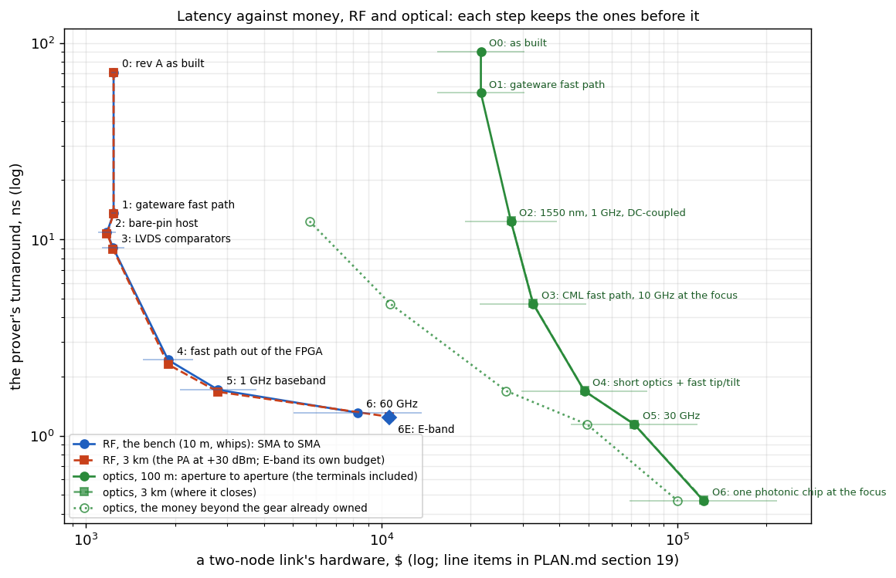
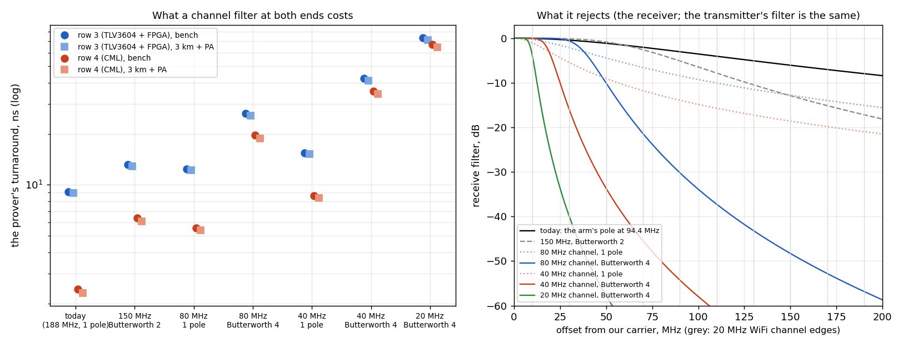

# CostasLink-PYNQ-Z2: the plan

A 5.8 GHz bidirectional link for quantum position verification that carries a bit (or two) from
one FPGA to another in the speed-of-light time plus about 23.5 ns of electronics, testing three
modulations with one receiver: BPSK with a hardware Costas loop, FSK, and QPSK. It plugs onto a
PYNQ-Z2's Raspberry Pi header like `GPSDO-PYNQ-Z2`. Two of them talk to each other. Every number
below is computed by `sim/budget.py` from the datasheets; change a part there and the numbers follow.

Status 2026-10-12 (Prompt 30): architecture and parts decided, stock checked, datasheets fetched; the
schematic generated on seven sheets (ERC clean, paths walked, every footprint pad with a net), with every
wire's frequency, level, bandwidth and DC offset in a blue box beside it; constraints for the PYNQ-Z2
**and the Icepi Zero**; the annotated block diagrams in `docs/images/block_*.svg`; the range model in
`sim/link_rates.py` for the **two decision paths** (section 15) with the two USB-C amplifier modules
Jason has (section 2c of the budget); the bring-up plan in `BRINGUP.md`; **the board placed and routed**,
DRC 0 violations, 0 unconnected, 0 parity (sections 7 and 16); the release in `mfg/release/`; the gateware
core and its Python driver (`gateware/`); the cost of the first order (section 17). Nothing ordered. Every
value is set once (`sim/budget.py`, `gen/parts.py`, `gen/pins.py`) and `tools/doc_check.py` checks the
numbers quoted here against the build. See `CLAUDE_CODE_CHAT.md`.

## 1. The idea in one paragraph

The receiver is a zero-IF quadrature demodulator (ADL5380) whose local oscillator is a 5.8 GHz
synthesizer (MAX2871) referenced to a **voltage-controlled crystal oscillator**. The Costas loop's
error signal steers that VCXO, so the whole synthesizer behaves as the loop's VCO, multiplied by
232: a ±100 ppm crystal pull is ±580 kHz at 5.8 GHz, which covers two TCXO-referenced transmitters
disagreeing by at most 29 kHz, with the FPGA stepping the synthesizer's fractional word for anything
larger. When the loop is locked, the demodulator's **I output is the data and its Q output is the
phase error**. Both go through a differential amplifier to fast comparators and straight into the
FPGA: the data path has no loop, no filter narrower than 100 MHz and no software in it, so a phase
flip at the transmitter is a comparator edge at the receiver about 15 ns later (plus the air). The
transmitter is a quadrature modulator (ADL5375) whose I and Q baseband inputs are driven by 2-bit
resistor DACs from four FPGA pins, so the FPGA sets the constellation point in a couple of
nanoseconds. The same analog receiver serves all three modulations; they differ only in what the
transmitter's FPGA writes to its four pins and how the receiver's FPGA reads its three.

### Why a carrier that is on all the time changes everything

In QPV the link is idle almost always and sends a bit at an unpredictable moment. With OOK the
receiver has nothing to lock to while idle, so it can only threshold power. Here the transmitter
sends an unmodulated carrier while idle (the constellation point "0°"), and the receiver's loop
tracks it continuously. A data event is then a brief departure from 0°:

| mode | idle | "bit" | what the receiver's FPGA sees | ambiguity |
|---|---|---|---|---|
| **BPSK** | carrier at 0° | carrier at 180° for the symbol time | the I comparator flips | the Costas loop locks at 0° or 180°; an edge is an edge either way, so a *transition* is the bit |
| **QPSK, 2 bits at once** | 0° (I = +a, Q = 0) | one of 45°, 135°, 225°, 315° (I = ±a, Q = ±a) | Q leaves zero: the Q window comparator (|Q| > a/2) fires and `sign(Q)` is bit 1, `sign(I)` at that moment is bit 0 | the 4-fold lock ambiguity is resolved once per session by a training symbol; after that the absolute phase is known |
| **FSK** | 0° | the modulator steps round the circle at ±Δf (the FPGA writes the four phases in turn) | I and Q comparators toggle in quadrature; the order of the first two edges gives the direction (bit 1), the period gives the tone (bit 0 of 4-FSK) | none; latency about half a cycle of Δf (5 ns at 100 MHz) |
| OOK (for comparison) | carrier off (I = Q = 0) | carrier on | both window comparators... power only | the loop is unlocked while idle: this mode is only for comparing against the old board |

The loop bandwidth is a few kHz, so a 100 ns excursion does not move it; it only ever sees the idle
carrier. That is why a plain phase-locked loop on Q would already work for QPV; the Costas
multiplication sign(I)·Q is kept (one analog switch) so that continuous BPSK data, the textbook
case, also locks, and so that Jason can switch between the two and watch the difference. The
hardware is a textbook Costas loop with the VCO being a crystal-referenced synthesizer.

### What this board is *not*

It does not do timing recovery in the classical sense: there is no symbol clock to recover,
because the data are events. The FPGA samples the three comparator outputs at 400-500 MHz
(or 8x that through ISERDES for timestamping) and acts on the edge; that is the "timing" and it
is the same for all three modulations. The classical alternative, a continuous whitened symbol
stream with a recovered clock, runs on the same hardware (the FPGA simply drives the ladders at
100 Mbaud): section 13 compares the two, and the board lets you measure the difference. Since
Response 6 the receiver decides twice: a **fast path** (the arms at gain 4, 100 MHz) flags the bit
in nanoseconds and a **slow path** (another ×20 and a 4.8 MHz pole, its own comparators) confirms
or vetoes the flag 37 ns later from 11 dB further away (section 15).

## 2. Block diagram

The annotated diagrams are `docs/images/block_system.svg`, `block_rx.svg`, `block_tx.svg`,
`block_loop.svg` and `block_modulations.svg` (made by `docs/blockdiagram.py` from the budget's
numbers: every arrow carries its level, frequency, bandwidth and DC offset, with a thumbnail of the
signal). The sketch below is the same thing in one screen; the antenna switch (sheet 5, section 14)
and the slow path (sheet 6, section 15: the arm outputs through a second THS4541 at gain 20, a 4.8 MHz
pole and three more comparators, with a second DAC for its threshold and offset trims) are not in it,
and the receiver now has two ADL5611 gain blocks.

```
                       RX ANTENNA                                                    TX ANTENNA
                           |                                                             |
   +-----------------------|-----------------------------------------------------------|---------------------+
   |   SMA                 v                                                             ^            SMA      |
   |  [1.5p] -> SKY65404 LNA -> PE43711 DSA -> ADL5611 -> [1.5p] -> balun -> ADL5380 ---+ ADL5611 <- ADL5375  |
   |           13 dB, NF 1 dB   0..31.75 dB    +14 dB    (coupler  5.4 GHz    IQ demod   |  +14 dB   IQ mod    |
   |                            (SPI)                     RX MON)             LO ^  I Q   |            ^ LO     |
   |                                                                            |  | |    |            |        |
   |                       25 MHz VCXO -> MAX2871 (RX LO) ------------------------+  | |    |   MAX2871 (TX LO)  |
   |                        ^ VC                 | RFOUTB -> LO RX MON (U.FL)        | |    |      ^  | RFOUTB   |
   |                        |                    |                                   | |    |      |  +-> LO TX MON
   |   loop filter  <- [mux sign(I)*Q] <--------------------------- THS4541 x4 <-----+ |    |  25 MHz TCXO (or REF IN)
   |   (OPA2388)       SN74LVC1G3157    I, Q baseband                               |    |                      |
   |      | VC MON        ^ sign(I)                             +-- THS4541 x4 <------+    |                      |
   |      v               |                                     |                         |                      |
   |   HOLD switch        |            TLV3601 x3: sign(I) ------+-----> CMP_I            |   2-bit R-DACs       |
   |   (TS5A3159)         +----------  Q > +Vth, Q < -Vth ------+-----> CMP_QP, CMP_QN   |   <- TX_I1 TX_I0     |
   |                                                                                     |   <- TX_Q1 TX_Q0     |
   |   MCP4728 4-ch DAC (Vr_I, Vr_Q, Vth, VC offset)   ADS1115 ADC (I, Q, VC, error)    |                      |
   |   I2C ---------------------------------------------- I2C                            |                      |
   |                                                                                     |                      |
   |   USB-C 5 V in --fuse--P-FET--+-- +5V_RF (ADL5380, ADL5375, 3x ADL5611)             |  TRIG A/B out, TRIG IN  |
   |   header 5 V  --fuse--P-FET--+-- 4x TPS7A2033 (PLL TX, PLL RX, ANA, DIG) + LP5907 (OSC)                    |
   +------------------------------- 2x20 socket to the PYNQ-Z2's RPi header (underside) -------------------------+
```

## 3. The numbers (sim/budget.py)

| quantity | value | where it comes from |
|---|---|---|
| TX output at the SMA | **+9.8 dBm** | ADL5375 at 5.8 GHz with 0.7 V p-p differential drive (−3.1 dB from full scale) = −4.5 dBm, ADL5611 +14.3 dB at 5.8 GHz |
| carrier feedthrough | −15 dBc | ADL5375 at 5.8 GHz is poor here (−19.5 dBm); irrelevant for a carrier that is on all the time, nulled by the Vr DAC channels for OOK tests |
| antennas | 2 dBi whips (a quarter-wave stick on each SMA) on the bench; four **24 dBi 40 × 30 cm panels** with 10 m cables (N at the panel, SMA at the board); **30 dBi 60 cm dual-polarised dishes** as the big option | Jason, Prompt 2; a 10 m cable is 5 dB of LMR-200 at 5.8 GHz (12 dB of RG-58), so the amplifier belongs at the panel |
| across the room, 10 m, 2 dBi whips | RX −54 dBm, SNR 38 dB in 100 MHz | Friis; NF 2.0 dB; 30 m: SNR 29 dB |
| across campus, 300 m, panels, 10 m cables, no amplifier | −49 dBm, SNR 43 dB | 3 km: SNR 23 dB (33 dB with the amplifiers at the panel) |
| 20 km, panels, amplifiers at the panel, no PA | −76 dBm, SNR 16 dB | the board alone reaches a mountain; dishes: 28 dB; section 13 has the error rates against PA price |
| level at the demodulator at 10 m | −15 dBm with the DSA at 0 dB, −20 dBm at its 5.25 dB setting (IP1dB +11.6) | the DSA has 31.75 dB of range for closer or stronger |
| baseband at the fast comparators | ±249 mV peak at the DSA's regulated level (−20 dBm at the demodulator, held from 3 m to about 300 m) | ADL5380 ×1.95, THS4541 ×4 (R_f 4.00 k computed, 4.02 k fitted / R_g 1 k: 94 MHz, 3.5 ns rise); gain 2 would be 170 MHz and about 0.6 ns sooner (sim/hosts.py) but 9 dB less deaf to the own transmitter 600 MHz away (section 15), so no |
| the comparator floor | a TLV3601 needs about 20 mV peak (2 × offset + hysteresis) to decide: **fast path -81 dBm** at the antenna (noise-quiet -81: balanced), **slow path -107 dBm** (noise-limited at -92) | the second ADL5611 (Response 6) is what brings the fast floor to its noise; the slow stage's ×20 takes the slow path well past it |
| electronics latency, FPGA pin to FPGA register | **23.5 ns** on the PYNQ-Z2 (TX 8.5 + RX 15.0), **14.7 ns on the Icepi Zero**; the slow path's confirmation **+37 ns** | the two passes through the PYNQ's 200 Ω header resistors are 8.8 ns of it; the Icepi has none (section 12). Response 7 found the earlier 24.1 ns counted the arm amplifier and "the arm filter" separately: they are the same part |
| the antenna switch (section 14) | HMC536: 15 ns rise, 30 ns on/off, 27 dB isolation and +27 dBm P0.1dB (both the 5-6 GHz minimum); SW TX takes +25 dBm without a limiter | own TX leaks −17 dBm into the RX jack while transmitting (0 dBm with a +27 dBm PA: then a limiter) |
| Costas loop | fn 3 kHz, ζ 0.7, R1 9.4 k (10 k fitted: fn 2.9 kHz, ζ 0.69), R2 750 Ω, C 100 nF C0G | Kd 0.12 V/rad at the DSA's regulated level: U110 passes ONE leg of the Q pair against V_MID, half the differential swing (build 17 used the whole swing and fitted 20 k: fn 2.05 kHz, ζ 0.48; the design review), Ko 2.7 Mrad/s/V (VCXO ±100 ppm over 2.7 V, ×232) |
| pull-in | 3.8 ms from 30 kHz off; 0.38 s from 300 kHz | the VCXO's guaranteed absolute pull (APR) is ±50 ppm = ±290 kHz at 5.8 GHz, against 29 kHz between two TCXO-referenced transmitters.  Beyond it the driver steps the RX synthesizer in whole 25 MHz integer-N channels (gateware/max2871_regs.py); a fractional-N re-centre (about 6 kHz steps) is not written yet (the design review) |
| MAX2871 loop filter | 80 kHz, 50°: C1 390 p, C2 6.8 n, R2 820, R3 2 k, C3 160 p (C0G) | Icp 2.56 mA (RSET 5.1 k, CP 7), Kvco 60 MHz/V, N 232; in-band floor ≈ −109 dBc/Hz |
| power | 1.37 A from 5 V (6.8 W) | ADL5380 245, ADL5375 203, 3 × ADL5611 372, 2 × MAX2871 ≤ 400, the rest 145 mA |
| hottest regulator | PLL LDOs, 0.25 W each after a 2.2 Ω series resistor: +47 °C in SOT-23-5 | the ECP5 board's trick |

### One antenna or two? (section 4 of the script)

Simultaneous transmit and receive on one antenna needs the local transmitter's leakage to stay
below the wanted signal minus 10 dB *at the demodulator*, because nothing before the demodulator is
frequency selective (the LNA, DSA and gain blocks are 0.1-6 GHz parts) and what rejects a TX-to-RX offset
of Δf is only the demodulator's 390 MHz baseband pole and the arm amplifier's 94 MHz pole (Prompt 31's
review C: an earlier model of "two poles at 100 MHz" gave 31 dB at 600 MHz where the real pair gives 21,
and the compression limit had counted one of the two gain blocks and the ADL5380's 900 MHz IP1dB, 11.6 dBm,
where its 5.8 GHz figure is 8.2):

| TX/RX spacing | arm filter rejection | isolation needed at the antenna port (10 m, +10 dBm TX) |
|---|---|---|
| 25 MHz | 0.3 dB | 73 dB |
| 100 MHz | 3.5 dB | 70 dB |
| 200 MHz | 8.4 dB | 65 dB |
| 600 MHz (5.2 GHz UNII vs 5.8 GHz ISM) | 21 dB | 52 dB |

A Wilkinson splitter gives 3 dB, a circulator about 20 dB (and only until the antenna's own
reflection, S11 ≈ −10 dB, is counted), two patches side by side 30-40 dB. **So frequency-division
duplex on one antenna does not work inside the 150 MHz ISM band, and barely works with a 600 MHz
split and separate antennas.** The board therefore has separate TX and RX SMAs. Two things make
that less painful than it sounds: (1) QPV's protocol is half duplex: the prover's reply cannot
start before the verifier's transmission has ended, so the verifier is never receiving while it
transmits, and a one-antenna system is a *time-division* switch whose turn-around adds a fixed
delay to the prover's answer and must be shorter than the round trip for the verifier. In the lab
(10 m, 67 ns round trip) that rules out the microsecond SOI switches (SKY13453: 1 µs = 15 round
trips) and the 150 ns integrated-driver ones (HMC8038, HMC849A); the board carries a **30 ns
HMC536** block with its own three SMAs (section 14), and the 10 ns HMC427A ($62-75, 5 V logic)
stays the upgrade. One-antenna T/R also needs the reply carrier to be on frequency before the
reply: the REF OUT → REF IN jumper makes the prover a coherent transponder. (2) The baseband bandwidth that gives
10-ns-class latency is 100 MHz, so each link occupies ±100-200 MHz: the ISM band holds **one**
such link per direction, not six; three links from a central station need the 5.15-5.85 GHz UNII
bands as well (the parts cover 4.9-6 GHz), or 30 MHz arm filters (12 ns slower) spaced 70 MHz
(but a one-pole filter rejects its neighbour by only ~7.5 dB, and a real channel filter at both ends
costs ~17-33 ns: section 19, "Narrower instead").
Every synthesizer frequency is software, so the frequency plan is a register write.

### PYNQ-Z2 or Brain-1?

PYNQ-Z2 for this prototype. Its header carries 28 Zynq pins at 3.3 V through 200 Ω series
resistors (TUL schematic sheet 4; measured on the GPSDO board), which cost 4.4 ns per crossing and
limit nothing else here; the GPSDO-PYNQ-Z2 board's measured header geometry, socket and standoff
scheme are reused. The Brain-1 (Opal Kelly, XC7Z012S, three standard SYZYGY ports and one
transceiver port) is the better *final* platform: a SYZYGY standard port has 28 I/O at a chosen
VIO with 8 LVDS pairs and no series resistors, and three ports are exactly the three links of a
central station. This board's 28 signals fill a SYZYGY standard port exactly as single-ended pins; with the five fast
comparators made LVDS, docs/HOSTS.md section 3 has the pin plan (a rev B, or an adapter that gets only
the Icepi's gain). It is not used now because the Brain-1 is the Syzygy board's
host and because the GPSDO pipeline for the PYNQ exists.

**Brain-1 against Icepi Zero on latency (Prompt 3).** Neither has series resistors (the SYZYGY
standard connects the FPGA pins straight to the connector; the SmartVIO resistors are on the pod,
in the DNA circuit, not in series with I/O. I have not seen the Brain-1's own schematic, which Opal
Kelly publishes on Aligni; add it to `datasheets/` and I will check). So both save the PYNQ's 8.8 ns.
Between them (corrected in Prompt 4): the 1.25 Gb/s ISERDES figure for the XC7Z012S-1 is the
regular HR-bank I/O *with an LVDS input*; a 3.3 V LVCMOS single-ended pin is limited by its buffer
to roughly half that (DS187's "maximum physical interface rate" table has the exact figure per
standard), i.e. the same class as the LFE5U-25F-6's GDDRX2 at 655.8 Mb/s. The transceivers (GTP,
3.75 Gb/s on the XC7Z012S-1, on the Brain-1's single TXR port; 6.25 was the faster grades' figure) are
serial lanes with clock recovery, AC-coupled: not a way to read a comparator's edge.  docs/HOSTS.md
(Prompt 20) puts numbers on every host: the Icepi with GDDRX2, a SYZYGY rev B with LVDS comparators,
an ECP5 on the board, and a carry-chain TDC on any of them. **On 3.3 V single-ended pins the Brain-1 and the Icepi are
equals, both about 9 ns ahead of the PYNQ-Z2**; the arm filter's 3.5 ns rise is the real floor. The Brain-1's larger win is what its
SYZYGY VIO allows: at 2.5 V its banks take true LVDS, so a rev B could use an LVDS comparator
(TI TLV3604, 0.8 ns, or ADI ADCMP604, 1.5 ns) in place of the TLV3601 (2.5 ns) and an LVDS pair per
comparator through the connector: roughly 2 ns more, and cleaner edges. On the Icepi the header
banks are 3.3 V single-ended, so the TLV3601 stays.

## 4. Parts: what, why, and what was rejected

Stock and prices are JLCPCB's parts API on 2026-10-09 00:36-00:57 PDT (cached with their times in
`tools/jlc_cache.json`), price at 10 pieces. "Basic" means no feeder fee at JLCPCB; the chips are
all Extended. Digi-Key/Mouser figures are from aggregator snapshots (Digi-Key refuses scripts); they
are the two parts to confirm in a browser before ordering.

### The ADI chips and the balun (JLCPCB's shelf; the chips with a Digi-Key fallback)

Until Prompt 31 these three were consigned: bought at Digi-Key and posted to JLCPCB.  Jason (2026-10-14): JLCPCB had
both ADI chips, and a consignment's true cost is its shipping, a week, and the spares JLCPCB asks for ("attrition on
consigned parts", two a line that are never used), so for two boards the shelf wins even a few dollars dearer; the
balun was the only part that would have forced a consignment, and the TDK HHM1907B1 replaces it from the shelf.  The
two ADI chips keep their Digi-Key numbers as a fallback that `mfg/make_release.py` applies only when JLCPCB's live
stock cannot cover the order (`mfg/release/CONSIGNMENT.md` says what, if anything, to buy).

| part | role | JLCPCB | elsewhere | why this one | rejected |
|---|---|---|---|---|---|
| **ADL5380ACPZ-R7** | IQ demodulator, 400 MHz-6 GHz | **C579152: 18 in stock, $21.62** (2026-10-14; the source) | **Digi-Key 4,512 at $17.96** (1-9; 505-ADL5380ACPZ-R7CT-ND, 2026-10-12); Newark 1746 ($7.6-12.4), ADI direct 2522, Rochester 1257, Richardson 450 ($10.9) | the only integrated IQ demodulator with 390 MHz baseband bandwidth that reaches 5.8 GHz at this price; its outputs are DC-coupled buffered emitter followers (25 Ω each), exactly what a Costas loop needs | LTC5586 ($31-40, 3 at JLCPCB, 430 mA, has a DSA and VGA we do not need); LTC5594 ($48); HMC8193 passive IQ mixer ($75-125, needs baseband amplifiers); two mixers plus a PCB hybrid (cheaper in parts, worse in balance, more layout risk) |
| **ADL5375-05ACPZ-R7** | IQ modulator, 400 MHz-6 GHz | **C579150: 4 in stock, $16.40** (2026-10-14; the source, thin: the fallback if it runs out) | **Digi-Key 5,829 at $17.26** (1-9; 505-ADL5375-05ACPZ-R7CT-ND, 2026-10-12; an aggregator had said $14.12), Mouser 726 ($14.31), Newark 1828, ADI 7169 | 750 MHz baseband bandwidth, high-impedance baseband inputs biased at 0.5 V that a resistor ladder from 3.3 V logic can drive directly; the -05 (0.5 V bias) version keeps the ladder inside 0-1 V | HMC495LP3E (3.5-7 GHz, not stocked); LTC5588-1 (not stocked, $16); a bi-phase mixer modulator (BPSK only: no QPSK, no FSK); ADL5375-15 (1.5 V bias needs a level shifter) |
| **TDK HHM1907B1** (Prompt 31) | 1:1 balun, 4.9-5.95 GHz, 0402, at the ADL5380 RF input | **C531388: 7,884 in stock, $0.10** (2026-10-14; the source) | a distributor is not needed (Digi-Key and Mouser list it; numbers to read on their pages if ever consigned) | the same ratio (50:50) and band as the Johanson 5400 the ADL5380's sheet uses, and better on paper: 0.8 dB max loss (1.0), 10 dB return loss (9.5), 180 +-10 deg (same), +-2.5 dB amplitude (2 dB); four pads, no DC-feed pin; TDK rf_balun_hhm1907b1_en | Johanson 5400BL15B0050001E (4.9-5.875 GHz; Digi-Key 6,874 at $0.69, 712-5400BL15B0050001ECT-ND, 2026-10-12; 0 at JLCPCB, so a consignment on its own); Mini-Circuits NCS1-63+ and TCW1-6000+ (50:50 to 6 GHz, 1 and 5 at JLCPCB, $2-4); TDK HHM1732B1 / HHM1562B and Pulse BLN1608LL01R5000A (50:100: a 2:1 mismatch into the ADL5380's 50 ohm pair); TCW4-582+ (not stocked); no balun (RFIN AC-grounded: the datasheet's low-band option) |

No consigned line (Prompt 31).  The LO inputs of both IQ chips need no balun: the
MAX2871's outputs are differential and drive them directly.

### Placed by JLCPCB

| part | role | LCSC, stock, $ | why | rejected |
|---|---|---|---|---|
| **MAX2871ETJ+T** ×2 | 5.8 GHz synthesizers (TX LO on the TCXO, RX LO on the VCXO) | C7458627, 3175, $8.57 | 23.5 MHz-6 GHz fundamental VCO (no doubler), 3.3 V, SPI with the ADF4351's register map (lots of existing code), differential open-collector outputs that feed the IQ chips directly, a second output for the LO monitor, deepest stock of any 6 GHz PLL at JLCPCB | ADF4355 ($37-48, 9 in stock, two supplies, the Syzygy board's part); LMX2572 ($11, 1741, 6.4 GHz, lower current; a good rev B alternative, 40-pin 6×6); LMX2592 ($31); HMC833 ($17, 113); ADF4351 (4.4 GHz maximum: cannot reach 5.8 GHz); MAX2870 (same chip, dearer) |
| **SX3V25.000B20100F30TNN** | 25 MHz VCXO: the Costas loop's VCO | C5179998, 418, $1.24 | pull ±100 ppm min over 0.3-3.0 V, modulation bandwidth 15 kHz (the loop is 3 kHz), CMOS out, 3225 | a VCTCXO (±10 ppm pull, 1-2 kHz modulation bandwidth: a slower loop and less reach); SiT3807 (none stocked); steering the synthesizer's fractional word digitally (register writes glitch the VCO, no analog loop to learn from) |
| **TC32H4-25.000-33GNDTNL** | 25 MHz TCXO ±2.5 ppm: the TX reference | C5119013, 498, $1.30 | LVCMOS output (the MAX2871 wants ≥ 0.7 V p-p: clipped-sine TCXOs are marginal), same 3225 footprint as the VCXO so either part fits either position | TC80E-25.000 (2949, $0.54: 2 mA suggests clipped sine; an alternative if its datasheet says CMOS); the same VCXO for TX (±50 ppm drift would eat the RX pull range) |
| **SKY65404-31** | RX LNA, 4.9-5.9 GHz | C210262, 1126, $0.73 | 1.0 dB NF, 13 dB gain, four external parts (0.5 pF, 0.6 nH, 100 Ω, 100 nF), 10 mA, 1.5×1.5 mm | QPL9547 (none), BGA2869 (none), SBB5089Z (3), HMC8410 ($30); absolute maximum input is only +1 dBm, so never cable TX into RX |
| **PE43711B-Z** | RX digital step attenuator, 0-31.75 dB in 0.25 dB | C470929, 1981, $3.44 | 9 kHz-6 GHz, serial interface shares the PLLs' SPI, glitch-less; it keeps the demodulator in its linear range and the Costas gain constant from 3 m to 3 km | HMC624A ($10-11, 145); PE4312 (4 GHz); fixed pads only (changing them means soldering) |
| **ADL5611ARKZ-R7** ×3 | gain blocks: two in the RX chain before the demodulator (the second, Response 6, lifts the comparator floor to the noise), one in the TX after the modulator | C208262, 3023, $5.21 | 14.3 dB at 5.8 GHz (its headline 22 dB is at 1 GHz), 50 Ω in and out, SOT-89 with a 43 nH bias choke; one part number for both | SBB5089Z (3 in stock), BGA2869 (none), a second SKY65404 as TX gain (+1 dBm abs max input); the TOKMAS ADL5611 clone ($1.26, 196: a copy of unknown provenance) |
| **THS4541IRGTT** ×4 | fully differential amplifiers: I and Q fast arms at gain 4 (100 MHz); the slow stages at gain 20 behind them (sheet 6) | C2058382, 427, $6.34 | 850 MHz GBW gives 100 MHz at the noise gain used; accepts the demodulator's 3.2-3.95 V common mode through a 1 kΩ shunt at the summing nodes; drives the comparators, the Costas switch and the monitor taps on a 3.3 V supply so no node can exceed the comparators' 3.6 V | THS4522 (dual, 95 MHz: too slow); LMH6552 (17 in stock); ADA4932 ($17.5); ADA4927-2 ($33); no amplifier (the comparators would see ±28 mV at 10 m: workable but no margin for thresholds) |
| **TLV3601DCKR** ×4 | comparators: sign(I) on the fast arm, and sign(I), Q > +Vth, Q < −Vth on the slow path | C2974371, 23776, $2.42 | 2.5 ns, 325 MHz toggle, rail-to-rail inputs, push-pull CMOS output that drives the 3.3 V FPGA pin through the header's 200 Ω with no translator; SC-70-5 | ADCMP604 (LVDS: an LVDS receiver adds 1.7 ns, and the Zynq's 3.3 V banks take no LVDS); ADCMP601 ($7.3, 3.5 ns); LMH7220 (LVDS); TLV3603 (adjustable hysteresis, 16 in stock) |
| **TLV3603DCKR** ×4 | the window comparators (sheet 7, Response 14): Q > +Vth, Q < −Vth, I > +Vth, I < −Vth, each against its own threshold | C5213955, 16 on 2026-10-10 (consign from Digi-Key if short), $4.02 | the TLV3601 with LE/HYS: high 0 mV, floating 3 mV, 150 k to VEE 30 mV, 56 k 60 mV, low latches; two DNP footprints per comparator make hysteresis an experiment | TLV3601 (fixed 3 mV) |
| **AD5696RARUZ** | the four window thresholds (sheet 7) | C650158, 7, $22.24 | 16 bits on its own 2.5 V reference: 0.038 mV a step, so the false-event servo moves the rate 10 % a step in the lab (12 bits: ×7.6); A grade, since the servo absorbs INL and drift | DAC7578 (12 bits), a third MCP4728 (no address variant stocked) |
| **SN74LVC1G3157DCKR** | the Costas multiplier: sign(I) selects +Q or −Q | C38663, 212803, $0.08 | 300 MHz analog mux, 6 Ω, 1.65-5.5 V; a hard-decision Costas loop needs nothing more | an analog multiplier (AD835, $15+); an XOR on both comparator outputs (bang-bang: more jitter, no linear error for the handbook) |
| **TS5A3159DCKR** | loop HOLD switch: NC takes the error, NO ties the integrator's input resistor to V_MID on a hold (Response 14: the switch's leakage no longer integrates) | C46388, 38285, $0.38 | 1 Ω, lets the FPGA freeze VC and measure the open-loop frequency | a jumper (no software control) |
| **OPA2388IDGKR** (was OPA2187: Response 9's review found it needs 4.5 V and its inputs stop 2 V below the rail) | the loop filter (PI) and the VC summing/scaling stage | C2059281, 2020, $2.29 | zero-drift, 1 µV offset: no static phase error from the op amp; 550 kHz is plenty for a 3 kHz loop | OPA2227 (bipolar, fine too); TL072 (drift) |
| **MCP4728T-E/UN** + **MCP4728A1T-E/UN** (C627342, 50, $2.55: the same part at the preset address 0x61) | two 4-channel 12-bit I2C DACs: Vr_I, Vr_Q (TX ladder references and carrier null), the fast Q arm's offset trim (Vth until Response 14, now on sheet 7's 16-bit DAC), VC offset; and the slow path's Vth2, I_OFF, Q_OFF (offset trims), one spare | C478093, 20908, $2.24 | rail-to-rail buffered outputs, EEPROM defaults, one I2C part | AD5621 (the Syzygy board's single DAC, SPI); 4 trimmers (no software) |
| **ADS1115IDGSR** | 4-channel 16-bit I2C ADC: I, Q (averaged), VC, loop error | C37593, 10239, $1.06 | lock detection and loop diagnostics in software at 860 SPS; the PYNQ's XADC is on its Arduino header, not the RPi one | nothing (then the FPGA cannot tell "locked" from "no signal") |
| **AD8310ARMZ** (Prompt 28) | log amp on the fast Q arm: the link band's level (LOG_Q) and, peak-held, its bursts (PEAK_Q) | C42711, 2625, $10.23 | DC-440 MHz (the arm is ±94 MHz), 95 dB, 24 mV/dB, 15 ns: a WiFi frame's envelope; inputs biased inside, so two 10 nF and two 1 k; OFLT 1 nF moves its offset loop's corner from 2 MHz to 59 kHz, BFIN 390 pF its video bandwidth to 135 kHz | AD8307 ($22 at JLCPCB, 59 in stock, 500 ns); an RF detector at the input (AD8318: no channel selection) |
| *LTC1968IMS8* (Prompt 28: drawn, then left off rev A) | a true RMS of the slow Q arm, the survey's power meter | C107779, 20, $12.23 | 15 MHz true RMS, 5-250 mV rms for noise.  **Not on rev A:** with duty and its feeder it would take the block from the $25 measured to ≈ $52 a board, over Jason's $25-35; and in the arms' corner, every placement left the router a net it could not finish (its own input, then the I-window monitor's line).  survey() measures the same band by the slow comparator's statistics; a rev B option | LTC1967 (4 MHz) |
| **ADS1115IDGSR** at 0x49 (Prompt 28) | the four detector channels: LOG_Q, PEAK_Q, V5_MON (+5V_RF / 2), TEMP | C37593 (on the order already) | ADDR to VDD; the existing I2C bus, so no FPGA pin (rev A's header has none free) | the PYNQ's XADC (on its Arduino header, a lead to the board) |
| **NCP18XH103F03RB**, **1N4148W**, OPA2388 (Prompt 28) | the board's temperature (a 10 k NTC under 10 k), the peak hold's diode and op amp | C13564 $0.05; C81598 Basic; C2059281 | the re-trims between sessions want the temperature; the diode sits inside the op amp's loop, so its drop does not count | the MAX2871's own sensor (±3 °C, needs an SPI readback the gateware lacks) |
| **LQW15AN6N8G00D** ×3 (Prompt 28; fitted since Prompt 29) | the antenna jacks' ESD / DC path: RX ANT, TX ANT, ANT | C82919, 23999, $0.07 | a 6.8 nH wirewound self-resonant at 6.0 GHz or above: 400 Ω to 1.5 kΩ across 4.9-6 GHz, ~0.05 dB as a shunt; each on its line (beside the DC block, or against the TX line) | multilayer LQG15HS (self-resonant at 3.4-4.5 GHz: capacitive in the band); a 0.2 pF RF TVS (fast ESD, no DC path) |
| **TPS7A2033PDBVR** ×4 | 3.3 V LDOs: PLL TX, PLL RX, analog, digital | C2862740, 198360, $0.22 | 300 mA, 10 µV rms, 65 dB PSRR at 100 kHz, SOT-23-5; the PLL ones sit behind 2.2 Ω to share the heat (0.25 W each) | ADM7150 ($8-21, 1 µV: the Syzygy choice, overkill at 232× multiplication where the MAX2871's own floor dominates); LP5907 for everything (250 mA: not enough for a MAX2871 at full output) |
| **LP5907MFX-3.3** | 3.3 V LDO for the two oscillators | C23380874, 3403, $0.14 | 6.5 µV rms; an oscillator's supply noise is FM, so it gets its own quiet rail | sharing the analog rail |
| **SN74LVC2G34DCKR** | buffers for TRIG A/B outputs to U.FL (latency measurement) | C14461, 22998, $0.16 | one package, 2.2 ns, 24 mA into 50 Ω through 33 Ω | — |
| **SN74LVC1G17** ×2 | Schmitt buffer for TRIG IN (a detector pulse); the REF OUT buffer on the VCXO | C10425, 83000, $0.07 | 1 kΩ series protection then a Schmitt input, 50 Ω termination jumper; REF OUT is the VCXO's 25 MHz through 33 Ω for the TX synthesizer's REF IN (coherent transponder) | straight to the FPGA pin (1 kΩ × 10 pF = 10 ns) |
| **SN74LVC1G04DCKR** ×2 | TR_B = not TR_A on the board (Response 14), freeing header pin 28; TX_EN's inverter U206 (Response 15) | C8207, 76408, $0.08 | the switch rests in receive on both hosts (A's pull-ups hold A high) | the FPGA driving B (one header pin) |
| **HMC536MS8G** | the antenna switch (T/R), section 14 | C17271830, **5**, $9.91 (Digi-Key 0 until 2027-01) | DC-6 GHz GaAs, 15 ns rise, 30 ns on/off, 27 dB isolation, +27 dBm at 0.1 dB (minimum; +29 typical), 0/3.3 V control straight from the FPGA, no supply pin, MSOP-8 with a paddle (hand-solderable: Jason's limit is 0603) | HMC427A (10 ns, 40-45 dB, $62-75 at Digi-Key, 389 in stock; +5 V complementary logic needs two translators; QFN 3×3); HMC8038 (150 ns, 60 dB, +36 dBm, $8.6, 282 at JLCPCB: the right switch for campus distances with a PA, useless in the lab); HMC849A (150 ns, $9, none at JLCPCB); ADRF5019 (150 ns, needs −2.5 V); ADRF5020 (10 ns, $41-75, needs −2.5 V, none); PE42423 (500 ns), PE42422 (2 µs), SKY13453 (1 µs), SKY13350 (45 ns, discontinued), HMC545A/UPG2179 (3 GHz) |
| **AO3401A** ×2 | P-FET ideal diodes on the two 5 V inputs (USB-C, header) | C15127 Basic, 756184, $0.10 | 60 mΩ at 4.5 V (maximum): 82 mV at 1.37 A against a Schottky's 350 mV, which the ADL53xx's 4.75 V minimum cannot spare; each input blocked from the other (CLAUDE_PCB.md §4) | Schottky OR-ing |
| **MF-MSMF200-2** ×2 | 2 A PTC fuses on both inputs | C210837, 16439, $0.07 | — | — |
| **SMAJ5.0A** | TVS on the 5 V rail | C113952, 575476, $0.04 | — | — |
| **TYPE-C-31-M-12** | USB-C 5 V input (CC pull-downs 5.1 k) | C165948, 409808, $0.19 | the HRO part built on three boards; its CPL datum is known | barrel jack (someone plugs in 12 V) |
| **BWSMA-KWE-Z001** ×9 | SMA, right angle through-hole: the five RF ports and four field ports (TRIG A, TRIG B, TRIG IN, REF IN) | C496551, 148391, $0.41 | the ECP5 board's part, +90 CPL correction known | edge-launch |
| **BWMMCX-KE** ×5 | MMCX, vertical through-hole, 500 matings: REF OUT and four baseband monitors | C5137198, 12841, $0.58 | the taps with room round them (Response 10) | BWMMCX-KEF (edge-mount: its footprint carries Edge.Cuts) |
| **U.FL-R-SMT-1(80)** ×12 | the 5.8 GHz taps and the boxed-in ones | C88374, 31378, $0.11 | SMT launch on the line; 30 matings | MMCX (no room; a through-hole pin on a 5.8 GHz line) |
| **2.54-2*20** (C2977589) | 2x20 socket, 8.5 mm, underside | C2977589, 33575, $0.32 | the GPSDO board's part; through-hole carries the mechanical load; soldered at home (hand_solder_bom.csv, Response 15) | the SMD HC-PM254 |
| PZ254V-11-02P / -03P | jumpers (loop source, LNA enable, TRIG IN 50 Ω, header 5 V) | C492401 / C2937625 | exact lengths, not strips (CLAUDE_PCB.md §8) | — |
| LQW15AN27NG80D ×8 | 27 nH chokes on the MAX2871 outputs | C882469, 19686, $0.09 | the datasheet's value | — |
| LQW18AN43NG00D (0603 43 nH) ×3 | ADL5611 bias chokes | C113126 | Table 6 of its datasheet | — |
| MLG1005S0N6CT000 | 0.6 nH at the LNA supply | C95042, 18970 | Skyworks' circuit | — |
| 0402 C0G 1.5 pF (C1552, Preferred), 0.5 pF (C285052), 100 pF (C1546 Basic), 33 pF (C1562 Basic), 68 pF (C14441) | RF blocks, matches and bypasses | all > 70 000 in stock | a 1.5 pF 0402 is series-resonant at 6.1 GHz with its 0.45 nH, so it is the best 5.8 GHz DC block (the Syzygy review's finding, re-done for 0402) | 100 pF blocks (inductive, +j20 Ω at 5.8 GHz) |
| 1206 C0G 100 nF (C170182) | Costas integrator | 175420, $0.16 | a class 1 dielectric where the value sets a time constant (CLAUDE_PCB.md §12) | X7R |
| 0603 C0G 6.8 nF, 0402 C0G 160/390 pF | synthesizer loop filters | — | — | — |
| X5R/X7R 100 nF 0402 (C1525 Basic), 1 µF 0402 (C52923 Basic), 10 µF 0805 (C15850 Basic), 22 µF 0805 (C45783 Basic) | decoupling | Basic | — | — |
| 0402/0603 thick film 1 % (UNI-ROYAL, mostly Basic) | everything else | Basic, except six Extended values (4.02 k, 453 Ω, 820 Ω, 750 Ω, 4.7 M, 2.2 Ω 1206) | — | — |
| KT-0603R (C2286 Basic) ×2 | rail LEDs | Basic | — | — |

Not on the board, deliberately: a 5.8 GHz bandpass filter at the RX input (none stocked at JLCPCB;
an SMA filter can go in the cable; a footprint would need a bridge when unfitted), a log power
detector at RF (AD8318, $13: it sees everything the LNA passes, no channel selection; Prompt 28 put a
baseband log amp on sheet 6 instead; the RMS converter is a rev B option), a limiter ahead of the LNA
(Mini-Circuits VLM-63-2W-S+ in the cable when a PA is used with the switch), and a bench 5 V
barrel jack. The TX/RX switch is on the board but as its own block with three SMAs (section 14), so
it can be cabled in or left out of the RF path.

## 5. The FPGA header

28 signal pins, LVCMOS33 on both FPGA boards; through 200 Ω on the PYNQ-Z2, straight to the balls on
the Icepi Zero. The table is `gen/pins.py`, which also carries the Icepi's ball for every pin; both
constraint files are generated from it, and the assignment may still move when the board is routed
(CLAUDE_PCB.md §5, late assignment), except pins 18 and 26. Clock-capable pins (an edge can drive
a clock net directly, for time-stamping without sampling): PYNQ-Z2 10, 11, 13, 18, 26, 31, 35, 40
(MRCC/SRCC); Icepi 16, 18, 19, 21, 22, 26, 32 (PCLK/GR_PCLK); **both: 18 and 26 only**, so the data
comparator (CMP_I) is on 18 and the detector trigger (TRIG_IN) on 26. The other inputs are sampled
(ISERDES on the Zynq, GDDRX2 at 655.8 Mb/s on the ECP5's left banks 6/7; pins 35/37 are on the
ECP5's bank 0, which has no GDDRX2: they carry MUX_RX and TRIG_A, neither a fast input).

Since Response 10 the interchangeable pins (since Response 14 seventeen: 12, 16, 19, 21-24, 28, 29,
31-33, 35-38, 40; the I window's two fast inputs joined them, kept off the Icepi's bank 0) are
bound from the placed board by `gen/pin_swap.py`: each signal's destination is the mean x of the chip
pins it reaches (through any series part), and the signals take the header's interchangeable pins in
the same right-to-left order, so no two header lines cross on the way down.  Fixed: the I2C pair
(the PYNQ's pull-ups on 3/5), TR_A (27, its pull-up; TR_B is made on the board), 18 and 26 (clock-capable on both), the
fast comparators and the TX ladders (7, 8, 10, 11, 13, 15, chosen for their banks and sitting
beside their parts), and the rails.  TR_B left the header in Response 14 (an inverter on the board makes it
from TR_A), and the spare went to the I window: every signal pin is used.  The table below is printed from `gen/pins.py`.

| pin | Zynq (PYNQ-Z2) | ECP5 (Icepi Zero) | signal | pin | Zynq (PYNQ-Z2) | ECP5 (Icepi Zero) | signal |
|---|---|---|---|---|---|---|---|
| 1 | — | — | 3V3_HOST | 2 | — | — | +5V_HDR |
| 3 | W18 | T2 | I2C_SDA | 4 | — | — | +5V_HDR |
| 5 | W19 | R2 | I2C_SCL | 6 | — | — | GND |
| 7 | Y18 | R1 (VREF1_6) | TX_I1 | 8 | V6 | P1 | CMP_QN |
| 9 | — | — | GND | 10 | Y6 (MRCC) | N1 | CMP_QP |
| 11 | U7 (SRCC) | R3 | TX_I0 | 12 | C20 | N4 | LOOP_SEL |
| 13 | V7 (SRCC) | P3 | TX_Q1 | 14 | — | — | GND |
| 15 | U8 | P2 | TX_Q0 | 16 | W6 | M2 (PCLKC6_0) | CMP_IN |
| 17 | — | — | 3V3_HOST | 18 | Y7 (MRCC) | L1 (PCLKT6_1) | CMP_I **(clock on both)** |
| 19 | V8 | L2 (PCLKC6_1) | LOOP_HOLD | 20 | — | — | GND |
| 21 | V10 | J1 (PCLKT7_1) | LE_PLL_TX | 22 | F20 | J2 (PCLKC7_1) | CMP_IP |
| 23 | W10 | G2 | MUX_TX | 24 | F19 | H2 | TX_EN (high transmits; Response 15) |
| 25 | — | — | GND | 26 | U19 (MRCC) | G1 (GR_PCLK7_1) | TRIG_IN **(clock on both)** |
| 27 | Y16 | G3 (VREF1_7) | TR_A | 28 | Y17 | K3 | CMP_QN_S |
| 29 | Y19 | E1 | SPI_SDATA | 30 | — | — | GND |
| 31 | U18 (MRCC) | F3 | SPI_SCLK | 32 | B20 | J3 (GR_PCLK7_0) | CMP_QP_S |
| 33 | W8 | E3 | LE_PLL_RX | 34 | — | — | GND |
| 35 | Y8 (SRCC) | E4 | MUX_RX | 36 | B19 | H3 | LE_DSA |
| 37 | W9 | D4 | TRIG_A | 38 | A20 | F1 | TRIG_B |
| 39 | — | — | GND | 40 | Y9 (SRCC) | F2 | CMP_I_S |

28 signals used, no spare (since Response 14); J303 (1x3, on the antenna sheet) carries TR_A, TR_B (made on the
board from TR_A) and ground, for an external switch module. `ECP5` = ball (dual function). Both boards are
Pi-standard on 1/17 (3.3 V) and 2/4 (5 V = USB VBUS); this board draws 1.37 A, so on the Icepi it takes 5 V
from its own USB-C.

## 6. Power

| rail | from | load | notes |
|---|---|---|---|
| +5V_IN | USB-C (CC 5.1 k) or header pins 2/4, each: PTC 2 A → AO3401A ideal diode | 1.37 A | both inputs blocked from each other; TVS; USB-C is the default, header 5 V only with the PYNQ on its barrel supply (its USB input cannot give 1.2 A) |
| +5V_RF | +5V_IN through a ferrite | ADL5380, ADL5375, 3 × ADL5611 | the PTC, FET and bead at their MAXIMUM resistances drop 0.21 V (sim/budget.py section 9), so 5.10 V at the plug leaves ≥ 4.89 V (the ADL53xx and ADL5611 want 4.75 V): a bench supply at 5.1-5.25 V; a USB port must hold 5.01 V, which a laptop port or a thin cable may not (the design review) |
| +3V3_PLL_TX, +3V3_PLL_RX | 2.2 Ω + TPS7A2033 each | 200 mA each | 0.25 W per LDO, +47 °C |
| +3V3_ANA | TPS7A2033 | four FDAs, two op amps, LNA, DSA, TX ladder reference | 62 mA |
| +3V3_DIG | TPS7A2033 | eight comparators, switch, mux, three DACs, two ADCs, buffers | 60 mA |
| +3V3_OSC | LP5907 | VCXO, TCXO | 15 mA |

## 7. The board

4 layers, JLC04161H-7628 (L1 RF and signals, L2 unbroken ground, L3 the supply pours and leftover
routing, L4 signals under a ground fill), 1.6 mm, ENIG, green. **120 × 100 mm** (Response 9: 10 mm taller than Response 8's 120 × 90, the extra room between the demodulator's arms and the socket; `gen/placement.py`
is the floorplan, `gen/board.py` makes the board inside KiCad's own Python, `gen/routes.py` lays the
RF lines by plan and tells the router the rest): the 2x20 socket on the underside along the bottom
edge, pin 1 at the right-hand end, our left edge at the PYNQ-Z2's x = 72 (clear of its HDMI jack) and
our bottom edge 11 mm above its top edge, as the GPSDO board sits (its measured geometry, copied into
`placement.py`); three M3 standoffs to the desk in the corners that are not over the PYNQ and a 3.2 ×
5.2 mm slot (H304) onto the PYNQ's own top-right mounting hole, because the two boards register
through the header. The Icepi Zero (65 × 30 mm, a male header soldered on) plugs up into the same
socket from below. Along the top edge, barrels out: RX ANT (x 24), TX ANT (56), then the switch
block's SW TX (76), ANT (92), SW RX (108). The receive chain runs straight down from RX ANT at x = 24
(LNA, DSA, two gain blocks, the coupler with RX MON beside it, the balun, the ADL5380 with its RF
pins up, I pair left into the I arm, Q pair right into the Q arm, LO up from the RX synthesizer below
it, the VCXO under that); the slow I stage and the three slow comparators sit at the bottom-left over
header pins 28/32/40, the fast comparators at the bottom-middle over pins 8/10/18. The transmit chain
runs straight up to TX ANT at x = 56 (the TX synthesizer with its TCXO and REF IN to its right, the
ADL5375 with RFOUT up and a ladder either side, the gain block, the pi pad, the coupler with TX MON
beside it). The Costas loop (mux, sign jumpers, HOLD, PI filter, SEL) sits under the TX synthesizer,
the two DACs and the ADC to its right, VC running left to the VCXO. The switch block is the top-right
corner; the five regulators a column under it; the USB-C on the right edge with the input fuse, FET,
TVS and bulk beside it; the header's 5 V path by the socket's right end; test pads, J303 and the
trigger jacks (left margin) where the PYNQ is not. 50 Ω grounded coplanar lines on L1 over L2
(`sim/rf_lines.py`: 0.29 mm wide, 0.25 mm gap, the top ground fill at that clearance; JLCPCB quotes 0.345 mm for plain microstrip on this stack) with a fence
of ground vias at 1.2 mm either side, laid by plan pad to pad; a −20 dB coupled-line coupler on the
TX output and one after the RX gain blocks for the TX MON and RX MON taps. Jacks besides the five RF
SMAs (Response 10 and 14): SMA for the field ports TRIG A, TRIG B, TRIG IN and REF IN on the board's
edges; MMCX, vertical, for REF OUT, VC MON, ERR MON (the switch output), I SLOW MON and TRIG IN MON (the
trigger buffer's output, ÷10); U.FL for the 5.8 GHz and the boxed-in taps: TX MON, RX MON, LO TX MON,
LO RX MON, I MON, Q MON, Q SLOW MON, CMP I MON (÷10) and the four window monitors IP, IN, QP, QN MON (÷10). Every passive is placed by rule from the netlist (a shunt perpendicular at
its pin, a series part on the line between its two pads, decoupling at the chip the schematic drew
it beside) and pushed apart until no courtyards overlap; the plan's model of pcbnew's rotations and
flip is checked against pcbnew's own pads before copper is laid (the socket against the PYNQ's
header, the RF pads against their lines). Section 16 has the state of the routing.

## 8. Gateware (PYNQ-Z2 and Icepi Zero, `gateware/`)

Generated from `gen/pins.py`: the XDC (PYNQ-Z2, Vivado) and the LPF (Icepi Zero, nextpnr-ecp5),
with the same port names, so one Verilog top serves both; only the clocking primitives (MMCM and
ISERDES on the Zynq; EHXPLL and GDDRX2 on the ECP5) and the control path differ (AXI-Lite and a
Jupyter notebook on the PYNQ's PS; a UART command set on the Icepi, which has no processor). A
Verilog top with an SPI master (MAX2871 ×2 and PE43711
registers computed by `gateware/max2871_regs.py` for 25 MHz reference, integer-N at 5.800/5.850
GHz), an I2C master for the DAC and ADC, the TX symbol encoder (idle / BPSK flip / QPSK point /
FSK rotation at a programmable Δf), the RX event decoder sampling the three comparators at 400 MHz
(edge → bit, QPSK window → two bits, FSK rotation direction), and a latency counter between
TRIG_IN and the decoded event; the **confirm-or-veto logic**: the fast comparators' edge is acted on
at once (the measurement fires, the trigger goes out) and the slow comparators' state 37-73 ns later
either confirms the trial or marks it discarded, with counters for both; the slow path alone as the
data path when the signal is below the fast floor; the **offset nulling** of the slow stages (set
I_OFF/Q_OFF until each slow comparator toggles 50/50 with no carrier); the T/R sequencer (TR_A/TR_B
and LOOP_HOLD together); an optional
LFSR scrambler/descrambler with a Gardner timing loop for the whitened-stream experiment (section
13). A station-identification keyer sends the callsign in Morse by switching the carrier (OOK
through the ladders) every 10 minutes when the amateur-band mode is enabled (§97.119: CW is always an
acceptable identification). The first firmware exists (Response 9, `gateware/costaslink_top.v`
and `gateware/README.md`: SPI, I2C, the ladder bits and a BPSK pattern, the comparators counted,
the triggers, the latency counter, the keyer, a UART register interface), as CLAUDE_PCB.md §9 asks
before the board is ordered.

**What exists since Response 15** (`gateware/README.md`): one board-independent core,
`costaslink_core.v`, with the transmitter's modes (TXSYM, events, events on TRIG_IN, PRBS symbols,
rotation, one point held; messages fixed, counted or from five PRBS polynomials), the receiver's event
decoder for every scheme of section 18 (an idle vector and an event mask; the settled vector or the
first-fired set through a 32-entry table; confirm or veto by the slow comparators; references from this
board's TX event or TRIG_IN; false and missed events; latencies to the sample; an 8 x 8 confusion
matrix; a 1024-bin histogram; a self-synchronising PRBS check on CMP_I), the eight-step T/R sequencer
(TR_A, LOOP_HOLD, TX_DIS, the TX gate), a counting gate (edges and high samples of all nine comparators:
the false-event servo and the offset nulling, run from Python), and a block-RAM logic analyser of every
fast sample with the pins and the decoder's marks.  The PYNQ-Z2 runs it at 800 Ms/s (ISERDESE2, 100 MHz
fabric, AXI-Lite in a Vivado 2024.1 block design for PYNQ 3.1); the Icepi Zero at 200 Ms/s (IDDRX1F,
100 MHz, a 1 Mbaud UART).  The Python driver (`gateware/driver/costaslink.py`) is the notebook's side;
the Gardner loop and the whitened stream are what is left.  Speed: the Zynq's ISERDES
samples a 3.3 V pin at up to 1.25 Gb/s; the ECP5 (grade -6) at 655.8 Mb/s with GDDRX2, i.e. 1.5 ns
of time resolution against 0.8 ns, both finer than the 3.5 ns arm-filter rise. The Icepi is not
slower where it matters, and it is 8.8 ns faster for having no header resistors.

## 9. Bring-up and the measurements it is for

`BRINGUP.md` (Response 8): six stages with what to have on the bench, what plugs where, what to
measure, the pass condition of each, and the dead-on-arrival list of section 10 mapped to the stage
that retires each risk. In one breath: (0) the gates before ordering (the pin audit, the gateware
building, the consignment); (1) first power, rails, current, heat, I2C; (2) the synthesizers on the
LO monitors and the transmitter on TX MON; (3) loopback through a 30 dB pad: the arms' offsets
nulled, the loop locked (the sign jumpers if it runs away), the latency on CMP I MON against TRIG A,
every modulation, the confirm-or-veto counters; (4) two boards across the lab on whips, the latency
line against distance, the error rates, time division with the switch; (5) across campus on the
panels, first bare, then the LNA module at the panel, then the 2 W PA module through a 20 dB pad,
in the amateur band with the Morse identification; (6) the dishes between two hills.

## 10. What would make it come back dead, and what guards against it (Response 7)

Ranked by how likely times how bad. "Dead" here means the experiment cannot start, not a wrong
number in a table.

1. **The Costas loop does not lock, or locks and runs away.** The sign of sign(I)·Q depends on which
   way the demodulator's Q swings for a positive phase error and on the two inverting op-amp stages;
   a wrong sign is positive feedback. The loop gain K_d scales with the baseband level, so f_n and
   ζ move with the DSA setting and with the signal below the regulated level. Guards: JP101/JP102
   swap Q's polarity; LOOP_SEL = FPGA makes a plain PLL on Q to find lock with the ambiguity out of
   the way; VC_OFF sweeps the VCXO; VC MON, ERR MON, I MON, Q MON and the ADC watch it; the loop
   can be opened (HOLD) and the VCXO measured on REF OUT. Lock at 0° or 180° is by design.
2. **DC offsets at the demodulator's outputs eat the fast comparators' margin.** The ADL5380's own
   I/Q output offset (a few mV, LO self-mixing, layout) ×4 is of the order of the 20 mV the TLV3601
   needs, so a weak signal's sign decision and the Q window are biased, and the loop acquires a
   static phase error. Guards: **DAC2's channel D now trims the fast I arm** (I_OFF_F through 100 k
   into its summing node, I_SUM on sheets 3 and 6: Response 8); V_T is adjustable; the DSA keeps the
   bench level high (±250 mV); the ADC reads the averaged I and Q, so the offset is known. The fast Q
   arm has no trim: its offset shifts the loop's static phase by a few milliradians and biases the Q
   window, which the slow path's own window confirms or vetoes.
3. **The 3.2-3.8 V common-mode level shift into a 3.3 V FDA.** The ADL5380's two tables disagree
   on its output common mode (Table 4: 3.2 V; Table 1: VS − 1.2 V, 3.8 V at 5.0 V).  The 1 k shunts
   put the THS4541's summing nodes at 1.61 V (3.2 V) to 1.87 V (3.8 V), and at 1.94 V from the
   highest +5V_RF the input path delivers (5.15 V), against the THS4541's guaranteed 2.0 V
   (VS+ − 1.3 V; 1.2 V is its typical): 61 mV of margin at the worst corner (sim/budget.py section
   7; the design review), and 1.9 mA pulled from each demodulator pin. Guard: the DNP 1.5 k on ADJ drops the common mode to
   2.5 V (and the 5.8 GHz gain a little); the FDA's PD pin and supply are per-arm, so one arm can
   be tried alone.
4. **5.8 GHz layout.** Two ADL5611s in a row are 28 dB of gain at 5.8 GHz; with sloppy grounding or
   bias-choke placement they oscillate. The balun footprint, the LO differential pairs from the
   MAX2871's open-collector outputs (27 nH chokes; each pair straight and mirror-symmetric, its
   legs equal to 0.00 mm, gated in gen/board.lo_skew: build 17's pairs were crossed and one leg went
   40 mm round, the design review), the SKY65404's 0.5 pF/0.6 nH
   match and the coupled-line coupler (copper drawn from sim/rf_lines.py, never built) are all
   single-chance structures. Guards: the DSA between the LNA and the gain blocks; the pi pad on
   TX; TX MON, RX MON, LO TX MON, LO RX MON for the spectrum analyser; JLCPCB's stack-up with its
   published dielectric; DRC at 5.8 GHz line widths.
5. **The LO is wrong.** Register words (checked against the datasheet's example, but the word order
   and the lock-detect polarity are software), a loop filter computed with a 60 MHz/V Kvco that the
   part only promises as 40-80, 0 dBm differential into the IQ chips that could be 3 dB low.
   Guards: MUX = lock detect on both PLLs; LO MON taps; every register is a write.
6. **Own transmitter into own receiver.** With two antennas 600 MHz apart the demodulator's and the
   arm's poles reject the leak by 21 dB and the budget asks 52 dB of antenna-to-antenna isolation
   (section 3; 48-58 across the scenarios): two panels side by side give about 30-40, so FDD on one
   mast is 10-20 dB short; closer, or with a PA, the demodulator compresses (its 5.8 GHz IP1dB is
   8.2 dBm) and the fast comparators chatter.  Two whips on the board's own SMAs (32 mm apart,
   about 14 dB) put the own transmitter at the LNA's P1dB, 5 dB from its absolute maximum.  Guards:
   the DSA; the switch block (time division) instead; cross-polarised panels or 3-5 m between masts;
   a 10-20 dB pad in the TX lead on the bench; the slow path vetoes the chatter but cannot restore a
   compressed demodulator (Prompt 31's review C).
6b. **The oscillators' phase noise at the bench (Prompt 31's review C).** Two x232 synthesizers
   (the MAX2871's 6 GHz VCO outside its 80 kHz loop: about 0.8° rms each), the TCXO (0.13°) and the
   VCXO, whose datasheet gives no phase-noise figure at all (0.4-1.3° guessed), add to 1.3-1.8° rms
   outside the Costas loop's 3 kHz: two to two-and-a-half times the thermal phase noise of the Q arm
   at the bench (0.7°).  No effect on lock or on range; at the bench the CFAR windows settle near
   0.2 a rather than docs/TRAJECTORIES.md's 0.1 a (about a nanosecond of event time), and the slow Q
   window at 0.1 a chatters with nothing sent.  Guards: the threshold servo finds the window; ERR MON
   and the ADC measure the phase noise (a result); the VCXO is a 3225 footprint, swappable for a
   specified one.
6c. **The slow I stage idles 1.7x overdriven** (20 x 249 mV against a 2.9 V swing), and the THS4541's
   20 ns overdrive recovery is not in sim/trajectories.py: the 37 ns confirmation is 55 ns or more.
   Guard: RX_TIMING's confirm delay is a register; start at 80 ns and shorten it from the measurement.
7. **Heat.** 1.37 A from 5 V is 6.8 W on a 120 × 100 mm board: ADL5380 1.2 W, ADL5375 1 W, three
   ADL5611 1.9 W, two MAX2871 1.3 W, the LDOs. Exposed pads need their vias; JLCPCB's 1 oz copper.
   Guards: the PLL LDOs' series 2.2 Ω; the DSOP pin and the DSA to idle parts; a measurement in
   bring-up before any enclosure.
8. **The slow path's offsets are not nulled, or its saturation confuses the Q window.** Two
   THS4541s in cascade ×20 sit up to 50 mV off; at the bench level the slow stage is at its rails.
   Guards: DAC2's I_OFF/Q_OFF (±0.33 V of reach) and the nulling procedure; V_T2 set above ×20 the
   loop's static error; the slow path is an experiment, the fast one works without it.
9. **The single-ended ladder drive distorts the constellation.** IBBN/QBBN are held at 0.51 V while
   IBBP/QBBP swing ±0.33 V, so the modulator sees a common-mode wobble of ±0.17 V with the data;
   the ADL5375's gain and phase move slightly with common mode, and the carrier feedthrough
   (−15 dBc) adds a fixed vector. Guards: VR_I/VR_Q null the feedthrough and centre the ladders;
   the loop and the comparators care about sign, not shape.
10. **Parts and the order.** The HMC536 has five at JLCPCB and none at Digi-Key until 2027; the
    ADL5375-05's shelf is thin (4 on 2026-10-14; if it is short on the day that line is consigned from Digi-Key
    and must arrive at JLCPCB with the right label); MCP4728 and MCP4728A1 are
    the same package at different addresses; a JLCPCB rotation on the SOT-89, QFN and SC-70 parts.
    Guards: PLACEMENT_CHECKS.txt and the preview; run the release the day of the order (it reads the
    live stock and decides the fallback); a second source for the switch is the HMC427A at $62.
10b. **This board powered while the PYNQ-Z2 is off** (Prompt 32): each high output pushes 12 mA through
    the Zynq's clamp diode on its pin (3.3 V less 0.6 V over 33 + 200 ohm), above its 10 mA absolute maximum.
    Guard: BRINGUP.md stage 1.5's order, PYNQ first and this board last, this board off first.
10c. **RF grounds through thermal spokes** (Prompt 32): the pours now join every pad solidly on the top and
    the inner layers; only the hand-soldered socket keeps reliefs.
11. **The Icepi Zero.** No I2C pull-ups on its header (now DNP 4.7 k on this board), 5 V from its own
    USB-C, and MUX_RX and TRIG_A (no fast input) on its bank 0.
12. **The generated symbols.** Audited pin by pin against the datasheet texts (Response 8,
    `build/scratch/pin_audit.md`): every drawn pin's number and name was right and every schematic
    use matched its function, but two symbols were *incomplete* and left footprint pads with no net
    (nine grounds on the PE43711, the HMC536's paddle), and the SMA footprint's centre pad was not
    the symbol's pin 1. All fixed; `tools/net_check.py` now fails the build on any footprint pad
    without a net, which is the check that would have caught all three. Still worth a second pair
    of eyes before ordering: the pin *figures* (the balun's terminal positions, the SKY65404's QFN-6)
    are pictures the audit could not read.
13. **The TCXO's pin 1.** TC32H4's datasheet text has no pin table (it is a drawing); the symbol
    leaves pin 1 open. On most 3225 TCXOs pin 1 is "NC or VC": if it is a control input, open means
    nominal frequency on some makers' parts and undefined on others. Guard: a rework wire to the
    V_MID divider (1.65 V) if the TX synthesizer's reference sits off frequency; stage 2 of the
    bring-up sees it on LO TX MON.
14. **Control senses written backwards.** The audit found the HMC536's truth table (A low, B high =
    RF1 = SW TX; the pull-ups rest it in RF2 = SW RX, receive) and the 74LVC1G3157's select (S low =
    B1, S high = B2) stated the wrong way round in two sheet notes and in the sign jumpers' default.
    The notes and the default (JP101 right, JP102 left: ERR = sign(I)·Q) are corrected; the gateware's
    T/R table and the jumper silkscreen come from the corrected text.

## 11. Open questions for Jason (also in QUESTIONS.md)

Answered in Prompt 2: Digi-Key has the ADL5380 (4,527 at $17.96); 5 PCBs with 2 assembled; UNII
and ISM both allowed on campus; the antennas (section 3). Still open:

1. ~~The THS4541 gain~~ Withdrawn (Prompt 3): ±88 mV at 10 m with whips is 8.8 × the comparators'
   offset + hysteresis and fine; doubling the gain would halve the arm bandwidth. Nothing to choose,
   nothing changes on the board.
1b. The fast arms' gain is 4 (100 MHz, floor −81 dBm, 31 dB of rejection of the own transmitter
   600 MHz away). R_f 2 k makes them gain 2 (170 MHz, about 0.6 ns sooner, floor −75 dBm, 23 dB of
   rejection): two 0402 resistors, not recommended (section 15).
2. The HMC536 switch: JLCPCB has 5 (the only source until 2027-01). Fit it on both assembled
   boards ($20), or leave the block unfitted and keep the 5 for later?
3. ~~The USB-C amplifier and LNA~~ Answered (Prompt 8, the AliExpress pages in `datasheets/`): the PA
   is an SBB5089 + SE5004 module, 5-6 GHz, 40 dB, P1dB +33 dBm at 5.5 GHz, 2 A at 5 V; the LNA is a
   "SAW filter + LNA" module whose 5.8 GHz version has no published numbers at all (its table stops
   at 2.4 GHz: 17 dB, NF 1.6). `sim/budget.py` section 2c carries the PA's numbers and assumed ones
   for the LNA (15 dB, NF 2 dB, passband 5725-5875, 30 dB of rejection 600 MHz away) until stage 5 of
   `BRINGUP.md` measures them. The PA wants a **20 dB SMA attenuator** on its input to run at +30 dBm;
   the board's +9.8 dBm alone would drive it 17 dB into compression.
4. The campus channel: a spectrum scan with the B210 at both ends before choosing between ISM
   (5.725-5.875) and UNII-2C (5.47-5.725; DFS, and usually empty indoors).
5. ~~The licence~~ Settled (Prompt 5): W3JQ, granted 2020-05-05, expires 2030-05-05 (FCC ULS). The
   5 cm band is open to the PAs; the gateware keys the callsign (section 8). With a valid
   licence (any class: Technician has full privileges above 50 MHz) the 5 cm band 5.65-5.925 GHz
   allows the PAs, the panels and any emission; the station must identify every 10 minutes, which
   the gateware does by keying the callsign in Morse on the carrier (section 8).
6. ~~Two bits on one edge on rev A~~ Done in Response 14 (Jason: "If it would unlock interesting tests, I
   don't mind a few 2-10% price increases"): sheet 7, the window comparators.  The original question:
   two bits on one edge on rev A (Response 10, section 18)? Adding an I window pair (two TLV3601
   wired like the Q pair, sharing V_T) lets this board run B2: the pilot at 45° with the four
   corners, both bits on the event's edge at 19.3 dB, instead of the plan's corners at 21.9 dB
   with the I bit 1.5 ns late. It costs two comparators, two header pins, a re-route of the
   comparator row and a DAC trim on the fast Q arm (section 18: a weak pilot needs the Q arm's DC
   offset trimmed). One pin is SPARE3; the other must come from another job, for instance one
   synthesizer's MUX line (its register readback goes, and its lock detect is then read at its
   test pad, TP101 or TP201).
   Without it rev A does one bit on one edge (A4) or two bits the plan's way (A3).

## 12. The Icepi Zero

Yes, the board works on the Icepi Zero with the changes made in Response 2 (nothing else moves):

* **Pins.** The Icepi's header-to-ball map (`cheyao/icepi-zero` `gateware/icepi-zero.lpf`, whose
  `gpio[BCM]` comments are header pin numbers) joined to Lattice's ECP5U-25 pinout gives the
  clock-capable header pins 16, 18, 19, 21, 22, 26, 32 (PCLKT/C6_x, PCLKT/C7_1, GR_PCLK7_x); the
  PYNQ-Z2's are 10, 11, 13, 18, 26, 31, 35, 40 (MRCC/SRCC). Only 18 and 26 are clock-capable on
  both, so CMP_I (the data) stays on 18 and TRIG_IN moved from 16 to 26 (LE_PLL_RX took 16). Every
  signal is LVCMOS33 on banks 6/7 except pins 35/37 (bank 0, top), which have no GDDRX2 and carry MUX_RX and TRIG_A, neither a fast input; they are
  spare. `gateware/icepi_zero.lpf` is generated beside the XDC.
* **Speed.** The ECP5-25 in grade -6 samples a 3.3 V input at 655.8 Mb/s (GDDRX2, left/right banks
  only: ours), toggles LVCMOS33 outputs at 150 MHz and inputs at 200 MHz; the ladder pins move once
  per event and the comparator lines carry edges, so this is plenty. Fabric at 100-150 MHz runs the
  decoders. It is not the Zynq's 1.25 Gb/s ISERDES, but the arm filter's 3.5 ns rise is what sets
  the timing resolution, not the sampler.
* **Series resistors.** None on the Icepi: 8.8 ns less latency (14.7 ns against 23.5), and the
  ladders' levels shift by 9 % (2.2 k against 2.4 k): 0.167/0.521/0.874 V instead of
  0.17/0.50/0.83, which Vr (a DAC channel) re-centres. The three comparator outputs now leave
  through 33 Ω (source termination for the unterminated line to the FPGA, 0.7 ns), which the
  PYNQ's 200 Ω does not mind.
* **Power and fit.** Pi-standard header on both; the Icepi's header 5 V is USB VBUS, so this board
  runs from its own USB-C (JP301 open). The Icepi has no header fitted: Jason solders a male
  vertical header and the Icepi plugs onto this board's socket from above (section 7).
* **Software.** No PS: the Icepi needs a Yosys/nextpnr build and a UART command path instead of
  the PYNQ's Jupyter notebook. The register words (MAX2871, PE43711, DAC) are the same; the
  Verilog top is shared.

## 13. Protocols and range: idle carrier, whitened stream, and how far each scheme goes

`sim/link_rates.py` (its output is `build/link_rates.json`; `docs/images/block_modulations.svg`
draws it). The model: the comparator sees I (or Q) plus Gaussian noise in the 100 MHz arm; each
scheme's decision-error probability is a function of that SNR: BPSK Q(√snr); QPSK Q(√(snr/2)) per
bit; FSK, decided from the rotation direction, ½e^(−snr/4); OOK on an envelope detector with 500 MHz
of noise bandwidth ½e^(−snr/8) at 7 dB less SNR; the whitened stream, a true 10 ns matched filter,
3·Q(√(2·snr)) for a self-synchronising descrambler.  (Until Response 10 these were the textbook
Eb/N0 forms with Eb/N0 = snr, which is 3 dB optimistic: a zero-IF arm's I noise is the RF noise of
both sidebands, so the decision's amplitude-to-sigma ratio is √snr, not √(2·snr).  An RF-level
simulation of a carrier, white noise, an ideal mixer and a brick-wall 100 MHz confirmed it to
0.5 %; every coherent range below shrank by √2.) Range is Friis with a margin (10 dB indoors, 6 dB outdoors).

**Three thresholds.** Jason tolerates 1 % (even 5 %) wrong *messages*; but a receiver that listens
always also makes decisions always, and every false one is a bit nobody sent. To keep false events
to 1 in 100 trials at a 1 MHz trial rate (1e4 per second at 1e8 decisions per second) the link must
be **quiet: ≤ 1e-4 per decision**, which costs BPSK 11.4 dB instead of the 7.3 dB that 1 % would.
(Response 10: 1e-4 per decision is still about 9000 false events a second on an idle link.  Section 18
sets the standard by false events an hour instead, which costs another 6 dB, and chooses the
constellation from it.)
The gateware's dwell requirement (a flip must persist N samples) buys quiet with latency.

**Words (Prompt 3).** *Panel* = your 24 dBi 40 × 30 cm flat-panel antenna (an array of patches
behind a radome; N connector; 8-10° beam). *Dish* = the 30 dBi 60 cm one. *Whip* = a quarter-wave
stick screwed straight onto the board's SMA, about 2 dBi, the bench antenna. *Amplifiers at the
panel* = the external PA and LNA mounted at the antenna's N connector, so the 10 m cable carries the
PA's output and the LNA's output and its 5 dB costs nothing; *amplifiers at the board* = the same
boxes at the SMA end, so the cable's 5 dB comes off the transmitted power and adds to the noise
figure. The scenario column of the tables says which.

| scheme | SNR for 5 % | for 1 % | quiet | lab, whips, no amp, quiet: fast / slow | campus, panels, amps at the panel, no PA: fast / slow |
|---|---|---|---|---|---|
| BPSK | 4.3 dB | 7.3 dB | 11.4 dB | 69 m / 251 m | 17.2 km / 62.9 km |
| QPSK | 7.3 dB | 10.3 dB | 14.4 dB | 49 m / 178 m | 12.2 km / 44.4 km |
| FSK | 9.6 dB | 11.9 dB | 15.3 dB | 44 m / 160 m | 11.0 km / 40.0 km |
| OOK | 19.6 dB | 21.9 dB | 25.3 dB | 14 m / 51 m | 3.5 km / 12.7 km |
| whitened | 3.5 dB | 5.7 dB | 9.0 dB | 72 m / 332 m | 18.1 km / 82.9 km |

Every number above is the shorter of two limits (Response 6; the amplifier tiers are the 2 W module
Jason has, run 3 dB below its P1dB through a 20 dB pad and at its P1dB, and a 10 W amplifier he does
not have, since Response 8): the **noise** in the path's bandwidth
(the SNR the scheme needs) and the **comparator floor**, the ~20 mV peak a TLV3601 needs to decide
at all, which with the DSA at 0 dB is a fixed level at the antenna: -81 dBm for the fast path and
-107 dBm for the slow one (`sim/budget.py` section 3). Earlier responses' tables had ignored the
floor and were optimistic for the fast path.

Side by side, every scheme, every scenario, every amplifier, both paths (from `build/link_rates.md`,
which `sim/link_rates.py` writes; the 5 % block is there too):

**Range, quiet (1e-4)** (metres unless km; free space plus margin; the shorter of the noise limit and the comparator floor; '-' below 1 m)

| scenario | amplifier | path | BPSK | QPSK | FSK | OOK | whitened |
|---|---|---|---|---|---|---|---|
| lab: 2 dBi whips on the SMAs, no cables | board alone ($0) | fast | 69 m | 49 m | 44 m | 14 m | 72 m |
| lab: 2 dBi whips on the SMAs, no cables | board alone ($0) | slow | 251 m | 178 m | 160 m | 51 m | 332 m |
| lab: 2 dBi whips on the SMAs, no cables | 2 W module at +30 dBm (20 dB pad) ($29, owned) | fast | 689 m | 487 m | 439 m | 139 m | 720 m |
| lab: 2 dBi whips on the SMAs, no cables | 2 W module at +30 dBm (20 dB pad) ($29, owned) | slow | 2.5 km | 1.8 km | 1.6 km | 507 m | 3.3 km |
| lab: 2 dBi whips on the SMAs, no cables | 2 W module at its P1dB (+33) (compressed) | fast | 991 m | 701 m | 631 m | 200 m | 1.0 km |
| lab: 2 dBi whips on the SMAs, no cables | 2 W module at its P1dB (+33) (compressed) | slow | 3.6 km | 2.6 km | 2.3 km | 729 m | 4.8 km |
| lab: 2 dBi whips on the SMAs, no cables | 10 W amplifier (+40) ($300+) | fast | 2.2 km | 1.6 km | 1.4 km | 447 m | 2.3 km |
| lab: 2 dBi whips on the SMAs, no cables | 10 W amplifier (+40) ($300+) | slow | 8.1 km | 5.7 km | 5.2 km | 1.6 km | 10.7 km |
| campus: panels, 10 m cables, amplifiers at the board | board alone ($0) | fast | 3.1 km | 2.2 km | 2.0 km | 620 m | 4.1 km |
| campus: panels, 10 m cables, amplifiers at the board | board alone ($0) | slow | 11.2 km | 7.9 km | 7.2 km | 2.3 km | 14.8 km |
| campus: panels, 10 m cables, amplifiers at the board | 2 W module at +30 dBm (20 dB pad) ($29, owned) | fast | 30.8 km | 21.8 km | 19.6 km | 6.2 km | 40.6 km |
| campus: panels, 10 m cables, amplifiers at the board | 2 W module at +30 dBm (20 dB pad) ($29, owned) | slow | >100 km | 79.4 km | 71.6 km | 22.6 km | >100 km |
| campus: panels, 10 m cables, amplifiers at the board | 2 W module at its P1dB (+33) (compressed) | fast | 44.3 km | 31.3 km | 28.2 km | 8.9 km | 58.4 km |
| campus: panels, 10 m cables, amplifiers at the board | 2 W module at its P1dB (+33) (compressed) | slow | >100 km | >100 km | >100 km | 32.6 km | >100 km |
| campus: panels, 10 m cables, amplifiers at the board | 10 W amplifier (+40) ($300+) | fast | 99.1 km | 70.1 km | 63.1 km | 20.0 km | >100 km |
| campus: panels, 10 m cables, amplifiers at the board | 10 W amplifier (+40) ($300+) | slow | >100 km | >100 km | >100 km | 72.9 km | >100 km |
| campus: panels, PA and LNA at the panel | board alone ($0) | fast | 17.2 km | 12.2 km | 11.0 km | 3.5 km | 18.1 km |
| campus: panels, PA and LNA at the panel | board alone ($0) | slow | 62.9 km | 44.4 km | 40.0 km | 12.7 km | 82.9 km |
| campus: panels, PA and LNA at the panel | 2 W module at +30 dBm (20 dB pad) ($29, owned) | fast | >100 km | >100 km | >100 km | 34.7 km | >100 km |
| campus: panels, PA and LNA at the panel | 2 W module at +30 dBm (20 dB pad) ($29, owned) | slow | >100 km | >100 km | >100 km | >100 km | >100 km |
| campus: panels, PA and LNA at the panel | 2 W module at its P1dB (+33) (compressed) | fast | >100 km | >100 km | >100 km | 49.9 km | >100 km |
| campus: panels, PA and LNA at the panel | 2 W module at its P1dB (+33) (compressed) | slow | >100 km | >100 km | >100 km | >100 km | >100 km |
| campus: panels, PA and LNA at the panel | 10 W amplifier (+40) ($300+) | fast | >100 km | >100 km | >100 km | >100 km | >100 km |
| campus: panels, PA and LNA at the panel | 10 W amplifier (+40) ($300+) | slow | >100 km | >100 km | >100 km | >100 km | >100 km |
| mountain: 30 dBi dishes, PA and LNA at the dish | board alone ($0) | fast | 68.5 km | 48.5 km | 43.7 km | 13.8 km | 72.0 km |
| mountain: 30 dBi dishes, PA and LNA at the dish | board alone ($0) | slow | >100 km | >100 km | >100 km | 50.4 km | >100 km |
| mountain: 30 dBi dishes, PA and LNA at the dish | 2 W module at +30 dBm (20 dB pad) ($29, owned) | fast | >100 km | >100 km | >100 km | >100 km | >100 km |
| mountain: 30 dBi dishes, PA and LNA at the dish | 2 W module at +30 dBm (20 dB pad) ($29, owned) | slow | >100 km | >100 km | >100 km | >100 km | >100 km |
| mountain: 30 dBi dishes, PA and LNA at the dish | 2 W module at its P1dB (+33) (compressed) | fast | >100 km | >100 km | >100 km | >100 km | >100 km |
| mountain: 30 dBi dishes, PA and LNA at the dish | 2 W module at its P1dB (+33) (compressed) | slow | >100 km | >100 km | >100 km | >100 km | >100 km |
| mountain: 30 dBi dishes, PA and LNA at the dish | 10 W amplifier (+40) ($300+) | fast | >100 km | >100 km | >100 km | >100 km | >100 km |
| mountain: 30 dBi dishes, PA and LNA at the dish | 10 W amplifier (+40) ($300+) | slow | >100 km | >100 km | >100 km | >100 km | >100 km |

**Range, 1 % wrong** (metres unless km; free space plus margin; the shorter of the noise limit and the comparator floor; '-' below 1 m)

| scenario | amplifier | path | BPSK | QPSK | FSK | OOK | whitened |
|---|---|---|---|---|---|---|---|
| lab: 2 dBi whips on the SMAs, no cables | board alone ($0) | fast | 72 m | 51 m | 65 m | 20 m | 72 m |
| lab: 2 dBi whips on the SMAs, no cables | board alone ($0) | slow | 402 m | 284 m | 236 m | 75 m | 488 m |
| lab: 2 dBi whips on the SMAs, no cables | 2 W module at +30 dBm (20 dB pad) ($29, owned) | fast | 720 m | 510 m | 648 m | 205 m | 720 m |
| lab: 2 dBi whips on the SMAs, no cables | 2 W module at +30 dBm (20 dB pad) ($29, owned) | slow | 4.0 km | 2.8 km | 2.4 km | 748 m | 4.9 km |
| lab: 2 dBi whips on the SMAs, no cables | 2 W module at its P1dB (+33) (compressed) | fast | 1.0 km | 733 m | 931 m | 295 m | 1.0 km |
| lab: 2 dBi whips on the SMAs, no cables | 2 W module at its P1dB (+33) (compressed) | slow | 5.8 km | 4.1 km | 3.4 km | 1.1 km | 7.0 km |
| lab: 2 dBi whips on the SMAs, no cables | 10 W amplifier (+40) ($300+) | fast | 2.3 km | 1.6 km | 2.1 km | 659 m | 2.3 km |
| lab: 2 dBi whips on the SMAs, no cables | 10 W amplifier (+40) ($300+) | slow | 12.9 km | 9.2 km | 7.6 km | 2.4 km | 15.7 km |
| campus: panels, 10 m cables, amplifiers at the board | board alone ($0) | fast | 4.9 km | 3.5 km | 2.9 km | 915 m | 5.7 km |
| campus: panels, 10 m cables, amplifiers at the board | board alone ($0) | slow | 18.0 km | 12.7 km | 10.6 km | 3.3 km | 21.8 km |
| campus: panels, 10 m cables, amplifiers at the board | 2 W module at +30 dBm (20 dB pad) ($29, owned) | fast | 49.2 km | 34.8 km | 28.9 km | 9.1 km | 57.2 km |
| campus: panels, 10 m cables, amplifiers at the board | 2 W module at +30 dBm (20 dB pad) ($29, owned) | slow | >100 km | >100 km | >100 km | 33.4 km | >100 km |
| campus: panels, 10 m cables, amplifiers at the board | 2 W module at its P1dB (+33) (compressed) | fast | 70.7 km | 50.0 km | 41.6 km | 13.2 km | 82.3 km |
| campus: panels, 10 m cables, amplifiers at the board | 2 W module at its P1dB (+33) (compressed) | slow | >100 km | >100 km | >100 km | 48.0 km | >100 km |
| campus: panels, 10 m cables, amplifiers at the board | 10 W amplifier (+40) ($300+) | fast | >100 km | >100 km | 93.1 km | 29.5 km | >100 km |
| campus: panels, 10 m cables, amplifiers at the board | 10 W amplifier (+40) ($300+) | slow | >100 km | >100 km | >100 km | >100 km | >100 km |
| campus: panels, PA and LNA at the panel | board alone ($0) | fast | 18.1 km | 12.8 km | 16.2 km | 5.1 km | 18.1 km |
| campus: panels, PA and LNA at the panel | board alone ($0) | slow | >100 km | 71.0 km | 59.1 km | 18.7 km | >100 km |
| campus: panels, PA and LNA at the panel | 2 W module at +30 dBm (20 dB pad) ($29, owned) | fast | >100 km | >100 km | >100 km | 51.2 km | >100 km |
| campus: panels, PA and LNA at the panel | 2 W module at +30 dBm (20 dB pad) ($29, owned) | slow | >100 km | >100 km | >100 km | >100 km | >100 km |
| campus: panels, PA and LNA at the panel | 2 W module at its P1dB (+33) (compressed) | fast | >100 km | >100 km | >100 km | 73.6 km | >100 km |
| campus: panels, PA and LNA at the panel | 2 W module at its P1dB (+33) (compressed) | slow | >100 km | >100 km | >100 km | >100 km | >100 km |
| campus: panels, PA and LNA at the panel | 10 W amplifier (+40) ($300+) | fast | >100 km | >100 km | >100 km | >100 km | >100 km |
| campus: panels, PA and LNA at the panel | 10 W amplifier (+40) ($300+) | slow | >100 km | >100 km | >100 km | >100 km | >100 km |
| mountain: 30 dBi dishes, PA and LNA at the dish | board alone ($0) | fast | 72.0 km | 51.0 km | 64.4 km | 20.4 km | 72.0 km |
| mountain: 30 dBi dishes, PA and LNA at the dish | board alone ($0) | slow | >100 km | >100 km | >100 km | 74.4 km | >100 km |
| mountain: 30 dBi dishes, PA and LNA at the dish | 2 W module at +30 dBm (20 dB pad) ($29, owned) | fast | >100 km | >100 km | >100 km | >100 km | >100 km |
| mountain: 30 dBi dishes, PA and LNA at the dish | 2 W module at +30 dBm (20 dB pad) ($29, owned) | slow | >100 km | >100 km | >100 km | >100 km | >100 km |
| mountain: 30 dBi dishes, PA and LNA at the dish | 2 W module at its P1dB (+33) (compressed) | fast | >100 km | >100 km | >100 km | >100 km | >100 km |
| mountain: 30 dBi dishes, PA and LNA at the dish | 2 W module at its P1dB (+33) (compressed) | slow | >100 km | >100 km | >100 km | >100 km | >100 km |
| mountain: 30 dBi dishes, PA and LNA at the dish | 10 W amplifier (+40) ($300+) | fast | >100 km | >100 km | >100 km | >100 km | >100 km |
| mountain: 30 dBi dishes, PA and LNA at the dish | 10 W amplifier (+40) ($300+) | slow | >100 km | >100 km | >100 km | >100 km | >100 km |

(Board alone is +9.8 dBm. Through walls at 30 m with whips the slow path has 18 dB to spare: a floor
or two brick walls.) **Power is not the limit of this link; line of sight and interference are.**

**Advantages and disadvantages, scheme by scheme.**

| scheme | for | against |
|---|---|---|
| **BPSK** (idle carrier, a 180° flip is the bit) | the lowest SNR of all (11.4 dB quiet); the simplest decision (one comparator, sign(I)); no amplitude threshold to set; the Costas loop is textbook; the longest reach | one bit per event: two bits are two flips in a row (+10 ns); the 0°/180° lock ambiguity (an edge is an edge either way, so a *transition* is the bit, and the idle level is learned after lock) |
| **QPSK** (one of four points, ±45°/±135°) | two bits in one event, so the second bit arrives 10 ns sooner than BPSK's; the same hardware | 3 dB more SNR per bit (14.4 dB quiet); needs the Q-window threshold V_T (a DAC setting) and two more comparators; the 4-fold phase ambiguity is resolved once per session by a training symbol |
| **FSK** (the phase rotates through the four points at ±Δf) | no phase reference needed to read the bit (the *direction* of rotation is the bit): survives a loop that is not quite locked; immune to the 180° ambiguity | 4 dB more SNR than BPSK (noncoherent decision); the symbol is a whole rotation, 20-40 ns, so it is the slowest to decode; needs edge-order logic on two comparators |
| **OOK** (carrier off / on, an envelope detector: the old board) | the cheapest receiver; no loop, no LO, nothing to lock | 14 dB worse than BPSK (noncoherent, and the detector's noise bandwidth is the whole 500 MHz because nothing is frequency selective); no rejection of anything in the band, so WiFi is a false bit; an amplitude threshold to set and keep; idle = no carrier = nothing to track |
| **whitened stream** (continuous 100 Mbaud BPSK through an LFSR, the bit XORed in) | a symbol clock and a continuous link-quality estimate; the compliant spectral shape for §15.247; what an SDR or a BERT expects | +13 ns (slot wait + full-symbol filter); 3 × the errors (self-synchronising descrambler) or frame sync to lose; 200 MHz wide all the time, so it interferes with everything it overlaps; no spreading gain, no sensitivity gain |

The lowest latency and the longest reach are the same choice: **BPSK on an idle carrier**, with
QPSK the way to land two bits at once at a 3 dB cost. FSK is the fallback if the loop will not stay
locked (interference, oscillators worse than thought). OOK is the comparison.

*Response 10 corrects that paragraph (section 18).* The BPSK flip from an idle carrier is an
**event with no bit** (idle plus one point); a bit needs a third point, two bits a fifth.  The
longest reach is still the flip, but not the lowest latency: sign(I) is a line through the origin,
crossed half-way through the arm's rise whatever the SNR (2.5 ns into it), while a threshold set
7.3 sigma from the idle point is crossed at a fraction that falls with SNR (0.8 ns in the lab).
And for two bits the plan's corners are not the best layout: section 18 has the one this board's
transmitter already makes and rev B's receiver would decide on one edge.

**Idle carrier + events** (this board's native mode): the carrier is always on, a bit is a phase or
frequency change at the instant the pin moves, the comparator reports it when the 100 MHz arm filter
settles (3.5 ns). No symbol clock, no slot, no frame. **Whitened stream** (an LFSR-scrambled
continuous BPSK at 100 Mbaud, the bit XORed in when it comes): the receiver recovers a symbol clock
from the transitions, integrates each symbol and descrambles. Compared:

* *Latency:* the whitened stream waits for the next slot (5 ns on average) and integrates a full
  symbol (10 ns) before it can decide: **+13 ns**. The idle carrier adds nothing.
* *Sensitivity:* the same in the model (`sim/link_rates.py` uses one error formula for both). In
  detail: a true integrate-and-dump over the 10 ns symbol has a noise bandwidth of 1/(2T) = 50 MHz
  against the 2-pole 100 MHz arm filter's ~110 MHz, about 3 dB better per decision; but the idle
  carrier buys the same 3 dB by setting the arm filter to 50 MHz (+3.5 ns), so it is a
  latency-against-noise knob both have, not a property of the stream.
* *The "arm filter" and its knob (Prompt 5):* "arm" is the I arm or the Q arm, the baseband path
  from one of the ADL5380's differential outputs through its THS4541 to its comparator(s). There is
  no filter part in it: the 100 MHz is the THS4541's closed-loop bandwidth (850 MHz GBW over the
  noise gain of 9.0; `sim/budget.py` section 7), behind the demodulator's 390 MHz, modelled as two
  poles at 100 MHz. To make it 50 MHz: a capacitor across each feedback resistor (0.8 pF across
  4.02 k, four 0402 positions, DNP by default). The ways to make it *adjustable*, by cost:
  (a) **in the gateware, free, today**: require a flip to persist N samples before it counts (the
  dwell); averaging the comparator's 1-bit samples over 10 ns is a 50 MHz filter minus the 1.96 dB
  that hard limiting costs (2/π), set from software, latency N samples; (b) **four DNP capacitors**:
  fixed by soldering, changes both arms and the loop's Q path at once, no cost until fitted;
  (c) **two paths at once**: a second trio of comparators fed from the same arm outputs through an
  RC (fast path unchanged: 3.5 ns; slow path 50 MHz or less: +3.5 ns and 3 dB more sensitive) on
  three spare header pins (now 40, 32 and 28, by the late assignment): three more
  TLV3601 ($7), six RC parts, three pins, and a gateware that reports the fast flag and lets the slow
  decision confirm or veto it 10 ns later, which turns a false alarm into a discarded trial instead
  of a wrong bit. (a) and (b) are in; (c) became sheet 6, the slow path (Response 7).
* *The scrambler itself:* a **self-synchronising** (multiplicative) scrambler sends
  y[n] = x[n] ⊕ y[n−a] ⊕ y[n−b], feeding back its own output; the receiver computes
  x[n] = y[n] ⊕ y[n−a] ⊕ y[n−b] from the *received* symbols, needs no synchronisation (after a+b
  symbols it is in step by construction), but uses each received symbol three times, so one channel
  error becomes **three** output errors. An **additive** (frame-synchronous) scrambler XORs the data
  with a free-running LFSR sequence and the receiver XORs with an identical LFSR: one error stays one
  error, but the receiver's LFSR must be in the same state as the transmitter's (**frame sync**,
  from a preamble or a sync-word search), and a single slipped symbol makes every following bit
  wrong until sync is found again. Idle-carrier BPSK has no scrambler: a flip is a flip.
* *False events:* the same mechanism (a noise decision) in both; the stream makes 1e8 decisions a
  second whether or not anything was sent, so it is no quieter.
* *Interference:* no help from whitening (spreading gain is zero when chips = bits), and the stream
  is 200 MHz wide all the time, so *we* become the interferer of every WiFi channel we overlap.
  Robustness against the university's 5 GHz comes from the arm bandwidth (narrower = quieter =
  slower; section 19 prices it: ~17 ns for a real 80 MHz channel), the panels' directivity (20-30 dB off-axis), the channel (scan first; UNII-2C 5.47-5.725
  GHz is nearly empty indoors), and power. The Costas loop is not protected by its 3 kHz bandwidth
  (Prompt 31's review C): the detector is sign(I) x Q, and once an interferer dominates the arms
  sign(I) is the interferer's, the product's mean no longer holds the carrier and the loop drifts
  open.  A WiFi access point on channels 149-165 (5735-5835 MHz, inside the arms' ±94 MHz of a
  5.8 GHz carrier) is −40 dBm or more within 10 m indoors, against a carrier of −54 dBm at 10 m
  with whips: a lost lock, not a false event; and a 100 µs frame outlasts the 60 ns veto, so the
  slow path does not help.  The survey (Prompt 26), the channel choice (UNII-2C, the 5775 MHz null)
  and the panels' directivity are the remedies.
* *Where the stream wins:* when the receiver is a conventional slotted detector that needs a clock
  (an SDR, a BERT), and for a continuous link-quality estimate. **It is an experiment on this
  hardware, not a design decision**: the FPGA drives the ladders either way.
* *Regulatory footnote:* §15.247 wants a digital transmitter at least 500 kHz wide; a bare idle
  carrier at +10 dBm is a §15.249 question (CW limit about −1 dBm EIRP in 5.725-5.875 GHz). The
  5 cm amateur band (5.65-5.925 GHz) allows any mode and the PAs; otherwise the whitened stream, or
  a slow dither of the carrier, is the compliant shape for outdoor tests.

## 14. The switch question

Jason: the SKY13453 (1 µs) is too slow for the lab; a switch should be soldered by JLCPCB (below
0603 he cannot hand-solder) or be an external module, which he dislikes. What the datasheets say
(`build/txt/`): every switch with an integrated driver and a single positive supply is 150 ns or
slower (HMC8038 150, HMC849A 150, ADRF5019 150, PE42423 500, PE42422 2000, SKY13453 1000 ns); the
10 ns ones are GaAs with complementary controls at the supply voltage (HMC427A, +5 V, $62-75,
389 at Digi-Key; HMC547A −5 V; MASW-011102 −5 V) or SOI with a negative rail (ADRF5020, −2.5 V,
$41-75). The **HMC536MS8G** sits between: GaAs, 15 ns rise, **30 ns** on/off, 0/+3.3 V control the
FPGA drives directly, no supply pin, +29 dBm, MSOP-8 (hand-solderable), $9.91, **5 at JLCPCB** (0
at Digi-Key until 2027-01). Its 27 dB isolation is fine for time division (the receiver is not
listening while we transmit; −17 dBm leaks in bare, 0 dBm with a +27 dBm PA: then a limiter ahead
of the LNA) and useless for frequency division (section 3). So the fourth sheet is a self-contained
block: ANT, SW TX and SW RX jacks, the HMC536, DC blocks, 100 Ω in each control line, a pull-up on
A and a pull-down on B (rests in receive), TR_A from header pin 27 and TR_B made from it on the board (both also on J303 for an
external module). 30 ns is 4 m of round trip: in the lab it is a fixed, calibrated 30 ns on the
prover's answer; the verifier's switch is back in receive long before the reply (67 ns at 10 m).

Why not simply two antennas: that is still the default, and the four panels are exactly one link
that way (both carriers always on, no holds, no turnaround, two frequencies 600 MHz apart). The
switch is for the central station's three directions with three panels instead of six, and for
measuring what time division costs. It needs two more things the board now has: LOOP_HOLD while
transmitting, and the **REF OUT → REF IN** lead that runs the prover's TX synthesizer from the VCXO
its Costas loop steers, so its reply is coherent with the verifier's carrier and the verifier's
loop, holding, is already on frequency when the reply arrives (a transponder; otherwise it would
have to re-acquire, 100 µs). DroneSDR's `pointToPointRF/README.md` (2025) reached the same switch
conclusion for the OOK link (HMC427A, with the −5 V and level-shifter pain it brings) and chose the
ADL5511 detector; what carries over from it: the limiter (VLM-63-2W-S+) ahead of a detector or LNA
when a PA is in play, DC blocks on GaAs switch ports, "don't buy a no-name terminator", and the
ADCMP604 LVDS comparator idea (rejected here: the Zynq's 3.3 V banks take no LVDS). Its CDR and
BERT survey is the whitened-stream world of section 13; its FSK note ("not appropriate above
20-30 Mbps because of VCO settling") does not apply to this board, whose FSK is four phase steps of
the ladder, not a VCO.

## 15. The two paths, and the bit rate (Prompts 6 and 7)

**What was wrong before.** A comparator is not an ideal sign detector: a TLV3601 needs about 20 mV
peak (twice its offset plus hysteresis) before it decides at all. Through the receiver's 25 dB of RF
gain, the demodulator's ×1.95 and the arm's ×4, that was −67 dBm at the antenna, 17 dB *above* the
noise-limited quiet threshold of −84 dBm in 100 MHz: the earlier range tables were noise-limited
idealisations and the board as drawn in Response 2 would have been deaf 17 dB early. Two things fix
it. A **second ADL5611** in the receive chain (+14.3 dB, 0.3 ns, $5.21) moves every floor down by
14 dB; and the sensitive path gets its **own gain** so that its floor sits below its noise.

**The two paths.** Both take the demodulator's I and Q pairs.

| | fast path (sheet 3) | slow path (sheet 6) |
|---|---|---|
| amplifier | THS4541 at gain 4 (R_f 4.02 k / R_g 1 k with the 1 k shunts): 94 MHz, 3.7 ns rise (docs/TRAJECTORIES.md: 6.6 ns end to end with the PYNQ's header RC) | the fast arm's output through a second THS4541 at gain 20 (R_f 20 k / R_g 1 k, no shunts), then 1 k / 33 pF: a 4.8 MHz pole, 73 ns rise |
| noise bandwidth | 100 MHz: noise floor -92.0 dBm, quiet from -80.6 dBm | 7.5 MHz: noise floor -103.3 dBm, quiet from -91.9 dBm |
| comparator floor | -81 dBm (balanced with the noise) | -107 dBm (15 dB below its quiet level: noise-limited) |
| decides | when its arm crosses: 15.0 ns from the jack to the FPGA register on the PYNQ, 10.6 ns on the Icepi | 37 ns after the fast one |
| comparators | a TLV3601 on header pin 18 (CMP_I) and four TLV3603 windows on 10, 8, 22, 16 (CMP_QP, CMP_QN, CMP_IP, CMP_IN) | 3 × TLV3601 on pins 40, 32, 28 (CMP_I_S, CMP_QP_S, CMP_QN_S) |
| thresholds | V_T from DAC 1 | V_T2 from DAC 2 (MCP4728A1, address 0x61) |
| offsets | 0.5 mV × 4: nothing | two stages in cascade ×20: up to 50 mV at the comparators, trimmed through 100 k by DAC 2's I_OFF / Q_OFF (±0.33 V of reach); the gateware nulls them with no carrier by watching the comparators' duty cycle |
| at the bench level | ±249 mV: a clean decision | saturated (±1.65 V): the sign survives, the Q window needs V_T2 above ×20 the loop's static error |
| reach, lab, whips, no amplifier (BPSK quiet) | 69 m | 251 m |
| reach, campus, panels, amplifiers at the panel | 17.2 km | 62.9 km |

**Confirm or veto.** The gateware acts on the fast flag at once (that is the latency the experiment
is about) and, 37 ns later, reads the slow comparators: if they agree the trial stands; if not it is
marked discarded. A false alarm thus costs a trial (efficiency) and never a wrong bit; a real bit that
the fast path missed because it was below the fast floor is still seen by the slow path, which can
serve as the data path alone when the signal is that weak (+37 ns). The far transmitter must hold a
symbol at least 73 ns so the slow path sees it; for BPSK the flipped phase simply persists.

**Is 100 MHz (10 ns) the right rate, faster or slower?** With two paths the question splits: the slow
path should be as slow as the protocol allows, because every halving of bandwidth is 3 dB of reach,
so it went to **4.8 MHz** (11 dB of reach over the fast path, 25 dB over the old single path's real
floor, 37 ns later; 100 pF instead of 33 pF makes it 1.6 MHz for another 5 dB and 110 ns). The fast
path looked like it should go faster too, and Response 6 took it to gain 2 / 180 MHz for 1.7 ns.
Response 7's audit took that back: the fast arm's roll-off is also the receiver's only frequency
selectivity, and at 170 MHz it rejects the own transmitter 600 MHz away by 17 dB instead of 21, so the
two-antenna full-duplex arrangement would have needed 57 dB of antenna isolation instead of 52
(section 3). **The fast path stays at gain 4 / 100 MHz**, where its comparator floor (−81 dBm) and its
noise (−81) are also balanced; R_f 2 k is the ~0.6 ns option if a test ever wants it. Both knobs are
0402 parts JLCPCB solders.

## 16. The board: where the routing stands (Response 9)

`gen/placement.py` plans every part (149 by hand, 269 by rule: a shunt stands at its pin with its
signal pad nearer the chip, a series part lies on the line between its pads or, when that line is
not along the chip pin's axis, straight out of the pin, the second of two at adjacent pins 2.2 mm
further out and stepped aside, a 1.8 mm band round every fine-pitch chip and the two RF chains'
corridors kept clear, 0.5 mm between courtyards), `gen/board.py` builds the board in pcbnew from
that plan, and `gen/routes.py` lays the copper in the order CLAUDE_PCB.md section 5 gives: the In2
supply pours; the five RF paths as straight 0.29 mm coplanar tracks with via fences; a stub out of
every LO pin; the LO pairs, the I/Q pairs, the slow pairs, the couplers' monitor and isolated ports
and every tap as straight planned lines (an L where the straight line is not clear, each segment
checked with exact geometry); a via grid in every paddle (0.8 mm pitch: 3 × 3 in a 2.6 mm paddle), vias
in the smaller paddles and the SOT-89 tabs too, and a tie into it from every ground pin; a
planned fan-out for every one of the 39 chips with five pads or more (each signal and supply pin a
stub, a line and a via of its own, the vias of a side evenly spaced, OWLternating Current's planner),
then each chip's short local nets; a via beside every remaining ground and rail pad; then the router
(`gen/router.py`, GPiBridge's A* grid with OWLternating Current's flat-array search): the RF leftovers
and baseband on the top, the rails on any layer, the slow signals underneath (the top is the RF's and
the eye's), ground last; rip-up and reroute of what was walled in; the unused fan-out vias and loose
tracks taken out with the net's piece count verified before each removal; the rails widened where
there is room; the ground fills last.  `tools/pcb_check.py` runs KiCad's DRC with schematic parity,
`build/route_report.json` says what the router could not join and why (walled in, or out of search
budget), and `build/view/` holds the renders (`docs/images/board_*.png` keep the last).

**State at the end of Response 9 (2026-10-09, 21:15):** 3131 tracks, 776 vias, 241 of 248 nets whole, 7
nets in pieces (I_OFF, U503's IN-, SPI_SCLK, MUX_TX, LOOP_HOLD, I_SUM, the LO RX MON tap), 11 unconnected
items, DRC 6 violations (loose ends: 4 tracks, 2 vias), 0 clearance, 0 shorts; ERC 0, net check 0.  The
remaining failures are pads walled in by their neighbours in the loop block and the slow stages, and two
long header lines; a placement pass by hand on that region and ten-minute builds finish it.  Not orderable
until DRC reads 0 and 0; the release script refuses it meanwhile (section 17 has the cost either way).

**State at the end of Response 10 (2026-10-10, 09:54):** 3239 tracks, 790 vias, 246 of 248 nets whole;
SPI_SDATA (walled in at the RX synthesizer's pin 2) and the LO RX MON tap (walled in at the jack) are in
pieces; DRC 5 loose ends (4 tracks, 1 via) and 3 unconnected items, 0 clearance, 0 shorts; ERC 0, net
check 0, schematic 0 overlaps.  This round put the field ports on SMA and MMCX, bound the header's
sixteen interchangeable pins from the placement (`gen/pin_swap.py`), moved the slow path's DAC beside
its stages, and put both arm amplifiers' feedback, gain and shunt resistors at their pins (the I arm's
feedback resistors had been 10-13 mm away; its inputs are now ILO to + and IHI to −, which inverts I
harmlessly).  Next: the two walled pins by a hand nudge, then the real release.

**State at the end of Response 14 (2026-10-10, 13:20):** 0 nets in pieces, DRC 0 items (violations,
unconnected, parity), 3682 tracks, 931 vias.  `gen/tidy.py` runs last: KiCad's own connectivity decides
what touches, near misses are joined, dead stubs trimmed back to their last contact.  The SPI bus routes
first of the signal nets.

**Response 15 (2026-10-10): the connectors' labels by rows.**  Jason: the labels must be big, beside
their connector, and every row of connectors labelled the same way, enforced.  `gen/placement.py`
decides each row's side (`LABEL_ROWS`) and each header's label layout (`HEADER_LABELS`) and keeps
those strips clear of the parts it places by rule; `gen/silk_jacks.py` places each row as one;
`tools/label_check.py` checks the written board, independently, and gates the release.  To make room:
TRIG A and B 1 mm up, U205 and its 1k off TRIG IN's pin line, J208 to (16.6, 40.2), the window
monitors 1 mm up, the rail pads 4.6 mm right with J303 at x 103.2, JP102 0.5 mm right, J502 0.4 mm
right and 0.5 up.  JP101 and JP102 had their Q+ and Q- labels reversed; fixed.

**Response 15: the routing, found and fixed.**  The label moves left 3-7 nets in pieces whatever the
router's order (eight seeds tried side by side).  The cause was older: a helper that routes a pin the
fan-out left out "whole" had routed GND whole, before each ground pad had its via, and laid 875 mm of
top-layer ground track joining every ground pad to the next, through chips and along their pin rows.
Fixed (`route_unfanned` skips GND and the poured rails; `plane_copper_check` prints every build what is
left: 288 mm of half-millimetre stubs and 173 ground vias).  Two more general fixes: every short
connection of a signal net (pads within 5 mm) is joined before any net is routed whole (`join_near`),
and the +3V3_DIG pour on In2 is cut to the comparator strip that needs it, with signals paying 3, not 6,
on In2.  The tidy pass joins each track that ends off its via's centre to the centre (KiCad had called
those dangling).  **State (2026-10-10, 17:04):** 3696 tracks, 1036 vias, every signal net whole, DRC 0
items (0 violations, 0 unconnected, 0 parity), the labels' check 0 violations; `mfg/make_release.py`
passes every gate (17:15).  Left for the order day: the CPL rotations of 31 parts, read off JLCPCB's
preview (Jason's call).

**Response 15, the rev-A changes the gateware found (20:00).**  Header pin 24 became TX_EN (high
transmits) through U206, a 74LVC1G04 beside the modulator at (66.5, 42), with R227 1 k holding it low and R209 now
pulling DSOP up; R314-R318 hold the synthesizers' and the DSA's latch enables and the trigger buffer's inputs low
(REVA_CHANGES.md 2-3).  383 parts then (418 since Prompt 29; C320, the input's polymer, since Response 18).  The placer hung LE_PLL_RX's pull-down 12 mm off U115's crowded side and the
net would not route: R315 is pinned above header pin 33.  A new cleanup step joins a pad that KiCad's
connectivity finds isolated to its net's nearest track (the router had run TX_EN past R227's pad 0.05 mm
clear of it).  3784 tracks, 1054 vias; DRC 0 items (0 violations, 0 unconnected, 0 parity), the labels' check
0; the release passes every gate with J302 soldered at home and the order one-sided (section 17).  30 part
numbers' rotations are left for the order day.

What the session's builds taught is in CLAUDE_PCB.md (section 5 and 11): the pour-membership test
must use the pour's outline; a series part at the midpoint of a long line is stranded; keep a band
round every fine-pitch chip free of parts in the placer; measure a shunt's signal pad after placing
(the vertical rotation rule was inverted and 65 of 65 shunts faced their pins with the ground pad);
a radius-0 cell query misses an off-grid line (the widening pass shorted fan stubs); every chip's
fan-out before any chip's local nets, and a straight 1.4 mm run out of a fine pin before a planned
line turns; `BOX2I.Merge()` returns a non-owning view.

## 17. What the first order costs (Response 8, re-run in Responses 10, 14 and 15; `mfg/cost_estimate.py`)

Jason's usual order, 5 bare boards and 2 assembled, with JLCPCB's parts API prices on the day and the
ECP5 cart of 2026-10-09 for the fees (`build/COST_ESTIMATE.md` has every line):

| where | what | cost |
|---|---|--:|
| JLCPCB | 5 boards 120 × 100 mm, 4 layers, ENIG (a model: $28-65) | $47 |
| | assembly on the top only, Standard PCBA (the SMAs and headers are through-hole): setup, stencil, fixture, 52 Extended codes' feeders, 1102 SMT pads and 93 through-hole joints a board; the 2x20 socket on the back soldered at home (Response 15); depanelled | $208 |
| | their parts: 80 BOM lines, with attrition (the two ADI chips and the balun among them since Prompt 31) | $425 |
| | US duty at 35 % under DDP | $238 |
| | shipping | $25-40 |
| | **JLCPCB total** | **$944-959** |
| Digi-Key | nothing consigned (Prompt 31: the ADI chips from JLCPCB's shelf while it covers the order, the balun replaced by a shelf part) | **$0** |
| | shipping a consignment to JLCPCB | $0-0 (none to ship) |
| other | attenuators, pigtails, MMCX leads, whips, leads, two PD power banks, standoffs, a heatsink; a second PA and LNA module when the far end needs them | **$142-271** |
| | **everything** | **$1,085-1,230** |

Prompt 28's interference detectors (the AD8310, its peak hold, the second ADS1115, the NTC, the +5V_RF
monitor) added $50 to the order, $25 a board: three Extended codes' feeders, 53 more pads, $28 of parts,
and their duty.  The three antenna shunts (Prompt 29) add $4.66 more.
The duty is a third of JLCPCB's line and nothing lowers it truthfully. The 49 Extended parts are
what they are (every chip is Extended). Prompt 31 took the consignment out of the order: the two ADI chips are
bought from JLCPCB's shelf (18 ADL5380 at $21.62 and 4 ADL5375-05 at $16.40 on 2026-10-14) with their Digi-Key
numbers kept as a fallback the release applies only if the shelf is short on the day, and the balun is the TDK
HHM1907B1 from the shelf (section 4).  Counted Jason's way (two spares a line never used, tax, Digi-Key's shipping
and the parcel to Shenzhen), consigning the two chips would have cost about $100 more than the shelf for two
boards (`mfg/release/CONSIGNMENT.md` has the number from the day's stock). The HMC536 is the thin line: 5 in stock, 2 needed, and Digi-Key has none until 500 arrive on 2026-12-24; every other line has at least three times the order in stock (2026-10-12). Response 14's measurement package (sheet 7, the hold rewiring, the trims, the bypass) added about $109 to JLCPCB's line, about 10 % of the whole order.  Response 15 took the 2x20 socket J302 off JLCPCB's order (Jason: "if it costs more than a few dollars to have JLCPCB solder the raspberry pi connectors, I'll do that myself"): it was the only part on the back, so fitting it cost a second setup and stencil, its feeder and its joints, $38 before duty and $52 with it; it comes loose (LCSC C2977589) with the jumper shunts (`mfg/release/hand_solder_bom.csv`).  The same response's TX_EN inverter and six pull-downs (REVA_CHANGES.md 2-3) are Basic parts but one, the 74LVC1G04, already on the order.

## 18. Idle plus N messages: the constellation from first principles (Response 10)

`sim/constellations.py` (output `build/constellations.txt`; the figure is
`docs/images/constellations.png`). Jason's question (Prompt 10): section 13's BPSK row carries an
event and no bit (an idle point and one other); one bit needs three points and two bits five; and
the QPSK row's five points were not chosen by any rule. What is best for idle plus N with real
comparators, and when does a flash ADC win? Five facts decide it.

1. **The two error rates are not alike.** The link idles almost all the time, so noise that
   carries the idle point over a threshold is a false event. It happens at Rice's rate
   ν0·exp(−u²/2) for a threshold u σ from the idle point; ν0 = 94 MHz for the arm's two poles. A
   wrong message can only happen when a message is sent.

   | target | σ needed from its point |
   |---|---|
   | one false event a second / an hour / a day | 6.1 / 7.3 / 7.7 |
   | one wrong message in 1e3 / 1e4 / 1e6 | 3.1 / 3.7 / 4.8 |

   The idle wants 11.0 σ to every message and the messages want 7.4 σ to each other. The
   threshold between idle and a message belongs 7.3 σ from the idle, not halfway. Section 13's
   "quiet" (1e-4 per decision) is about 9000 false events a second; this standard costs 6 dB more.
2. **Bits are known part-way up the arm's rise.** The filtered signal goes from the idle point
   to the message in a straight line, so every comparator's margin grows linearly along the rise.
   A threshold set from the idle point, or a line through it, is crossed at a fraction that falls
   as the SNR rises. A line through the origin (sign(I), a phase comparator) is crossed at a fixed
   fraction whatever the SNR: half the rise for a 180° flip, 2.5 ns into the 94 MHz arm's rise.
3. **What limits the transmitter decides the shape.** Under an envelope limit (an amplifier at
   its P1dB) the best layouts for N ≤ 5 keep the idle at full amplitude and put the messages
   across the circle. For N = 4 that is messages near ±90° and at 180° ± 27°: Jason's "+" with
   its centre point, the one nearest the idle, split in two on the far side (18.2 dB). For N ≥ 6 a
   weak pilot at the centre with N-PSK round it is best, and its cost stays flat to N = 8
   (21.4 dB), because the false-alarm margin sets it, not the spacing. This board's transmitter is
   limited both ways: the ladders bound I and Q separately (three levels each), and the ADL5611's
   P1dB at 5.8 GHz, 12.8 dBm, is exactly where the corners land when the axis point is 9.8 dBm.
4. **Comparators come in three kinds.** One on an arm against a DAC costs a TLV3601. One on a
   rotated line needs a resistor pair in front of it. A line through the idle point needs the
   arms AC-coupled (the idle is the DC) or a threshold that follows the received amplitude.
5. **The bandwidth should follow the SNR.** A sequential test (CUSUM) is the optimum detector
   and a low-pass matched to the SNR comes close. In the lab a 400 MHz arm would decide at
   0.3 ns instead of 0.9 ns. At 3 km, 221 MHz would decide at 2.1 ns instead of 2.8. That is less
   than a nanosecond against the 22.7 ns of fixed delay, so the arm stays as it is.

**The schemes, scored.** The SNR is the axis point's in 100 MHz, for one false event an hour and
1e-4 wrong messages; a star adds 1 dB for corners at the ADL5611's P1dB. The times are how far
into the arm's rise every bit is reliable: in the lab at 10 m with whips (38.2 dB), and at 3 km
with panels and 10 m cables (22.6 dB).

| | scheme | N | SNR | comparators | lab | 3 km | needs |
|---|---|---|---|---|---|---|---|
| A1 | BPSK flip, sign(I) | event | 17.3 dB | 1 | 2.50 ns | 2.98 ns | rev A |
| A4 | pilot at 45°, TX (−1, 1) / (1, −1), QP / QN | 2 | 18.9 dB* | 2 | 0.84 ns | 2.73 ns | rev A |
| A3 | corners round a full idle (the plan's QPSK) | 4 | 21.9 dB* | 3 | 2.50 ns | 3.91 ns | rev A |
| J1 | Jason's "+", the idle on the right arm | 4 | 20.8 dB | 4 | 3.64 ns | 4.37 ns | a second I threshold |
| J2 | Jason's even circle: 5-PSK | 4 | 19.5 dB | 5 | 3.02 ns | 3.77 ns | five-level TX, phase comparators |
| B1 | weak pilot + the 4 axis points | 4 | 21.4 dB | 4 | 1.06 ns | 4.23 ns | an I window pair |
| **B2** | **weak pilot at 45° + the 4 corners** | **4** | **19.3 dB*** | **4** | **0.86 ns** | **2.84 ns** | **an I window pair** |
| R4 | idle on a corner, lines through it | 4 | 19.2 dB* | 4 | 0.85 ns | 2.81 ns | AC-coupled weighted comparators |

The best any comparator layout can do, by search: 14.8, 15.4, 16.7, 18.2, 19.7 and 21.1 dB for
N = 1 to 6 (envelope limit, lines through the idle point), and 21.4-21.5 dB for N = 7 and 8.

**What rev A does (since Response 14: the window comparators).** Rev A now carries all four window
comparators (sheet 7), each against its own 16-bit threshold, so it runs every window scheme in the
table: A1 (and the flip decided beside the idle by IN instead of at zero by sign(I)), A2, A3, A4 and
B2. The plan's corners (A3) stay the robust default; B2 is the experiment, with the pilot at about
−14 dBc and the fast Q arm's offset trimmed (DAC1 C, Q_OFF_F). Every window comparator has a scope tap
(IP, IN, QP, QN MON), so each scheme's latency and jitter are read directly.

**What rev B should do (B2).** Keep the transmitter. Send the pilot at 45° (VR_I and VR_Q each
nudged off the carrier null) and use the four corners as the messages; the pilot's level is set by
the next paragraph, not by the SNR table (about −14 dBc, not −26). Run the
receiver's loop as a plain PLL on Q (JP103 to FPGA, LOOP_SEL fixed). An idle point with no twin
needs no Costas loop and has no 180° ambiguity. The loop turns the pilot onto +I, and with it the
corners onto +I, −I, +Q and −Q at the corners' full amplitude. Add an I window pair (IP, IN) wired
like the Q pair; all four can share V_T. Each message then moves its own comparator and no
other, so the event and both bits arrive on one edge, 0.86 ns into the rise in the lab. That is
2.6 dB less SNR than A3 and 1.6 ns sooner. The loop gain falls with the pilot (Kd is proportional
to its amplitude): R1 from 10 k to about 1.9 k keeps fn at 3 kHz with a −14 dBc pilot. The DSA's AGC regulates the pilot
to its known fraction. Rev A has the I window pair and the Q-arm trim since Response 14; the R1 value
is a rework (10 k to 1.9 k) when the pilot experiment wants the full loop bandwidth.

**What the scores took into account, and what they did not.** The scores include the noise at the
comparators in the arm's real bandwidth (94 MHz, two poles) and the false-event rate it gives;
thresholds set from the idle by counting, which absorbs each comparator's offset (5 mV max) and
hysteresis (3 mV); the comparators rev A really has (sign(I) fixed at zero, QP and QN each against its own threshold,
the fast I arm's trim range); the arm's step response; the ladders' three levels per axis; and the
ADL5611's compression at the corners. They leave out the angle between the pilot and the messages,
which section 9 of the script then checks. Its three sources are the modulator's quadrature error
(0.2° in its datasheet: negligible), its carrier feedthrough (−15 dBc at 5.8 GHz before nulling: a
vector added to the pilot turns it), and the loop's static phase error (a DC offset in the Q arm over
the pilot's slope; the ADL5380's ±10 mV is ±20 mV at one arm output). Decoding the *first* edge (the
gateware time-stamps every edge) tolerates 19° whatever the SNR; decoding the settled states
tolerates only 1.9° in the lab, where a corner is 120 σ from the pilot.

| pilot | slope on one leg (the loop holds one leg of Q against V_MID: a/2) | static phase error, 20 mV offset on that leg | feedthrough nulled below | cost on one corner |
|---|---|---|---|---|
| −26 dBc | 6 mV/rad | 73° | −47 dBc | 0.3 dB |
| −20 dBc | 12 mV/rad | 58° | −41 dBc | 0.6 dB |
| −14 dBc | 25 mV/rad | 39° | −35 dBc | 1.3 dB |
| −10.5 dBc | 37 mV/rad | 28° | −32 dBc | 2.1 dB |
| the plan's full idle (A3) | 124 mV/rad | 9.1° | (no pilot to turn) | — |

(Prompt 31's review C: the table had divided the one-leg offset by the differential slope, which halved
every entry.  The THS4541's common-mode offset adds up to 2.7°; the worst-case sum, 13°, is inside the
Q_OFF_F trim's ±15° reach, and BRINGUP.md stage 3.2 trims it.)

So a weak pilot is fragile on this hardware unless the Q arm's offset is trimmed: B2 wants the pilot
at about −14 dBc, the carrier feedthrough nulled to −35 dBc (the VR_I / VR_Q trims), first-edge
decoding, and on rev B a DAC trim on the fast Q arm like the I arm's. Then it needs about 20.6 dB
against A3's 21.9 dB and still delivers both bits on one edge, 1.6 ns sooner. On rev A, the plan's
full idle (A3) is the robust choice. What the script still leaves out: the comparator's longer delay
at small overdrive, AM-PM in the compressed gain block, and interference. The bench measures them
(BRINGUP.md stage 4).

**The false-event count (gateware, works on rev A).** A counter per comparator counts edges while
the link is known to be idle; the gateware's EDGE_CNT registers already do (`gateware/README.md`).
A servo, a few lines of Python on the PYNQ, moves V_T over I2C until the count meets its target. One a minute is
measurable in a minute and puts the threshold at 6.7 σ; Rice's law extrapolates from there to
one an hour. Counting at two thresholds fits σ and the offset together. The TLV3601's offset
(5 mV max) is 1.6 σ in the lab and 0.3 σ at 3 km, and the same count calibrates it out.

**How the circuit changes with N.** The loop is the same for every N: it sees only the idle,
because events are 10⁴ times shorter than its time constant. Only the decision bank grows. Up
to four orthogonal messages take one window comparator each. From five to eight round a pilot,
N event comparators plus N lines through the pilot (a phase quantizer) cost the same SNR.

**When a flash ADC.** A comparator bank is a one-bit flash with its thresholds on the decision
boundaries, so an N-message decision needs about N of them. A b-bit flash on each arm needs
2(2^b − 1) and puts them on a grid that is not the boundaries. An integrated GS/s converter adds
pipeline and serial-interface latency (several to tens of ns). A flash becomes right when the
boundaries must move faster than a DAC can (multipath, a rotating constellation), when N reaches
a QAM grid (16 and up), or alongside the comparators as soft information for calibration. The
ADS1115 does that last job slowly.

**What fast receivers do.** Radar sets its thresholds from the measured noise (CFAR); the
false-event count above borrows it. Instantaneous-frequency receivers in electronic warfare
digitise phase with banks of comparators on weighted sums of sine and cosine, which is the phase
quantizer of the N > 4 case. Low-latency trading links drop forward error correction and
interleaving and use repeaters that do not demodulate. None of them decides several bits on the
first edge after an idle point; the design here comes from the five facts.

**DAC trims: where they help.** They help where a threshold is not zero or must follow the noise
(V_T, V_T2 and rev B's I window, all set by the false-event count). They help where the
comparator's offset is a sizeable fraction of σ (1.6 σ in the lab). They help in the transmitter:
the pilot, the carrier null, and the I and Q amplitudes that make the corners square. They do
not help per symbol: an MCP4728 write over I2C takes about 0.1 ms. And they do not matter where
the offset is small against σ, as for the sign comparators at range.

**Holding the receive loop while this station transmits.** It is a sample-and-hold. LOOP_HOLD
opens the TS5A3159 in front of the PI integrator, the 100 nF C0G keeps VC, the OPA2388 keeps
driving the VCXO, and the RX synthesizer stays locked to the VCXO throughout; only the outer loop
is held. The switch's off leakage sets the drift:

| TS5A3159 leakage | VC drift | at 5.8 GHz | carrier phase off by 0.1 rad after |
|---|---|---|---|
| 0.2 nA typical, 25 °C | 2 mV/s | 860 Hz/s | 6.1 ms |
| 2 nA maximum, 25 °C | 20 mV/s | 8.6 kHz/s | 1.9 ms |
| 20 nA maximum, −40 to 85 °C | 200 mV/s | 86 kHz/s | 0.6 ms |

The far transmitter's synthesizer runs all the time; its switch only moves the antenna, so its
carrier's phase resumes where it left off. A digital hold, with the averaged I and Q into the
FPGA and a DAC to the VCXO, would hold exactly and is not too slow: the loop is 3 kHz, and the
data never pass through it. It needs a fast SPI DAC and an ADC faster than the ADS1115, so it
is a rev B idea, worth it only if holds longer than a few ms matter.

**Range at this standard** (free space; board alone with whips indoors and a 10 dB margin; with
24 dBi panels, 10 m cables and 6 dB; with the 2 W module, whose +30 dBm is the peak):

| | lab, whips | campus, panels | campus, panels, 2 W |
|---|---|---|---|
| A1 BPSK flip (an event) | 35 m | 1.6 km | 15.7 km |
| A4 one bit, pilot at 45° | 29 m | 1.3 km | 10.3 km |
| A3 two bits, the plan's corners | 21 m | 919 m | 7.3 km |
| B2 two bits, pilot at 45° + corners | 28 m | 1.2 km | 9.9 km |

## 19. Far future: how low the latency could go, and what it costs (Prompt 21)

An exploration for a later project, not a plan for this board.  `sim/latency_roadmap.py` computes the
RF rows and E-band (`build/latency_roadmap.json`) and `sim/optics_roadmap.py` the free-space optical rows
(`build/optics_roadmap.json`); both go on `docs/images/latency_vs_cost.png`.  They use the trajectory
model of docs/TRAJECTORIES.md and the host terms of docs/HOSTS.md.

**The figure of merit is the prover's turnaround.**
- The clock starts when an ideal step arrives at the RX SMA (the verifier's own rise is the verifier's)
  and stops at 50 % of the answer at the TX SMA.  That is what QPV bounds; the verifier's own TX and RX
  delays are fixed and calibrated out.
- Electronics only: add 3.34 ns per metre of air.
- From step 1 on, the decision is B2's first edge, a window at its CFAR place (one false event an hour).

**Two bounds no step can beat:**
- **The energy bound.**  To clear a threshold z ≈ 7.5 σ from the idle, the receiver must collect
  z²·N0 of energy, so no decision can come sooner than t ≥ z²·N0 / P (a sequential test at best).
  With the board alone (+9.8 dBm) that is **85 ps at the bench but 3.1 ns at 3 km**.  With the 2 W
  module at +30 dBm it is 31 ps at 3 km.
  - **At range, transmitter power is a latency knob**, and the cheapest one: the PA module costs $29.
  - **At the bench, the bound is far below everything else**, so there the hardware is the limit.
- **The bandwidth bound.**  A filter of bandwidth B rises in about 0.35/B.  But the CFAR window
  moves out as √B with the noise, so the time to the window falls only as 1/√B.  Widening the air
  bandwidth is therefore a late knob.

**What the time is spent on today:**
- **Rev A's turnaround is dominated by its gateware, not its radio:** about 59 of its ~71 ns.  Rev A
  has no receive-to-transmit path; the figure is what its registered decoder at 100 MHz would take: the
  ISERDES word, the 4-sample decision delay, about five clocks of stages.
- **Next in line:**
  - the FPGA's own pin-to-pin path (~5 ns: input buffer, routing and a LUT, output buffer);
  - the PYNQ's header RCs (2.7 ns);
  - the TLV3601 (2.5 ns);
  - the RF chips and lines (1.6 ns);
  - the radio's filters (~1.5 ns).

### The knobs, in the order they pay

- **Passives on the rev A chips: about 0.4 ns of ~11 at the bench** (`sim/hosts.py`, build/hosts_knobs.json).
  - The ladder's node at 100 Ω instead of 240 Ω: 0.28 ns (0.46 ns at 3 km).  It is the lowest the FPGA
    pins can drive (~10 mA each); 50 Ω would save 0.41 ns but needs ~22 mA a pin.
  - The arm at gain 2 (170 MHz): 0.14 ns at the bench, 0.33 ns worse at 3 km.  The CFAR window moves
    out with the noise.
  - The arm at gain 1: 0.23 ns at the bench, 1.6 ns worse at 3 km.
  - No arm at all: 0.31 ns at the bench, and no fit at 3 km.

  **The current chips are not the limit; the FPGA path and the comparator are.**
- **The first bottleneck is gateware:** a combinational fast path (the comparator pins through one
  LUT to the ladder pins, a TDC time-stamping alongside) takes 71 to 13.6 ns for $0.
- **The first chip bottlenecks are the FPGA's I/O and the TLV3601.**
  - The PYNQ's 200 Ω go with a bare-pin host.
  - LVDS comparators (TLV3604) come with a SYZYGY or on-board-FPGA rev B (docs/HOSTS.md).
  - **Then the fast path should leave the FPGA:** SiGe comparators (ADI ADCMP572, 165 ps, CML out,
    $30.18 at Digi-Key) into a CML gate that computes the answer and drives the modulator's baseband
    directly.  The FPGA only arms it, configures it and time-stamps it.  This is the step with the best
    value in the table: **about 9 to 2.4 ns for ≈ $0.4-1k more.**
  - The ADCMP572 rather than the ADCMP580 ($30.97, 180 ps): it runs from one 3.3 V supply where the
    ADCMP580 needs ±5 V, and its offset is 2 mV where the ADCMP580's is 10 mV.
- **The next chip bottleneck is the ADL5380's 390 MHz baseband** (the ADL5375's 750 MHz follows it).
  - It takes a wideband I/Q demodulator: a passive I/Q mixer and a GHz-class FDA, about 2 GHz on the
    air.
  - Neither 5.8 GHz's ISM band (150 MHz) nor the amateur 5 cm band (275 MHz) has that much; it means a
    shielded lab or an experimental licence.
  - It buys only ~0.7 ns, because the filters were never the big term.
- **A higher centre frequency only for the spectrum.**  57-64 GHz is unlicensed, with 2 GHz channels.
  - ADI's HMC6300 / HMC6301 chipset has 1.8 GHz of analog I/Q baseband, so the architecture carries over:
    I/Q, windows, a Costas loop.  Each chip integrates its own synthesizer.
  - The chips are cheap: $25.91 each at Digi-Key.  The board is the cost: a Rogers stack, an eWLB BGA,
    a transition to waveguide.  ADI's evaluation PCBs are $1,587.52 each (EV1HMC6300BG46,
    EV1HMC6301BG46), and the EK1HMC6350 kit (one of each, cables, a supply) is $6,385.19.
  - At 60 GHz, oxygen absorbs ~15 dB/km, which limits it to hundreds of metres.  For kilometres with
    GHz channels, 71-86 GHz (E-band, light-licensed in the US) is the band: see "E-band" below.
  - Fixed-aperture antennas gain with frequency, so the link budget is not the problem; pointing is.
- **Below about 1 ns, a different architecture.**  The RF chips' and lines' own delays (~0.7 ns
  even at 60 GHz) and the modulator's rise become the floor.  The way under it is optical, with 30-40 GHz
  photoreceivers and modulators and an InP gate; see "Free-space optics" below.

### The table: each row a lower turnaround

**What the money columns mean:**
- **Total $** is what that row's two-node link costs to build directly: two boards and their hosts.
  Antennas, amplifiers and bench kit are excluded, except antennas a row needs that rev A's cannot be.
- **Δ$** is that total less the row before.  Walking the steps one by one also pays a board order
  (about $1k) at every re-spin, and the engineering time, which is not in the table.
- **The sources:**
  - Jason's Digi-Key prices of 2026-10-12, 1-9 pieces, are exact: the Brain-1 $450, the ADCMP572
    $30.18, the HMC6300 and HMC6301 $25.91, the evaluation PCBs $1,587.52, the EK1HMC6350 $6,385.19.
  - Rev A's boards are section 17's $944-959: JLCPCB $944-959, nothing consigned (Prompt 31).
  - The rest are estimates (≈); `build/latency_roadmap.json` lists every line.

| # | turnaround, bench | at 3 km (with the PA) | what changes | Δ$ (two nodes) | total $ |
|---|---|---|---|---|---|
| 0 | **~71 ns** | ~71 ns | rev A as built: PYNQ-Z2, header RCs, TLV3601, A3 through the registered decoder at 100 MHz (estimated: rev A has no RX-to-TX path) | — | $1,200-1,220 |
| 1 | **13.6 ns** | 13.4 ns | gateware: B2's first edge through a combinational LUT path, pin to pin; a TDC time-stamps alongside | $0 | $1,200-1,220 |
| 2 | **10.8 ns** | 10.7 ns | a bare-pin host (Icepi Zero, ≈ $69-129, or any host without the 200 Ω) | ≈ −$120 to $0 | ≈ $1,080-1,220 |
| 3 | **9.1 ns** | 8.9 ns | rev B: TLV3604 LVDS comparators over LVDS pairs into an ECP5 on the board (≈ $150-300 for two); or on SYZYGY, two Brain-1 at $450, for $1,900-2,000 in all | ≈ +$30-90 | ≈ $1,110-1,300 |
| 4 | **2.4 ns** | 2.3 ns | the fast path leaves the FPGA: 8 ADCMP572 ($30.18), CML gates (≈ $15-60 each) driving the modulator's baseband, the DSA out of the fast path; the FPGA arms and time-stamps | ≈ +$430-960 | ≈ $1,540-2,260 |
| 5 | **1.7 ns** | 1.7 ns | ~1 GHz baseband: passive I/Q mixers and GHz FDAs for the ADL5380 and ADL5375, LO amplifiers, 4.8-6.8 GHz antennas; ~2 GHz on the air (a shielded lab or an experimental licence); the PA at range | ≈ +$520-1,460 | ≈ $2,060-3,720 |
| 6 | **1.3 ns** | (hundreds of metres only) | 60 GHz: 2 HMC6300 + 2 HMC6301 ($25.91 each), a Rogers board (≈ $2k) or ADI's four evaluation PCBs ($6,350), WR-15 horns (≈ $1.2-2.4k), InP comparators (HMC674-class) | ≈ +$3-10k | ≈ $5-14k |
| 6E | **1.24 ns** | **1.25 ns** (1.38 ns in ~5 dB/km of rain; fails in heavy rain) | instead of row 6, E-band: ADMV7310 / ADMV7410 (71-76 GHz, I/Q to 2 GHz, no public price; ≈ $300-900 each), LO synthesizers, a board with waveguide back plates (≈ $1.5-4k; ADI's evaluation boards are $2,606.81 and $2,053.22, $9,320 for two nodes), 43 dBi dishes (≈ $1.2-6k for four), the FCC's light licence | ≈ +$3.7-16k from row 5 | ≈ $5.8-20k |
| 7 | | | below ~1 ns: free-space optics, its own table below | | |



### Narrower instead: into a WiFi channel? (Prompt 24)

Jason: if widening from 100 to 150 MHz buys little, should the link narrow to 80 or 40 MHz to fit
the WiFi channel plan, and avoid interfering with WiFi and being interfered with?  `sim/wifi_channels.py`
(`build/wifi_channels.json`, `docs/images/wifi_channels.png`) puts the same baseband filter at both ends
and runs the decision model.
- **A W-MHz RF channel is a baseband of ±W/2 on I and on Q.**  An 80 MHz channel means 40 MHz
  filters and a 40 MHz channel 20 MHz filters.
- **Today the board is ~190 MHz wide.**  The arm's one pole at 94.4 MHz is ±94 MHz at RF.  The
  transmitter has no filter at all: its edges are the ladder's and the modulator's, hundreds of MHz.

| filter at both ends | row 3 (TLV3604 + FPGA), bench | row 4 (CML), bench | 3 km, no PA (row 3 / 4) | rejects the next channel (RX / TX) | the one after |
|---|---|---|---|---|---|
| today: one pole at 94.4 MHz, none on TX | 9.1 ns | 2.4 ns | 11.6 / 5.0 ns | 0.8 / 0.2 dB (40 MHz away) | 2.5 dB |
| 150 MHz (the ISM band), Butterworth-2 at 75 MHz | 13.1 | 6.4 | 15.2 / 8.5 | 13 / 14 dB | 26 dB |
| 80 MHz, one pole at 38 MHz | 12.4 | 5.6 | 14.8 / 7.9 | 7.5 / 8 dB | 13 dB |
| **80 MHz, Butterworth-4 at 38 MHz** | **26.3** | **19.6** | 30.9 / 24.1 | **26 / 27 dB** | **51 dB** |
| 40 MHz, one pole at 19 MHz | 15.4 | 8.6 | 17.9 / 11.1 | 7.4 / 7.5 dB | 13 dB |
| **40 MHz, Butterworth-4 at 19 MHz** | **42.4** | **35.7** | 50.1 / 43.3 | **26 / 26 dB** | **50 dB** |
| 20 MHz, Butterworth-4 at 9.5 MHz | 73.7 | 67.0 | 86.8 / 80.1 | 26 / 26 dB | 50 dB |



**What it says:**
- **Selectivity costs delay at both ends, about order/(2π·f_c) each.**
  - A 4th-order Butterworth that actually keeps an 80 MHz channel's neighbour out (26 dB, 51 dB the
    one after) adds ~17 ns.  At 40 MHz it adds ~33 ns.
  - So row 4's 2.4 ns becomes 20 or 36 ns: worse than rev A's gateware fix alone.
  - The transmitter pays most of it, because the answer must reach 50 %: 12 ns at 80 MHz, 24 ns at
    40 MHz.  The receiver only needs its low window, 5.8 and 10 ns.
- **A one-pole "channel" is cheap, but it is not a channel.**  It costs +3 to +6 ns and rejects the
  neighbour by only ~7.5 dB.
- **Narrowing never makes the decision faster, even at range.**  At 3 km without the PA, every filter
  in the table is slower than today's (11.6 ns).
  - The energy bound does not depend on the bandwidth.
  - The window moves in as √B, but the filter's rise slows as 1/B, so the crossing time grows as
    1/√B.
  - Narrowing pays only when the false events come from **interference** rather than thermal noise.
    It is the trade of latency for immunity.
- **The same immunity is available without the latency:**
  - **Antennas.**  The panels' 20-30 dB off-axis is the same rejection as the 80 MHz Butterworth,
    and it costs no time.
  - **The channel.**  Scan first.  UNII-2C (5.47-5.725 GHz) is nearly empty indoors, and the parts
    cover 4.9-6 GHz.  The ISM band holds one ~190 MHz link either way.
  - **Time gating.**  The prover knows when a round's challenge can arrive.  Arm the windows only
    then: a 1 µs gate at a 1 kHz round rate is a duty of 1e-3.  That cuts WiFi's chances to fake an
    event a thousandfold, and lets z (and so the window) come down.
  - **The decoder.**  WiFi's I/Q wanders like noise.  A challenge settles on a constellation point.
    The settled-vector check and the slow path's veto (section 18) throw out what is not a vector.
- **Interference to WiFi comes from the idle carrier, not the challenges.**
  - The challenges are rare edges, tens of ns long, a few per round.  To a WiFi receiver they are a
    nick in one 3.2-12.8 µs OFDM symbol, which its coding absorbs.
  - The idle carrier is on all the time.  **Put the carrier, not the bandwidth, on WiFi's plan.**
    5775 MHz should be a null in every WiFi channelization of UNII-3 (check against the 802.11ac/ax
    tone plans):
    - the gap between 20 MHz channels 153 and 157;
    - the gap between 40 MHz channels 151 and 159;
    - the DC null of 80 MHz channel 155;
    - the DC null of the lower 80 MHz half of 160 MHz channel 163.
    
    5800 MHz, today's PLL setting, sits inside channel 161's occupied tones.  The synthesizer frequency
    is a register write.
  - A carrier above WiFi's energy-detect level (−62 dBm in 20 MHz) at an access point makes the AP
    defer or move.  Below it, WiFi ignores us.  The DSA and the panels set that level.
- **Where narrowing would make sense:** a system whose budget is ~50-100 ns, sharing a crowded band
  with no directivity, as heralding over a campus might be.  That is not QPV's fast path.

**Jason's frequency-agile plan (Prompt 25).**  Each node already has a slow Ethernet control link.
So survey the band at each receiver, pick the quietest place, and tell the far transmitter over
Ethernet.  Interference, not thermal noise, will set the real-world false-event rate.  The model
agrees.

- **What interference costs.**  The receiver's noise is −92 dBm in 100 MHz.  WiFi is noise-like
  during a burst, so it raises N0, and the CFAR window must move up with it.

  | WiFi in our band, continuous | the window, bench | row 3, bench | row 4, bench | row 4, 3 km + PA |
  |---|---|---|---|---|
  | none (thermal) | 0.10 a | 9.1 ns | 2.4 ns | 2.3 ns |
  | −92 dBm (INR 0 dB) | 0.14 a | 9.2 | 2.55 | 2.4 |
  | −82 dBm (INR 10 dB) | 0.33 a | 9.7 | 3.1 | 2.7 |
  | −72 dBm (INR 20 dB) | 1.0 a: no fit | — | — | 4.0 |
  | −62 dBm (INR 30 dB) | no fit | — | — | — |

  - **One access point a room away (−60 to −75 dBm) is enough to stop the bench link,** if its
    traffic were continuous.
  - So Jason's suspicion holds: in a building, interference is the first-order term, and thermal
    noise the second.
- **Bursty interference costs rounds, not nanoseconds.**  WiFi transmits for a fraction of the time
  (its airtime, often 1-30 %).
  - With the window at its thermal place, a burst during a round's gate fakes events.  The
    settled-vector check and the slow path's veto (section 18) catch them, so the round is
    discarded rather than answered wrongly.
  - The cost is a lost-round rate of about airtime × gate.  Only a continuous floor raises the
    window and costs latency.
  - So the survey needs two numbers per candidate frequency: **the continuous floor** (which sets
    the latency) and **the burst airtime** (which sets the lost rounds).
- **The best spectrum analyzer is the link's own receiver.**  It sees the interference through the
  same antenna, pointing and filter, at the same thresholds.
  - **The floor:** step the PLL and fit the window comparator's duty against its threshold, with the
    far TX off: `survey()` (below).  Not the RSSI path: `received_dBm()` needs the loop locked
    (corrected in Prompt 26).
  - **The bursts:** count window crossings at the operating thresholds over a few seconds, with the
    far TX off.  That count is the false-event rate the link would have at that frequency, measured
    directly.
  - That is driver work, not hardware: see "What rev A can survey" below.
- **A WiFi card adds who and why:** which channels, how busy, and whether it is WiFi at all or radar,
  a point-to-point link or a phone.  `iw dev <if> survey dump` on a USB adapter reports each channel's
  busy time.
  - **On the receive antenna, tap rather than switch.**  A 20 dB coupler costs ~0.2 dB and lets the
    card listen while the link works.
  - A switch costs 0.5-1 dB of noise figure.  On a transmit antenna it must also take the 2 W PA's
    +33 dBm.
  - The card's transmitter must stay off: its +20 dBm into our LNA is a hazard.
  - A tinySA-class analyzer also works.  Check that it reaches 5.9 GHz with useful sensitivity.
- **The protocol.**  Each direction is its own one-way link, so each receiver chooses its own
  frequency and tells its transmitter over Ethernet.
  - The score is the interference weighted by our receive filter, |H(f − f_c)|², not one WiFi
    channel's busy time.  Today's ±94 MHz receiver hears four or five 20 MHz channels at once.
  - Prefer, among equals, a carrier on WiFi's nulls (5775 MHz).
  - Retuning costs the PLL's lock and the Costas loop's pull-in (3.8 ms to 0.38 s, section 3), so
    choose between sessions, not between rounds.
  - 5775 MHz is 231 × 25 MHz, a whole integer-N channel of the MAX2871 as the driver steps it
    today, like 5800 MHz.
  - Keep surveying between sessions.  The CFAR thresholds can then follow the measured false-event
    rate (an adaptive CFAR) instead of the thermal calculation.
- **How far it can move.**  The link is ~190 MHz wide on receive.
  - Under Part 15 the ISM band (150 MHz) leaves almost no room to move.
  - UNII-2C is quiet because WiFi must do radar detection (DFS) there, and so would we as a
    Part 15 device.
  - Under Part 97 the 5 cm amateur band, 5.650-5.925 GHz, gives 275 MHz with no DFS: room to slide
    the carrier by ~±40 MHz.
  - Real agility over the whole 4.9-6 GHz the parts cover needs an experimental licence.  Otherwise
    the narrower filters above buy the room, at their price in ns.

**What rev A can survey, with no lock and no new hardware (Prompt 26).**  Jason: "I thought we didn't
have signal strength information without a lock."  Right: Response 25 named the wrong path.
- **Why the RSSI path needs a carrier.**
  - `received_dBm()` reads the I arm on the ADS1115.  The ADS1115 is a delta-sigma converter that
    averages each reading over ~1.2 ms (860 SPS).
  - Locked, I is the carrier's amplitude, a DC level, and the average is the level.  Unlocked,
    interference is a zero-mean wander on I and Q, and its average is zero, whatever its power.
  - The board has no detector chip.  The AD8318 was left off in section 4, on the reasoning that
    "I² + Q² from the ADC gives the power once locked".
- **What does measure power without a lock: the window comparators, by statistics.**
  - A comparator's duty against its threshold traces the arm's amplitude distribution:
    duty = Q((V_T − v0)/σ) for noise-like interference.
  - The gateware's counting gate already counts every comparator's high samples (stage 3.7), and the
    thresholds are DACs.  So stepping a threshold and fitting the probit line gives σ.  That is the rms
    of the noise plus interference on that arm, and the arm's gain turns it into dBm at RX ANT.
  - New in the driver: `noise_scan()`, `probit_fit()`, `sigma_to_dbm()`, `survey()`.  `pll_tune()`
    and `max2871_regs.regs()` now take a 5 MHz PFD (R = 5) for the survey.  `driver/test_sim.py`
    `TestSurvey` checks it against a model of the comparator.
- **The slow path is the instrument.**
  - Its gain is 80 from the demodulator, behind a 4.8 MHz pole, so it looks at ~10 MHz of RF around
    the LO.  A neighbour 12.5 MHz off is down 9 dB, 20 MHz off 12.6 dB.  That resolves 20 MHz WiFi
    channels.
  - It is noise-limited (sim/budget.py asserts it).  The receiver's own noise, −103.3 dBm in 7.5 MHz
    at RX ANT, is an ~11 mV σ on the comparator's leg with the DSA at 0 dB, against the threshold
    DAC's (V_T2, MCP4728) 0.8 mV steps.
  - Its range runs ~30 dB from that floor until the arm clips.  The DSA's 31.75 dB stretches that to
    ~60 dB.
  - The fast path's window (CMP_QP, the 16-bit V_TQP) scores the link's whole ±94 MHz band.  Its
    comparators see only above ~−81 dBm (budget.py's fast floor), which is INR ≳ 10 dB, where the
    latency starts to suffer anyway.
- **The grid and the time.**
  - With R = 5 the RX synthesizer steps 5 MHz in integer-N, landing on every WiFi centre.  The
    charge pump at its maximum (5.1 mA) halves the loss of loop gain from the 5× larger N.  The loop
    slows to roughly 30-40 kHz (est), which a survey does not mind.
  - The link's own 25 MHz grid also works, with up to 9 dB of scalloping between steps.
  - 25 thresholds × 5 ms plus settling is ~0.14 s a frequency.  The 5 cm amateur band at 5 MHz steps
    takes ~8 s, and 4.9-6.0 GHz ~30 s.
- **The bursts.**
  - `survey()` reports the duty past 4σ (the "tail"): 3e-5 for noise.  WiFi's bursts lift it by their
    airtime × the chance a burst is out there, a lower bound on the airtime.
  - Burst lengths need time: the counting gate in short repeated windows (driver only), or the 40 µs
    capture buffer.  A per-µs histogram would be a small gateware addition.
- **The limits.**
  - I alone sums LO + Δ and LO − Δ.  Scanning the LO still places an interferer, at the 10 MHz
    resolution.
  - A carrier within kHz of the LO is a DC offset that the fit takes as v0.  WiFi's OFDM has no DC
    term, so it is unaffected.
  - The survey borrows the comparators from the link, so it runs between sessions.
  - The far transmitter must be off: ask it over Ethernet.
  - The dBm uses the budget's gains.  Calibrate once against a known carrier (`cal_db`).
- **With no board change, an external analyzer:** RX MON (U.FL, the −20 dB coupler after the gain
  blocks) carries the antenna's signal +19 dB (DSA at 0 dB) through the link's own antenna and LNA.
  - An SDR or analyzer that reaches 6 GHz gives kHz resolution there.  A HackRF or a Pluto does;
    check any tinySA model's upper limit.
  - A splitter can share RX MON with a WiFi card in monitor mode, transmitter off, to identify what
    is on air.
- **More hardware, in order of value (rev B):**
  1. **A baseband power detector on the slow I and Q** (Prompt 28 put a log amp on the fast arm and its
     peak hold on rev A; the true RMS stays a rev B option: "The detectors on rev A" below): an RMS-to-DC converter (LTC1968-class,
     15 MHz) or a log amp (AD8307-class), ≈ $10-15 each, into a second ADS1115 (≈ $2, its own address;
     the first one's four inputs are taken).
     - It gives the power on the operating channel continuously, during operation, without borrowing
       the comparators.
     - About $25-35 and a dozen passives a board.
  2. **Its output on a comparator into the FPGA:** a "busy" flag that blanks the rounds a burst
     overlaps, within µs.
     - Rev A's header has no pin to spare (28 used since Response 14), so this belongs to rev B's host.
  3. **A real FFT analyzer:** a dual 12-bit 65-125 MS/s ADC on the I/Q (≈ $20-40) and an FFT in the
     FPGA.
     - That is 100+ MHz of span at kHz resolution, the two sidebands told apart (I + jQ), and WiFi's
       preambles recognised.
     - It needs the lanes of rev B's host (SYZYGY, or the ECP5 on the board: row 3 of the table).
  4. **Not an RF detector at the input** (the AD8318 of section 4).  It sees everything the LNA
     passes, from DC to 8 GHz, with no channel selection.  It is good only for overload and total
     power.

### The detectors on rev A, the antenna jacks, and the band rev A covers (Prompt 28)

Jason: how would an RMS or log detector reach the FPGA, and does it need pins?  "If it's just $25-35
per board, add it."  And with spare slow ADC channels: RMS, plus a slowly decaying peak detector, for
WiFi's bursts beside a truer level.

**It needs no FPGA pin.**  A second ADS1115 at 0x49 (ADDR to VDD) shares the I2C bus the DACs and
the first ADC use.  **It costs $25 a board** (JLCPCB's order $826-841 against $777-792, before Prompt 29's
shunts: section 17).  The driver reads it with `detectors()`.  Sheet 6, placed in the free field above
the Q arm (the RMS converter beside the slow Q stage it reads):

| channel | what | band | range | why |
|---|---|---|---|---|
| AIN0 LOG_Q | an AD8310 log amp on the fast Q arm, through 1 k + 10 nF a leg (it sees a third of the arm) | the link's whole band, ±94 MHz round the carrier | 95 dB: from the receiver's own noise (38 dB over the log amp's floor) to the arm's clipping | the floor: the ADC's conversion averages the log (1.2 ms at 860 SPS, 125 ms at 8 SPS), so bursts barely move it.  For noise add ~2.5 dB (a log amp reads noise under a sine of the same rms) |
| AIN1 PEAK_Q | LOG_Q held: OPA2388 A charges 10 nF through a 1N4148W inside its loop, B buffers it, 4.7 M lets it fall in 47 ms | the same | the same | the bursts: a 20 µs WiFi frame still reads a few conversions later.  The link's own events lift it too, so read it in a pause |
| AIN2 V5_MON | +5V_RF through 10 k / 10 k | — | 0-4.1 V on the ADC: the rail at 2 mV | the ADL5380, ADL5375 and gain blocks want 4.75-5.25 V; on a roof's long supply lead this says so before the link does |
| AIN3 TEMP | a 10 k NTC under 10 k from 3.3 V | — | −40 to +85 °C | the re-trims between sessions |

- **Two numbers, two meanings.**  The log average is the floor, which sets the CFAR window and so the
  latency.  The peak is the bursts, which cost rounds.  Together they tell a quiet channel, a busy one
  and a bursty one apart.
- **The true RMS** (an LTC1968 on the slow Q arm) was drawn and then left off rev A, for two reasons:
  - Cost: it would take the block from $25 a board (measured) to about $52, over Jason's $25-35.
  - Routing: in the arms' corner, every placement left the router a net it could not finish.

  The slow band's power is `survey()`'s, from the slow comparator's statistics.  The RMS converter is a
  rev B option, with room.
- **The log amp's band is the link's band.**  The AD8310 runs DC-440 MHz; the arm is ±94 MHz.
  - Its offset loop's corner (2 MHz inside) is moved to 59 kHz by 1 nF on OFLT.
  - Its video bandwidth is cut to 135 kHz by 390 pF on BFIN: a frame's envelope, not every flicker of
    the noise.
- **The LOG Q test pad** shows WiFi's frames on a scope directly.

**The antenna jacks' ESD / DC path (fitted since Prompt 29).**  L101 (RX ANT), L202 (TX ANT) and L401
(ANT) are a 6.8 nH wirewound, LQW15AN6N8, from the line to ground on the jack's side of each DC block.
- Its self-resonance is at 6.0 GHz or above, so it stays inductive and high across the band: 400 Ω at
  4.9 GHz, more than 1 kΩ near 6 GHz, about 0.05 dB as a shunt.
- The multilayer LQG15HS parts resonate at 3.4-4.5 GHz and would be capacitive in the band.
- It drains static from a cable or an antenna that is not DC-grounded.  Below ~1 GHz, where most of a
  touch's ESD energy lies, it is a few ohms (4 Ω at 100 MHz), and with the 1.5 pF DC block in series it
  makes a high-pass that keeps most of that pulse out of the LNA.  It does nothing for lightning: that
  is the bulkhead arrestor's job.
- Fitted (Prompt 29: "worth taking the very small hit"): $4.66 an order with the feeder and duty.
- Each sits as near its line as the placer's rules allow, a 1-1.6 mm stub (0.05 of a wavelength).

**The band rev A covers as it is: 4.9-5.9 GHz, set by the LNA (Prompt 31: the balun now reaches 5.95).**

| part | rated |
|---|---|
| **SKY65404-31 LNA** | **4.9-5.9 GHz** |
| TDK HHM1907B1 balun (the ADL5380's input; Prompt 31) | 4.9-5.95 GHz (≤ 0.8 dB loss, ≥ 10 dB return loss; the Johanson 5400BL15B0050001E it replaced stopped at 5.875) |
| MAX2871 synthesizers | 3-6 GHz on the fundamental VCO |
| ADL5380, ADL5375-05 | 0.4-6 GHz |
| ADL5611 gain blocks | 30 MHz-6 GHz |
| PE43711 DSA | to 6 GHz (1 dB monotonic above 5 GHz) |
| HMC536 switch | DC-6 GHz |
| the 1.5 pF DC blocks | series-resonant at 6.1 GHz: ~8 Ω at 4.9 GHz |
| the −20 dB couplers | a quarter wave at 5.8 GHz: within 0.3 dB of −20 dB across 4.9-6 GHz |

- **The carrier:** 4.9-5.9 GHz in spec, on the 25 MHz integer-N grid (5 MHz with R = 5).
- **The receive band (±94 MHz) inside the spec:** carriers of 5.0-5.78 GHz.
- **5.9-6.0 GHz:** the LNA (5.9), then the balun (5.95), run out of their rated bands.  Expect some dB of gain and a
  worse I/Q balance there; measure before relying on it.
- **Both edges are the LNA's (Prompts 29-31).**  The LNA and the balun both start at 4.9 GHz; the LNA stops at 5.9, the TDK balun at 5.95 (the Johanson it replaced stopped at 5.875, which was the edge until Prompt 31).
  - Their plots go a little wider: the SKY65404's S-parameters from 4.8 GHz, the balun's loss and return
    loss from 4.4 GHz.  So 4.8-4.9 GHz is in their data but out of their guarantee.
  - Below 4.8 GHz the board has no data at all.
  - The LNA's match (Skyworks' 0.5 pF shunt and 0.6 nH) is the narrower of the two.
  - Nothing else limits it before ~4 GHz: the 1.5 pF DC blocks are ~15 Ω there, and the couplers −21.1 dB.
  - The transmitter (ADL5375, ADL5611) has no band part; it would go lower if the far receiver could.
- **Wider would need different parts:** a wider LNA and balun (for an experimental licence beyond
  4.9-6 GHz, or below 4.9 GHz), and the MAX2871's output divider (below 3 GHz).

### E-band (71-76 and 81-86 GHz)

**E-band is 60 GHz's twin without the oxygen.**
- Oxygen absorbs 0.3-0.4 dB/km at 71-86 GHz against ~15 dB/km at 60 GHz; with water vapour, about
  0.7 dB/km in all (est).  So the same GHz channels reach kilometres.
- **The spectrum:** 5 GHz in each of 71-76 and 81-86 GHz, which is room for 2 GHz of I/Q.
- **The chips carry the architecture over unchanged.**  ADI's ADMV7310 upconverts I/Q from dc to 2 GHz
  to 71-76 GHz with 25 dBm at 1 dB compression; the ADMV7410 downconverts to I/Q, dc to 2 GHz, with a
  5 dB noise figure.  Both multiply a ~12 GHz LO by 6 and sit in cavity LGAs with waveguide ports.  The
  81-86 GHz pair is the ADMV7320 / ADMV7420.
- **The link budget is generous in clear air.**  +20 dBm, two 43 dBi dishes, 3 km: −35 dBm at the
  receiver, 51.6 dB in 100 MHz.
  - That is 9 dB more than the 5.8 GHz board gets at 3 km with panels and its 2 W PA.
  - The energy bound is ~5 ps, and the turnaround 1.25 ns.
- **Rain is the limit.**  About 5 dB/km of rain (moderate) costs 15 dB at 3 km, and the turnaround
  becomes 1.38 ns.  About 10 dB/km (heavy rain, ~25 mm/h) leaves 21.6 dB in 100 MHz, and the window no
  longer fits in 2 GHz.
- **The licence is "light", not none (47 CFR 101 subpart Q).**
  - First a non-exclusive nationwide licence from the FCC, then each link registered with a
    third-party database manager (Comsearch, Micronet, Frequency Finder), with an interference analysis.
  - Each registration is good for 10 years.
  - The antennas must have at least 43 dBi and at most 1.2° of beamwidth (101.115).  At 73 GHz that is
    a ~30 cm dish, and the group's telescope mounts would point it easily.
  - The managers' fees were not found.  For a short experiment, an FCC Part 5 experimental licence is
    the other route.
- **What it costs:** E-band costs about what 60 GHz does (≈ $5.7-20k against $5-14k).  The chips have
  no public price.  The dishes and the waveguide are the money.

### Free-space optics, starting from the group's terminals

The group's free-space terminals for the quantum photons are the starting point.
- **The terminals:** used 80-100 mm William Optics refractors ($2-3k each), used Rainbow Astro / iOptron
  HAE mounts ($2-4k), a slow pointing loop through a 90/10 splitter to a ZWO ASI camera, a dichroic that
  injects a beacon laser or the classical TX, and Thorlabs 30 mm cage optics and stages.
- **The fibres:** multimode, with no fast tip/tilt.
- **The classical channel:** 50 MBd LED plastic-fibre links.

`sim/optics_roadmap.py` keeps those terminals and improves them one step at a time.  The time is
counted **aperture to aperture**.  A terminal's own path, objective to focus and its fibres, is part of
the prover, as an antenna's few millimetres are not.

**The physics that sets every row:**
- **Pointing sets the field the receiver must accept.**
  - The slow camera loop and the mount leave ~25 µrad rms a axis (est).  The atmosphere adds its angle
    of arrival: ~10 µrad at 3 km in moderate turbulence (Cn² = 1e-14), r0 4 cm at 1550 nm.
  - So the receiver must take in ±130 µrad at 3 km.  A fast steering mirror (~3 µrad, and most of
    the angle of arrival) brings that to ±42 µrad.
- **The field sets the detector's size (étendue).**  A detector or fibre core of diameter d, fed by a
  cone of numerical aperture NA, accepts θ = d·NA/D from an aperture D.
  - At D = 90 mm, ±130 µrad needs d ≥ 39 µm at f/1.7 (NA 0.3).  At the refractors' own f/6, it
    needs 140 µm.
- **The detector's size sets its bandwidth.**  A photodiode's capacitance grows with its area: about
  10 GHz × (40 µm / d)^1.6 (a fit to commercial InGaAs parts, est).
  - 1 mm (the plastic fibre) is ~0.06 GHz, 105 µm 2 GHz, 50 µm 7 GHz, 20 µm 30 GHz.
  - **So in free space, pointing is a latency knob:** a steadier beam allows a smaller, faster
    detector.
- **The transmitted beam must be wide enough to cover the pointing error and the beam wander.**  It is
  set by the pointing, not by the aperture.
  - **The plastic fibre's 1 mm core at a 550 mm focus throws 1.8 mrad.**  That is a 5.5 m spot at
    3 km, 35 dB of capture loss.  The 50 MBd links close to ~100 m only, whatever their speed.
  - A single-mode source defocused to the slow loop's needs throws ~260 µrad.  With the steering
    mirror it is ~90-130 µrad, close to a 30 mm aperture's diffraction limit.
- **The terminal's own length is a latency term.**
  - A refractor's objective is ~0.55 m from its focus, so receiving and sending through two of them
    costs 3.7 ns.  That is more than all the fast electronics after row O3.
  - A metre of fibre is 4.9 ns.  The 50 MBd links' patch cords are about 10 ns.
- **Optical power:**
  - **Never amplify after the modulation with an EDFA.**  Its 5-30 m of erbium-doped fibre is
    25-150 ns.  Amplify the CW light before a fast modulator, or use a booster SOA (a millimetre of
    chip, +18-20 dBm).
  - 1550 nm in a 90 mm beam is eye-safe at these powers: 0.2 W in 90 mm is ~30 W/m², far under the
    ~1 kW/m² limit at 1.5 µm.
  - With +18-23 dBm the received power at 3 km is −6 to −16 dBm.  The energy bound is a few ps.  At
    100 m the receivers need attenuation.

| # | turnaround, 100 m (aperture to aperture) | at 3 km | what changes | Δ$ (two nodes) | beyond the gear owned | total $ |
|---|---|---|---|---|---|---|
| O0 | **~91 ns** | no link (−39 dBm) | as built: 50 MBd LED POF links at the focal planes (~25 + ~12 ns, est), ~1 m of POF a side (10 ns), a registered FPGA path (~40 ns, est), the refractors (3.7 ns), the slow camera loop | — | $0 | ≈ $15-31k (the terminals: refractors $4-6k, mounts $4-8k, cameras, Thorlabs ≈ $6-12k) |
| O1 | **~56 ns** | no link | gateware: the FPGA path combinational, pin to pin | $0 | $0 | ≈ $15-31k |
| O2 | **12.4 ns** | 12.4 ns | 1550 nm, DC-coupled: a pigtailed DFB (+10 dBm) defocused to the pointing; a ~1 GHz InGaAs receiver on 20 cm of 105 µm fibre behind an f/2.3 relay (fibre ports in the cage); TLV3604 into the FPGA's combinational path | ≈ +$3.7-8.8k | ≈ $3.7-8.8k | ≈ $19-39k |
| O3 | **4.7 ns** | 4.7 ns | the CML fast path, and no fibre: a 10G PIN-TIA (~50 µm, f/1.7) and a 10G DFB at the focal planes, CML gates between them; a booster SOA (+18 dBm) for range | ≈ +$2.4-10k | ≈ $6-19k | ≈ $22-49k |
| O4 | **1.7 ns** | 1.7 ns | short optics and fast tip/tilt: the classical path gets its own short apertures on the same mount (a 75 mm off-axis parabola, f = 150 mm, to receive; a 30 mm collimator to send): 3.7 → 0.7 ns; a fast steering mirror loop (Newport's FSM-300 is ~$11-12k; a voice-coil one ≈ $3k) | ≈ +$8-30k | ≈ $14-49k | ≈ $30-79k |
| O5 | **1.1 ns** | 1.1 ns | 30 GHz: 20 µm receivers (the steering mirror makes room for them), InP comparators and gates, a CW DFB through an EDFA (+23 dBm) into a 40 GHz electro-absorption modulator | ≈ +$14-38k | ≈ $28-87k | ≈ $44-117k |
| O6 | **0.47 ns** | 0.47 ns | one InP photonic chip at the focus (photodiode, gate, modulator), one f = 50 mm aperture used both ways | ≈ +$25-100k | ≈ $54-190k | ≈ $69-220k |

Everything in this table except the refractors' and mounts' prices is an estimate.  The 50 MBd modules'
delays are not from their datasheet: Broadcom's AV02-4369EN would give them.

**What the optical table says:**
- **The first two steps are the same as in RF, and the plastic fibre is the reason for both.**  Gateware
  (91 → 56 ns, free), then a real optical link (56 → 12 ns, ≈ $4-9k).  The 50 MBd modules and their
  patch cords are ~47 of the 56 ns, and their 1 mm core is why the link stops at ~100 m.
- **The coupling problem has a standard answer.**  A fibre port on an XY stage at a relayed f/2.3 focus,
  into a 105 µm, NA 0.22 fibre, accepts ±257 µrad from 90 mm, twice what the slow loop needs at 3 km.
  For the fast rows, the detector goes at the focus itself and no fibre at all.
- **From row O3 on, the telescopes are the slowest part.**  Their 3.7 ns is three quarters of
  O3's 4.7 ns.  Short dedicated apertures (O4) are the cheapest nanoseconds after that, but they need
  the steering mirror to keep a small detector on the beam.
- **Optics beats RF only below ~1.2 ns, and costs several times more on the way.**
  - The RF rows reach 2.4 ns for ≈ $1.6-2.3k and 1.2-1.3 ns for $5-20k.  The optical rows reach 1.7 ns
    for ≈ $30-79k ($14-49k beyond the gear owned) and 1.1 ns for ≈ $44-117k.
  - What optics has that RF does not: no spectrum limit, no licence, and the classical beam
    boresighted with the quantum one, so one pointing system serves both.
- **For the quantum-networking work** (heralding and control), the optical rows O2-O3 are the natural
  classical channel: the same telescopes, a dichroic, ≈ $4-19k beyond what is owned.  But at
  4.7-12 ns, they are no faster than the 5.8 GHz board.

### Fancier FPGAs: the RFSoC 4x2 and the ZCU102

**Neither board shortens the prover's turnaround.  Transceivers, even raw, buy throughput and timing
resolution, not latency.  Both boards are the right tools for the verifiers.**

- **A transceiver works in words.**  The fabric sees the line only as parallel words.
  - At 25.78 Gb/s (the RFSoC 4x2's QSFP28, four GTY lanes for 100G Ethernet) a 64-bit word is
    2.5 ns.  At the ZCU102's GTH (to 16.3 Gb/s, its four SFP+ cages) a 32- or 40-bit word is 2-2.5 ns.
  - In the rawest mode (no encoding, both buffers bypassed) a decision still waits for the receiving
    word to fill, the receive pipeline, one registered clock in the fabric, the transmit pipeline and
    the serializer.  That is about 6-10 word clocks, **≈ 15-25 ns (est)**, against ~5 ns for a
    combinational LVDS pin path and ~0.5 ns for row 4's CML path.
  - The receiver's CDR also needs a running, balanced stream.  So does the AC coupling of every SFP
    and QSFP module.  A quiet line with one challenge edge is the wrong signal for it.
  - These numbers are estimates.  The latency tables of UG576/UG578 and a loopback on the bench would
    settle them.
- **100G Ethernet is worse.**  The CMAC adds lane alignment and 64b/66b, and 100GBASE-SR4 requires
  RS-FEC: hundreds of ns through a frame (est).  It is a throughput engine.
- **The RFSoC's RF data converters are slower still.**  QICK measured 90 ns from DAC to ADC with
  interpolation and decimation bypassed, half in each, and 113-117 ns with the mixers and filters.
  Others measure 128-250 ns with more of the chain.
- **Where the UltraScale+ fabric helps a little:** the ZCU102's FMC HPC LVDS pairs into combinational
  logic, ≈ 3-4 ns pin to pin against the Zynq-7000's ~5 (est).  That saves ~1-2 ns at row 3, and
  nothing from row 4 on, where the fast path has left the FPGA.
- **Where they are the right tools: the verifiers, whose delays are calibrated out.**
  - **A GTY receiver with its CDR held is a 1-bit sampler at 25.78 GS/s:** 39 ps bins with a fixed
    latency, a time-stamper without a carry chain.
  - **Two GTY transmit lanes are a challenge generator.**  The four challenge vectors are (±a, ±a), one
    bit on I and one on Q, placed to 39 ps.
  - **The RFSoC 4x2's converters can be a whole verifier radio.**  The 9.85 GS/s DACs synthesize
    5.8 GHz directly in the second Nyquist zone.  The 5 GS/s ADCs sample it in the third and time the
    answer by correlation to picoseconds.
  - For quantum networking, the QSFP28 and SFP+ cages are the obvious way to move time-tag and
    heralding streams at 10-100 Gb/s, where tens to hundreds of ns do not matter.
- **The fast path in optics can still use the cheap modules.**  An SFP+ module's CML pins can drive
  the CML logic directly, bypassing the FPGA.  A tap goes to a GTH lane for time-stamping.  The AC
  coupling then needs a balanced idle pattern.

### What it says

- **Rows 0-3 cost what rev A costs, about $1.2-1.4k, and take the turnaround from ~71 to ~9 ns.**
  - Rows 0-2 are gateware and a host.
  - Row 3's ECP5 on the board costs about what the hosts it replaces cost.
  - The Brain-1 route to the same row costs $0.8k more for the same speed; it buys a ready-made board
    and a Zynq instead of an FPGA designed onto ours.
- **Row 4 is the step with the best value:** 3.7× for ≈ $0.4-1k, less than doubling the total.  The
  comparator-to-modulator path in CML, outside the FPGA, is the architecture for a fast prover.
- **Past row 4 the money balloons.**
  - Each further step costs several times the one before (≈ +$0.5-1.5k, then +$3-10k, then
    +$20-65k).
  - Each buys less (0.7 ns, then 0.4 ns, then about 1 ns).  The filters, the energy bound and the RF
    chips' own delays are all already within a factor of a few of each other.
- **Widening the air bandwidth and raising the frequency come last, and pay least per dollar.**
  - They matter only below ~2 ns.
  - At range, power (the energy bound) matters before bandwidth.
- **E-band is the RF band for kilometres below 2 ns:** 1.25 ns at 3 km in clear air for ≈ $5.7-20k.
  Rain is its limit.
- **Optics wins only below ~1.2 ns, and costs several times more on the way.**  Its first gains,
  though, are the same free ones (gateware) and one cheap one (a real 1550 nm link instead of the
  plastic fibre).
- **Fancier FPGAs do not help the prover.**  Transceivers and RF converters work in words and
  pipelines (15-25 ns raw, 90-250 ns through the RFSoC's converters).  They are the verifiers' tools.
- **The 60 GHz chips are not the expense.**  Four of them are $104; the 60 GHz board and its horns
  are the cost, and ADI's evaluation PCBs ($6,350 for four) are the quick way to try it.

## 20. The system around the radio (Prompt 27): docs/SYSTEM.md

Jason: the prover XORs or hashes the 2-3 verifiers' challenges into a basis, drives a BME Pockels
cell, measures the photon with SPADs or SNSPDs, and answers "A, B, or no click".  So rev A should be
reliable before it is heroic.  docs/SYSTEM.md, with `sim/system_budget.py`, covers:

- **The prover's turnaround (antennas to antennas, air excluded).**
  - 156-267 ns with rev A's gateware as planned, where the RF link is 27-40 %.
  - **113-225 ns with a robust fast gateware path,** where it is 17-20 %.
  - 71-137 ns with rev B and SNSPDs, where it is 7-9 %.
  - The BME driver and cell (25-55 ns, the trigger delay estimated) and the detector (10-60 ns)
    dominate.
  - The largest avoidable term is the prover's antenna cables: 8 ns at 1 m each way, 78 ns at 10 m.
- **Rev A's job:** configuration B, held on a roof.
  - First edge, slow-path veto, an "invalid" answer, receiver gating, survey and carrier placement,
    lock watching, re-trims between sessions.
  - The roof's protection is in the cable and the box: a cavity band-pass filter, a limiter, a
    DC-grounded antenna with a bulkhead arrestor, fibre Ethernet, no 2.4 GHz radio inside the box.
- **The verifiers.**
  - Only the 2N prover links are latency-critical.  The V0 ↔ Vk links need precision, not speed, and
    a herald's microseconds cost a 1 km coil 0.2 dB.
  - Frequency comes from the Costas carrier lock, time from two-way exchanges over the same links:
    ~10 ps statistical with a TDC.
  - Rev A tests it with a REF OUT → TRIG IN lead (pin 26 is clock-capable).  BRINGUP.md stage 4.8 is
    added.
  - The deployment's real constraint is the frequency plan: up to 10 one-way links against the 5 cm
    band's 275 MHz.  Time division, spatial reuse, narrow synchronization links, and 80 MHz prover
    channels (+17 ns, ~10 % of the chain) make it fit.  A Part 5 licence would also open 4.9-6 GHz.
- **The platform.**  One universal rev B radio on SYZYGY, with two or three on each Brain-1: 10 radios
  and 4 Brain-1s for P, V0, V1, V2.
  - Rev B is the coherent core plus the SyzygyRadioBoard's field I/O: 4 BME outputs, comparator
    detector inputs, GPS, the locked clock to SYZYGY's P2C_CLK.
  - The RFSoC 4x2 is the lab's reference verifier and timing monitor, not a roof node.  The ZCU102 is
    a lab host.
- **Before the order:** rev A can go as it is.  Optionally:
  - an RF ESD/DC shunt inductor at the antenna jacks (or the same protection outside the board);
  - unfitted baseband channel-filter footprints, only if the deployment will live in the 5 cm band.

