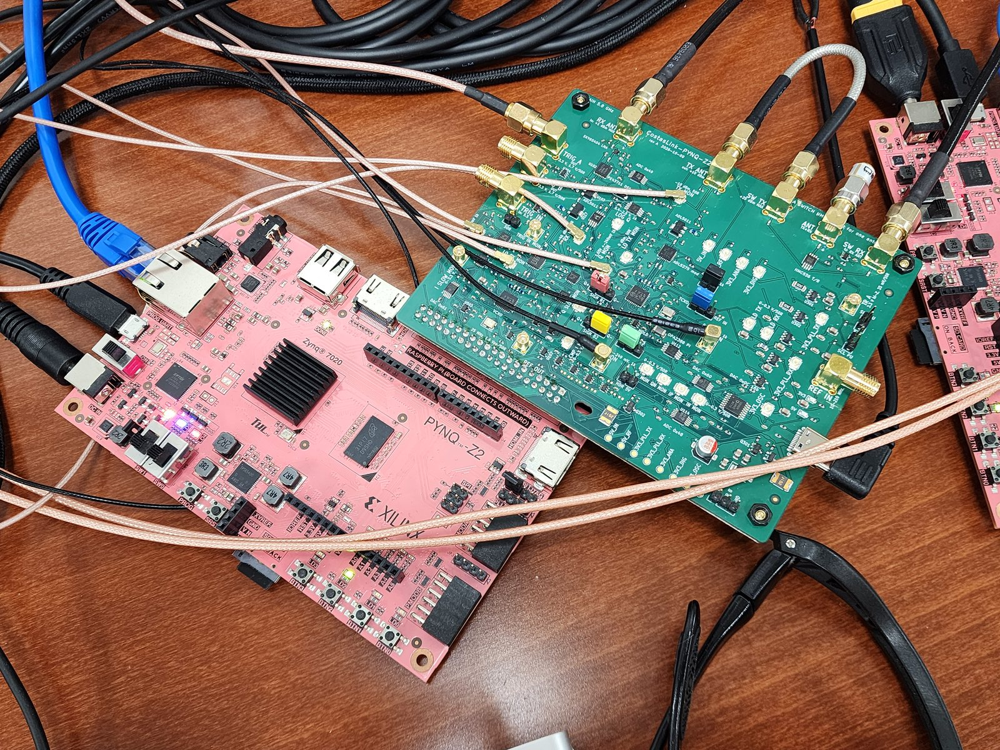
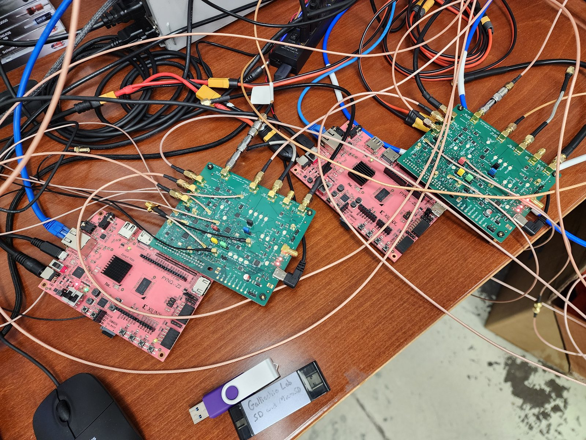
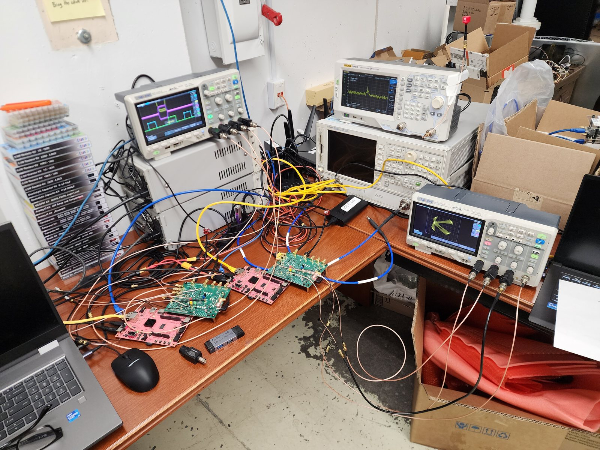
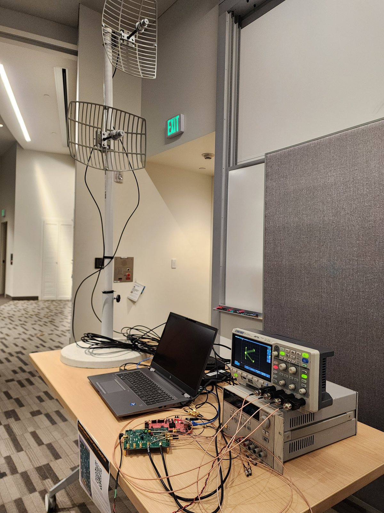
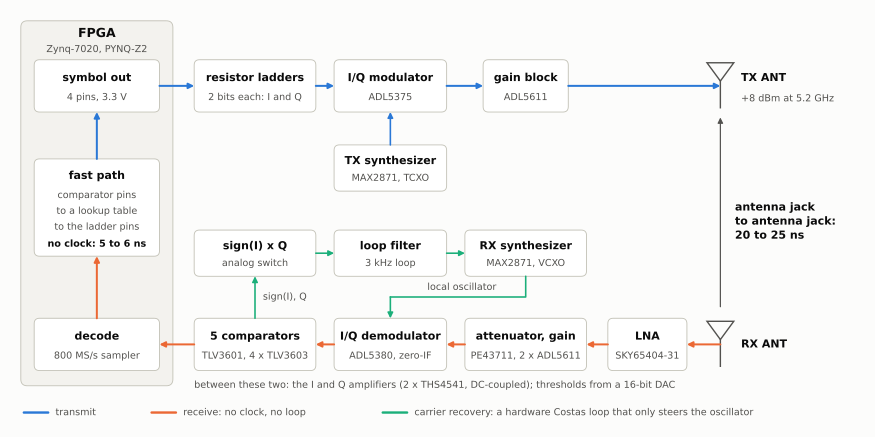
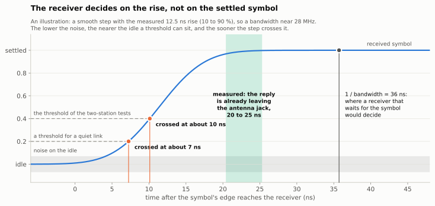
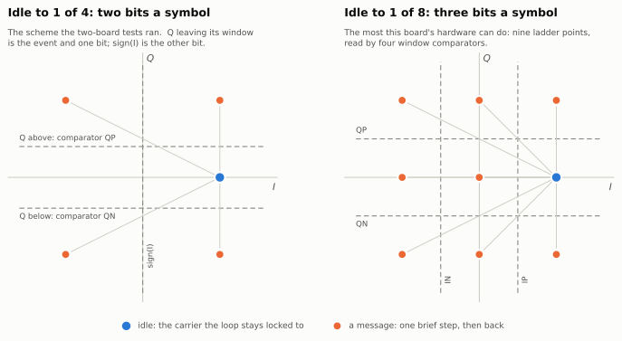
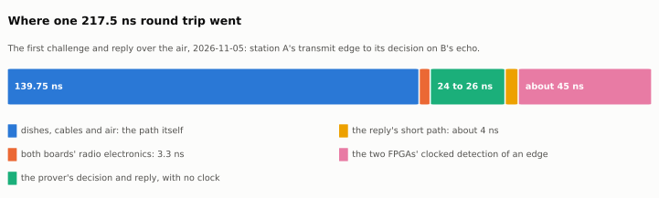

# CostasLink-PYNQ-Z2

**A radio link whose reply is on its way 20 to 25 ns after the question arrives.**

An open-hardware 5 GHz transceiver board for a [PYNQ-Z2](http://www.pynq.io/boards.html), built for quantum
position verification: one station sends a challenge (a measurement basis), the other decides which of four it was
and answers, and the electronics add tens of nanoseconds to the light's travel time.

## What rev A measured

| | measured | how |
|---|---|---|
| **Turnaround**, antenna jack in to antenna jack out | **23 to 25 ns**; **20.4 to 20.8 ns** with lower thresholds | one board answering itself through a cable; no clock in the path |
| **Throughput**, idle to 1 of 4 | **2 million challenges a second** (4 Mbit/s), each answered and checked | two boards, both directions at once |
| | 4.2 million a second (8.3 Mbit/s) | one board, cabled to itself |
| **Errors**, cabled | **1 wrong in 155 billion** challenges, none missed | two boards, 21.6 hours |
| **Errors**, over the air | 1.5 in a million of 25.6 billion, in bursts | dishes across the lab one way, small antennas back, 3.6 hours untouched |
| **Idle to 1 of 8** (3 bits) | 105 million symbols, none wrong | two boards, cabled |
| **Round trip** | 120 ns on bench cables, 245 ns across the lab | one station's transmit edge to its decision on the other's reply |
| **Plain BPSK** | no error in 89 billion bits at 2 to 50 Mbaud; error-free to 20 Mbaud across the lab | one board over the air; two boards over the dishes |
| **Cost** | about $345 a board, assembled by JLCPCB | the estimate at the order, before duty and shipping; a PYNQ-Z2 is extra |

Every number is from the bench record: [`bringup/BRINGUP_LOG.md`](bringup/BRINGUP_LOG.md),
[`bringup/LATENCY.md`](bringup/LATENCY.md), [`bringup/FINDINGS.md`](bringup/FINDINGS.md).

## Photos

<table>
<tr>
<td width="50%"></td>
<td width="50%"></td>
</tr>
<tr>
<td>The two stations: a PYNQ-Z2 and a rev A board each.</td>
<td>Both stations running. Left scope: a challenge and its reply. Right scope: the received constellation, the idle and its messages.</td>
</tr>
<tr>
<td></td>
<td>One station at a demonstration in a lecture hall: a dish to send and a dish to receive, on carriers 600 MHz apart. The scope shows the live constellation.  All the photos are in <a href="photos/README.md"><code>photos/</code></a>.</td>
</tr>
</table>

## How it works

- **The transmitter never stops.** It idles on a plain carrier, so the receiver is always locked.
- **A message is one brief step** of that carrier to another point in the I/Q plane, then back.
- **A hardware Costas loop** keeps the receiver's oscillator on the carrier. It is slow (3 kHz) and the data never
  pass through it.
- **Five comparators decide**, straight off DC-coupled I and Q. No ADC, no matched filter, no symbol clock.
- **The FPGA's fast path has no clock**: comparator pins, a lookup table, transmit pins, 5 to 6 ns.

### Deciding before the symbol settles

- A receiver that samples a settled symbol waits about 1/bandwidth. This one waits for a threshold.
- With little noise the threshold sits close to the idle, and the rising edge crosses it early.
- Measured: lowering the thresholds from 0.4 to 0.2 of the step took 3 ns off the turnaround.
- The price: set too low, noise fires the comparators. In the two-board link, false events stopped at 0.4.

### Idle to 1 of N

| scheme | bits a symbol | tested |
|---|---|---|
| idle to 1 of 2 | 1 | cabled and over the air |
| **idle to 1 of 4** | 2 | cabled and over the air: most of the results above |
| **idle to 1 of 8** | 3 | cabled: 105 million symbols, none wrong |

**Eight is the most this board can do.** Two 2-bit resistor ladders give three levels on each axis, nine points:
the idle and eight messages. Four window comparators read each axis as low, middle or high. More messages need
more comparators and a linear transmitter ([`bringup/REVB.md`](bringup/REVB.md), row 42).

### Where a round trip's time goes

## What rev A does not do

| limit | detail |
|---|---|
| **5.8 GHz** | Designed for the 5.8 GHz band, but the receive gain falls off above 4.5 GHz and no link closed at 5.8. Every result here is on carriers between 4.4 and 5.5 GHz. |
| **A decoded message on a pin** | 85 to 105 ns one way, about 80 ns of it the gateware's clocked pipeline. The 20 to 25 ns is the clockless reply. |
| **One antenna** | Both directions at once need two antennas a board and carriers 600 MHz apart. |
| **Distance** | The longest paths so far: about 16 m of air across a lab, and a lecture hall. |
| **Lock** | Software restores a lost lock in 2 to 3 s. The thresholds are set for one signal level, within about 6 dB. |
| **1 of 8** | Tested over cables only. |

The full list, each with its measurement: [`bringup/REVB.md`](bringup/REVB.md).

## What is here

| path | what |
|---|---|
| [`hardware/`](hardware/) | the KiCad 10 project: 120 x 100 mm, 4 layers |
| [`mfg/release/`](mfg/release/) | what was uploaded to JLCPCB: Gerbers, BOM, placement |
| [`gateware/`](gateware/README.md) | the Verilog, the PYNQ overlay's build, the Python driver |
| [`bringup/`](bringup/README.md) | the bench programs, the log of every measurement, the list for rev B |
| [`gen/`](gen/), [`sim/`](sim/), [`tools/`](tools/) | the scripts that generate and check the design (`python3 build.py`) |
| [`docs/`](docs/) | the schematic as [PDF](docs/images/CostasLink-PYNQ-Z2_schematic.pdf), the studies, the figures |
| [`PLAN.md`](PLAN.md), [`BRINGUP.md`](BRINGUP.md) | the design and its reasons; the bring-up procedure |
| [`docs/DESIGN_STATUS.md`](docs/DESIGN_STATUS.md) | the design phase's own summary, step by step |
| [`design_review/`](design_review/README.md) | six reviews before the order, and [what was done about them](DESIGN_REVIEW_RESPONSE.md) |
| [`photos/`](photos/README.md) | the boards and the bench |

## How it was made

Jason Gallicchio designed this with Claude (Anthropic's Fable 5.1 and Opus 5.5, in Claude Code).

| | dates | days |
|---|---|---|
| Design, to the order at JLCPCB | 2026-10-09 to 2026-10-17 | 9 |
| Boards delivered | 2026-10-28 | |
| Bring-up and debugging | 2026-10-28 to 2026-11-11 | 15 |

Every prompt and every response is kept: [`CLAUDE_CODE_CHAT.md`](CLAUDE_CODE_CHAT.md) for the design,
[`bringup/CLAUDE_CODE_CHAT_BRINGUP.md`](bringup/CLAUDE_CODE_CHAT_BRINGUP.md) for the bench.

The board grew up in a private repository of the research group. Its commits are all here; vendor datasheets
are not. Commit hashes quoted in the documents are the old ones: [`docs/COMMIT_MAP.tsv`](docs/COMMIT_MAP.tsv).

## Before you transmit

This is an uncertified experimental radio. Check what you are licensed to radiate where you are, or work over
cables.

## Licence

Hardware under CERN-OHL-P-2.0, software under MIT: [`LICENSE`](LICENSE).
