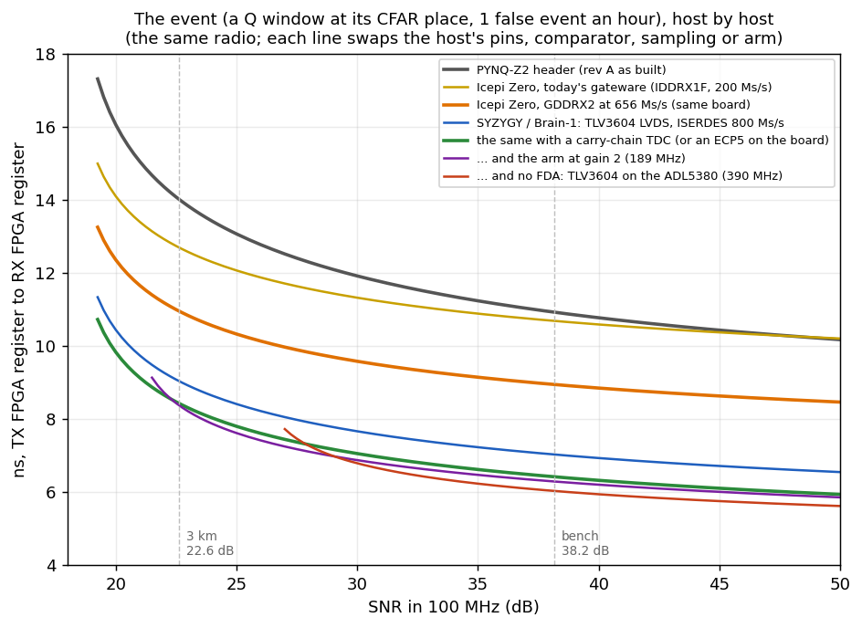
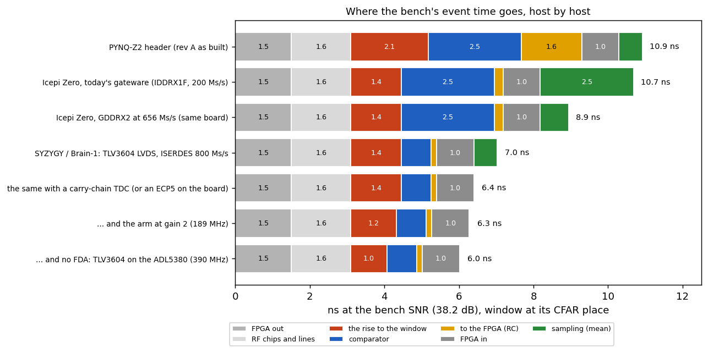

# Other hosts: the Icepi Zero, a SYZYGY port, an ECP5 on the board

Prompt 20 (2026-10-12).  The question: with an Icepi Zero, a SYZYGY port on the Brain-1, or an ECP5
on the board itself (as on ECP5-2ADC-2DAC), what could or should change about the architecture and
the chips?  Would the only change to [TRAJECTORIES.md](TRAJECTORIES.md)'s estimates be the missing
200 Ω resistors and the faster edges?

`sim/hosts.py` makes the numbers and figures here (`build/hosts.json`).  It is the trajectory model
of `sim/trajectories.py`, the same radio, with each host's own terms swapped in.

## The short answer

* **The Icepi Zero, with this board as it is: yes, almost only the resistors.**  It was designed in:
  the 33 Ω on each comparator output replaces the PYNQ's 200 Ω, and the ladder's levels shift a
  little, which VR trims.  But today's Icepi gateware samples at 200 Ms/s (5 ns), and that eats the
  whole gain: 10.7 ns against the PYNQ's 10.9, with three times the timing jitter.  The ECP5's
  GDDRX2 inputs at 656 Ms/s (already the plan, gateware/README.md's "not here yet") give the real
  improvement: **8.9 ns at the bench and 10.9 ns at 3 km, 2-3 ns faster than the PYNQ.**
* **A SYZYGY port or an ECP5 on the board: more should change, because differential pairs now
  reach the FPGA.**
  * The fast comparators become LVDS parts: TI's TLV3604 takes 0.8 ns against the TLV3601's
    2.5 ns, and an LVDS pair's edge arrives in 0.15 ns rather than through an RC.  That reaches
    **7.0 ns**.
  * A time-to-digital converter in the FPGA's carry chain then replaces the 1.25 ns sampling grid,
    giving **6.4 ns, with ±0.07 ns of jitter instead of ±0.4.**
  * The arm (94 MHz), the RF chips and the FPGA's own buffers are then the floor.
  * Widening the arm buys almost nothing (section 1).
* **The radio itself does not change:** the ADL5375, ADL5380, ADL5611s, MAX2871s, DSA (the
  PE43711 digital step attenuator), the arm and the Costas loop.  What changes is everything between
  the comparators and the FPGA, plus what an on-board FPGA leaves room for: converters, an RSSI that
  works unlocked, and a digital confirm path.

## 1. What changes in the numbers

Each line is the time from the transmitting FPGA's register to the receiving FPGA's register.  The
event is a Q window at its CFAR place (constant false-alarm rate: 7.5 σ from the idle, one false
event an hour).  The FPGA's own output and input buffers (1.5 + 1.0 ns) are counted for every host,
since a Zynq's and an ECP5's are the same class.  TRAJECTORIES.md's times stopped at the FPGA's input, so
these are 1.0 ns longer: they add the input buffer.

| host | 10-90 % rise, TX + RX | the window, bench / 3 km | **event, bench** | **event, 3 km** | A3's I bit (sign) |
|---|---|---|---|---|---|
| PYNQ-Z2 header (rev A as built) | 6.6 ns | 0.10 a / 0.60 a | **10.9 ± 0.38 ns** | **14.0 ± 0.69 ns** | 13.3 ns |
| Icepi Zero, today's gateware (200 Ms/s) | 4.5 ns | same | 10.7 ± 1.44 | 12.7 ± 1.50 | 12.2 |
| Icepi Zero, GDDRX2 at 656 Ms/s (same board) | 4.5 ns | same | **8.9 ± 0.44** | **10.9 ± 0.59** | 10.5 |
| SYZYGY / Brain-1: TLV3604 LVDS, ISERDES 800 Ms/s | 4.5 ns | same | **7.0 ± 0.37** | **9.0 ± 0.53** | 8.6 |
| the same with a carry-chain TDC (or an ECP5 on the board) | 4.5 ns | same | **6.4 ± 0.07** | **8.4 ± 0.39** | 8.0 |
| ... and the arm at gain 2 (189 MHz) | 3.0 ns | 0.13 a / 0.79 a | 6.3 ± 0.06 | 8.4 ± 0.55 | 7.3 |
| ... and no FDA: TLV3604 on the ADL5380 (390 MHz) | 2.2 ns | 0.24 a / 1.45 a | 6.0 ± 0.06 | does not fit | 6.5 |

(± is the rms timing jitter: the noise divided by the slope where it crosses, plus the sampling
grid's step / √12.)

Reading the breakdown:

* **The PYNQ's two RC terms are 3.6 ns between them.**  The 200 Ω into 10 pF at the transmitter
  slows the rise (2.1 against 1.4 ns to the window), and the 233 Ω into 10 pF at the receiver adds
  1.6 ns to 50 %.  That is all the Icepi saves, if its sampling keeps up.
* **The comparator is the next biggest term** (2.5 ns), and it only changes where a differential
  pair can carry an LVDS output to the FPGA.
* **Sampling at 1.25 ns costs 0.6 ns on average and ±0.36 ns rms.**  A TDC costs nothing on average
  and about ±0.01 ns.  On the bench, where the noise is small, the TDC is what sets the timing
  precision.  At 3 km the noise sets it (±0.39 ns).
* **The arm hardly matters once the rest is fast.**  A wider arm passes more noise, and the
  CFAR window moves out with it: 0.13 a at 189 MHz, 0.24 a with no FDA.  The rise gets faster and
  the window gets farther away, and the two nearly cancel: 0.1 ns at the bench.  At 3 km the wider
  arms lose outright: with no FDA a window 7.9 σ from the idle no longer fits inside a (sim/
  constellations.py's point 5 found the same).  The ~94 MHz arm stays right.  The one thing a
  wider arm speeds up is A3's I bit (sign(I) at half the rise), and B2 removes that wait anyway.
* **The floor is 6 ns: the FPGA's buffers (2.5), the RF chips and lines (1.6), the radio's own rise
  to the window (1.4), and the comparator (0.8).**  None of those depends on the host.

## 2. The Icepi Zero (this board, unchanged)

What stays:
* Every chip.  The board was laid out for both hosts.  The comparators drive the header through
  their own 33 Ω, because the Icepi has no series resistors.  The fast inputs land on the ECP5's
  banks 6 and 7, which have the gearing for GDDRX2 (REVA_CHANGES 1).

What should change, all in gateware and software:
* **GDDRX2 (IDDRX2F) at 656 Ms/s** in place of IDDRX1F at 200 Ms/s.  Without it the Icepi is no
  faster than the PYNQ and three times noisier in time.  This is the one change that matters.
* **The ladder's levels:** 0.167 / 0.521 / 0.874 V without the 200 Ω, against 0.170 / 0.500 /
  0.830 V on the PYNQ (sim/budget.py section 1).  VR_I and VR_Q re-centre them at bring-up.
* **The host link** is a 1 Mbaud UART, not AXI.  Control is fine; reading the capture buffer is
  slower.

What is lost: the PYNQ's ARM, Linux, Jupyter and Ethernet.

## 3. A SYZYGY port (the Brain-1)

The Brain-1 (Opal Kelly; XC7Z012S-1) has three SYZYGY Standard ports and one transceiver port
([Crowd Supply](https://www.crowdsupply.com/opal-kelly/syzygy-brain-1),
[FPGA Developer](https://boards.fpgadeveloper.com/boards/Brain-1)).  A Standard port carries 28
impedance-controlled signals, of which up to 16 can be differential pairs; it has no series
resistors, and its VIO is negotiated by the pod's DNA.  PLAN.md section 3 already chose it as the
better final platform, for latency and because three ports are a central station's three links.

What could and should change on this board, for a SYZYGY rev B:
* **LVDS comparators for the five fast windows: TLV3604** (TI: 800 ps, LVDS out, rail-to-rail inputs,
  2.4-5.5 V, SC-70-6, LCSC C2916042;
  [TI](https://www.ti.com/product/TLV3604)).  The SYZYGY radio board in this repository already
  uses LVDS comparators (the ADCMP605) for the same reason.  The slow path's three comparators can
  stay TLV3601s: their decision comes 6-25 ns after the fast event, and 1.7 ns does not matter there.
* **The pin plan.**  The board has 28 header signals, exactly one Standard port's 28 single-ended
  pins.  Five LVDS pairs need five more pins.  One port still takes everything fast:
  | pins | signals |
  |---|---|
  | 10 | five LVDS pairs: CMP_I, CMP_QP, CMP_QN, CMP_IP, CMP_IN |
  | 9 | TRIG_IN, TX_I1, TX_I0, TX_Q1, TX_Q0, TX_EN, TR_A, TRIG_A, TRIG_B |
  | 5 | SPI_SCLK, SPI_SDATA, LE_PLL_TX, LE_PLL_RX, LE_DSA |
  | 3 | the slow comparators |
  | 1 | LOOP_HOLD |

  That is all 28.  The rest has to go elsewhere:
  * The I2C devices (the DACs and the ADC) onto the port's own I2C bus, if the SYZYGY
    specification lets a pod add devices to it beside the DNA.  Check that first; if it does not,
    use a second port.
  * MUX_TX, MUX_RX and LOOP_SEL, which are all slow, behind an I2C GPIO expander, or onto the DNA
    microcontroller that a SYZYGY pod needs anyway (the radio board uses an ATtiny44).
* **The termination.**  The Zynq's HR banks take LVDS with an internal 100 Ω only at VCCO 2.5 V.
  At VIO 2.5 V, though, the HMC536's 0/3 V control and the ladders' levels would need redoing.  So
  keep VIO at 3.3 V and put the 100 Ω on this board, at the connector, as the SYZYGY radio board's
  review concluded.
* **The power.**  The board draws 1.34 A at 5 V.  A pod may draw up to 2 A from each SYZYGY rail,
  but a carrier is not obliged to supply it
  ([Digilent's PMCU specification](https://files.digilent.com/resources/programmable-logic/eclypse/Eclypse-PMCU-Specification-Public.pdf)),
  and the Brain-1's per-port budget is not in the documents here.  Keep the USB-C input.
* **The DNA:** an EEPROM or a small microcontroller for SmartVIO, as on the SYZYGY radio board.
* **The size.**  SYZYGY pods are small by specification.  This 120 × 100 mm board would hang off the
  connector on its own standoffs.  An adapter (SYZYGY to this board's 2x20 socket) is possible, but
  it carries single-ended LVCMOS only: it gets the Icepi's gain and not the LVDS one.
* **The transceiver port: not for the comparators.**  Its GTP lanes are AC-coupled serial
  receivers with clock recovery, which cannot hold a comparator's long idle level (PLAN.md section 3,
  corrected here: 3.75 Gb/s on the -1 grade, not 6.25).

## 4. An ECP5 on the board (as on ECP5-2ADC-2DAC)

Everything in section 3, and no connector at all:
* The LVDS comparators go straight into the ECP5's left and right banks (where GDDRX2 lives), on
  short internal traces.
* TRIG_IN and the 25 MHz radio reference go straight to the FPGA too.  The sample clock locked to
  the radio's reference, the gateware's "not here yet" item for coherent time stamps between two
  boards, becomes a trace instead of a cable.

What it leaves room for, which no header gives:
* **Converters on I and Q:** the ECP5-2ADC-2DAC's AD9238, two 12-bit channels at 65 MSPS.  They give:
  * an RSSI (received signal strength indicator) that works unlocked (I² + Q² from simultaneous
    samples, where the ADS1115 multiplexes at 860 SPS);
  * a digital AGC;
  * the constellation and the arms' offsets, read live;
  * a digital confirm or veto (a matched filter or CUSUM) beside the analog slow path.

  The AD9238's pipeline is 7 clocks (108 ns at 65 MSPS; its datasheet), so the analog slow path
  stays for latency.
* **A DAC for shaped transmissions:** the ECP5-2ADC-2DAC's AD9767, 14 bits at 125 MSPS.  It is
  slower to a step than the 2-bit ladder: its input latch's clock (8 ns), its 1 ns delay and 35 ns
  of settling to 0.1 %, against the ladder's ~1 ns.  So the ladder stays for the fast symbols and the DAC serves the experiments:
  pulse shaping, spectral masks, chirps.
* **Faster housekeeping:**
  * SPI threshold DACs in place of the I2C AD5696R, so the CFAR servo can update in microseconds
    instead of a fraction of a millisecond;
  * a faster housekeeping ADC than the ADS1115.

The cost:
* A BGA, its power rails, a configuration flash, and a USB or Ethernet link to a computer: the
  ECP5-2ADC-2DAC is a 6-layer, 158 × 119 mm board.
* The LFE5U-25F has no SERDES, and needs none here, for the reason in section 3.
* No ARM and no Linux on the board.

This is a rev B, or a new board built from the ECP5-2ADC-2DAC's pipeline, not an addition to rev A.

## 5. What to change, and when

**On any host, gateware only:**
* **A carry-chain TDC on each fast comparator input:** a Zynq's CARRY4 or an ECP5's CCU2 chain,
  calibrated against the sample clock, with bins of tens of picoseconds.  It works on the PYNQ-Z2
  too.  On the bench it takes the timing jitter from ±0.4 to below ±0.1 ns, at no hardware cost.  It
  is the cheapest improvement in this document.
* **On the Icepi: GDDRX2.**

**With a SYZYGY port or an on-board FPGA (rev B):**
* TLV3604 LVDS comparators for the fast path;
* 100 Ω terminations;
* the DNA;
* the pin plan in section 3.

**With an on-board ECP5 (a new board):**
* the converters for an unlocked RSSI, the digital AGC and the digital confirm;
* SPI threshold DACs.

**Do not change:**
* **The radio chips.**  None of the host options touches the RF path or its 1.6 ns.
* **The ~94 MHz arm.**  It is near-optimal for both the bench and the range (section 1).
* **The 2-bit ladder for the fast symbols.**  A real DAC is slower to a step.

The remaining 6 ns floor is the FPGA's own buffers, the RF chips, and the radio's rise.  Going
below it means moving the decision out of the FPGA: a comparator that keys the transmitter directly
(BRINGUP stage 4.7's FPGA-free path already does this for one trigger).
