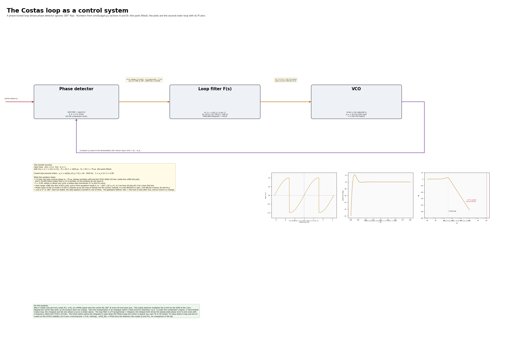
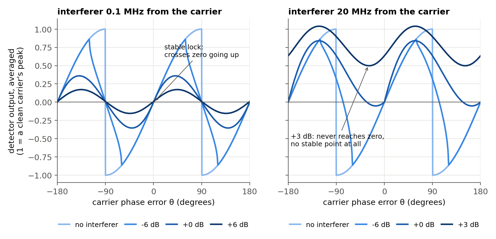
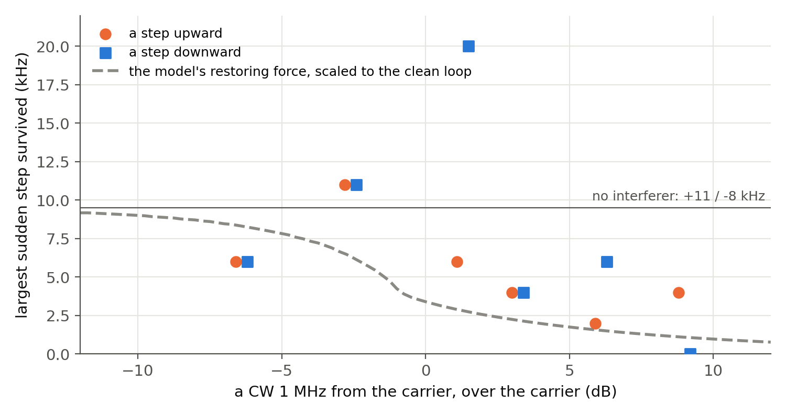
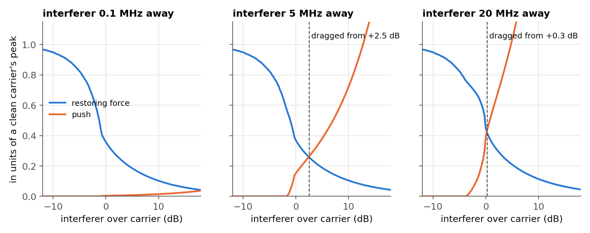
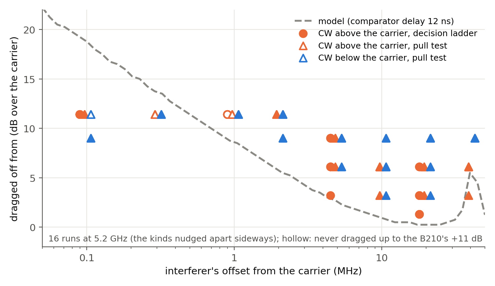
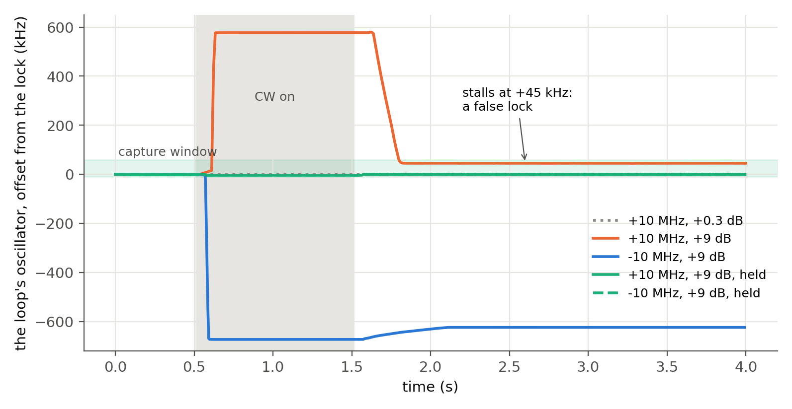
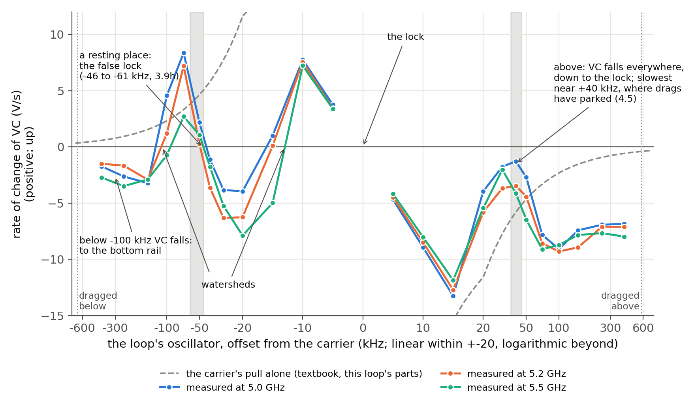
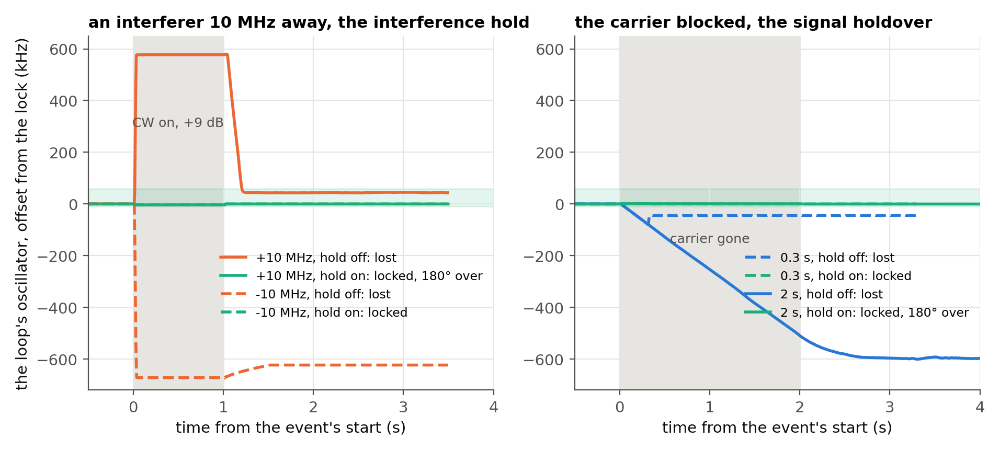

# How the Costas loop holds lock, and how it loses it (board A, 2026-10-30)

Jason, 2026-10-30: "I am guessing that 'loss of lock' will continue to be the biggest problem with this circuit,
especially in a realistic situation with interference and a low and changing signal amplitude. … Remember, we'll
be in the WiFi and ISM bands with lots of interference." And, after the first answers: "Once the strong interference
goes away, I don't understand why the good carrier, which *is* in the lock window, does not make the loop recapture
on it."

This note explains, for anyone who works on this board after us, what keeps the receiver's Costas loop locked, the
two ways the bench saw it lose lock (a strong interferer, and the carrier going away), why it does not come back by
itself, and what was built into the gateware so that it does. Every figure is drawn from measurements on board A
over the air at 5.2 GHz, or from a model of this board's own detector, by [`docs/lock_figures.py`](lock_figures.py);
the bench's record is [`bringup/BRINGUP_LOG.md`](../bringup/BRINGUP_LOG.md) rows 3.9-4.12 and
[`bringup/REVB.md`](../bringup/REVB.md) rows 17-30.

**In short**

1. The loop's detector is a comparator (sign of I) switching the Q arm. Its averaged output against the phase error,
   the S-curve, is what pulls the loop back to lock; its height is the loop's restoring force.
2. An interferer stronger than the carrier takes over the comparator (the capture effect of a hard limiter), and the
   restoring force collapses. The comparator's 10-13 ns delay also turns the interferer's beat into a steady push.
   When the push is larger than what is left of the restoring force, the loop's integrator ramps the oscillator to a
   rail, on the interferer's side: from about +1 dB for an interferer 20 MHz away, about +3 dB at 5 MHz, and +11 dB
   or more within 1 MHz.
3. After the interferer goes, the carrier is where it always was, but the loop's oscillator is 580 kHz above it or
   670 kHz below. The lock window is a window in *frequency difference*, about 10-60 kHz wide here, and the loop is
   far outside it. Out there the carrier's pull on the loop is weaker than the board's own offsets, which push the
   oscillator downward: from below it runs away, from above it comes back down, to the lock or to a false lock
   36-45 kHz short (section 6 maps it).
4. Holding the loop (freezing its integrator) while the interferer is present, or while the carrier is gone, keeps
   the oscillator at the carrier's frequency, and the loop is locked again within milliseconds of the release.
   Two holds now do this in the gateware, each switched and tuned from software: the **interference hold** and the
   **signal holdover** (section 7).
5. A hold cannot undo a loss. The board notices one by itself (the oscillator's control voltage far from the lock)
   and recovers it: re-centre the loop, start it just above the carrier, let it come down into the lock. It takes
   about two seconds, with nobody there (section 8).

Contents: [1 The loop](#1-the-loop-and-what-lock-means) ·
[2 The S-curve](#2-the-detectors-s-curve-the-restoring-force) ·
[3 What an interferer does](#3-two-things-an-interferer-does) ·
[4 Where it lets go](#4-where-the-loop-lets-go) ·
[5 The drag in time](#5-what-the-drag-looks-like) ·
[6 Why it stays lost](#6-why-a-dragged-loop-stays-lost) ·
[7 The holds](#7-holding-on-the-two-holds-in-the-gateware) ·
[8 Coming back by itself](#8-coming-back-by-itself-the-boards-own-recovery) ·
[9 Robustness](#9-what-else-makes-a-loop-robust) ·
[10 The decisions](#10-the-decisions-are-a-separate-matter) ·
[11 Reproducing it](#11-reproducing-everything) ·
[12 Glossary](#12-glossary)

---

## 1. The loop, and what "lock" means

The receiver mixes the carrier at RX ANT down with a local oscillator (LO) in the ADL5380 into two baseband arms, I
and Q, a quarter cycle apart. When the LO has the carrier's frequency and phase, all of the carrier lands in I and Q
is zero. The detector is a comparator and a switch: `CMP_I` takes the sign of I and the analog switch U110 passes Q
or −Q accordingly. Their product, sign(I)·Q, is the phase error. A PI loop filter (U112A: an integrator with a
proportional zero) turns it into the control voltage VC, which pulls the VCXO that both synthesizers use as their
reference, and so the LO.



| | design (`sim/budget.py`) | measured on board A |
|---|---|---|
| detector gain K_d at the comparator's level | 0.12 V/rad | |
| oscillator gain K_o | 2.70·10⁶ rad/s/V (430 kHz/V at 5.8 GHz) | 410 kHz/V at 5.2 GHz |
| loop filter (1 + sτ₂)/(sτ₁) | τ₁ = 1000 µs, τ₂ = 75 µs | |
| natural frequency, damping | 2.9 kHz, 0.69 | 2.8-4.5 kHz, 0.4-0.9 (both grow as the square root of the level) |
| VC's range | 0.3-3.0 V, about ±580 kHz | 0.22-3.27 V: −672 to +578 kHz at 5.2 GHz |

Two properties matter for everything below.

* **The sign makes it a Costas loop.** A BPSK symbol flips I and Q together, the sign flips back with them, and the
  product does not change: the data cannot disturb the error. The same symmetry gives the loop two equally good locks,
  at 0° and at 180°, so a disturbance that is too big can leave the loop locked again but upside down (a *slip*).
* **The integrator remembers the frequency.** At lock the error is zero on average and VC sits where it has to for
  the LO to equal the carrier. Freeze the integrator (LOOP_HOLD) and the LO stays there: on this board the held LO
  drifts from the carrier by 0.01-2.5 Hz (BRINGUP_LOG 3.9e), a few hundredths of a radian in 70 ms. That memory is
  what the holds of section 7 rely on.

"Locked" therefore means two things at once: the LO is at the carrier's frequency (the integrator's job), and its
phase sits at one of the two zeros of the detector (the restoring force's job).

## 2. The detector's S-curve: the restoring force

Hold the LO at the carrier's frequency and turn its phase error θ by hand: the detector's average output as a
function of θ is the loop's **S-curve**. With a clean carrier, I = cos θ and Q = sin θ, so the error is
sign(cos θ)·sin θ (the light curve below): positive just above 0°, negative just below. The loop turns a positive
error into a correction that lowers θ, so wherever the curve crosses zero going up (0° and 180°) the loop has a
stable lock; the jumps at ±90° are the unstable points between the two locks. **The height of the curve is the
restoring force**: the most push the loop can resist without letting go.



*The averaged detector output of this board's detector (the model of [`bringup/loopmodel.py`](../bringup/loopmodel.py):
a carrier of amplitude 1, one CW interferer of relative amplitude r beating at f_b, the comparator 12 ns late
against Q, averaged over the beat). Left: an interferer 0.1 MHz away only shrinks the curve. Right: one 20 MHz away
also lifts it; at +3 dB it never reaches zero, and there is no stable point at all.*

The hard limiter has a useful side: the comparator does not care how large I is, only its sign, so the curve's
height does not depend on the carrier's level. The loop's gain changes little when the signal fades, which is why
all 108 fades of 3 to 25 dB, lasting 10 ms to 1 s, rode through with no slip (BRINGUP_LOG 3.9c), down to a 44 mV leg.
A weak carrier is not the problem; an absent one is (section 7.3).

The restoring force can be measured. A loop with an integrator has no steady phase error, so the force shows up
instead in how large a sudden frequency jump the loop absorbs before it slips (the *pull-out* range). Stepping VC_OFF
suddenly by a few kilohertz' worth and checking the lock half a second later gives:



*The largest sudden step survived, upward and downward, against the level of a CW 1 MHz from the carrier (at 1 MHz
the interferer adds almost no push of its own, so this isolates the restoring force). Clean, the loop takes 8 to
11 kHz. Past 0 dB the margin falls to a few kilohertz, about as the model's restoring force does (grey, scaled to
the clean value). One run per point on a coarse ladder of steps: read the trend, not the points.*

## 3. Two things an interferer does

**It takes over the sign.** While the interferer is smaller than the carrier, the carrier decides the comparator's
sign and the S-curve keeps its shape. Once the interferer is the larger, it decides the sign most of the time, and
the carrier's part of the average falls roughly as 1/r. This is the **capture effect** of a hard limiter: of two
signals, the stronger suppresses the weaker. The restoring force collapses, whatever the interferer's offset.

**It pushes.** The comparator's decision arrives about 10-13 ns after the Q it multiplies (the end-to-end edge of
REVB 20). For a beat at f_b that is a phase lag of 2π·f_b·τ, and sign(I) lagged against Q no longer averages to zero.
For an interferer that owns the sign it leaves a steady error of about

    push ≈ (2/π) · r · sin(2π · f_b · τ),      τ ≈ 12 ns

with the sign of f_b. At 0.1 MHz the lag is 0.4°, so the push is negligible; at 20 MHz it is 86°, and the push is
nearly the interferer's whole amplitude. When the push exceeds what is left of the restoring force the S-curve has
no zero (the right half of the figure above), and the integrator does what an integrator does with a constant
error: it ramps VC until VC hits a rail.



*The model's restoring force (the S-curve's half-height) and push (its offset), against the interferer's level. The
loop is dragged where the push crosses above the restoring force: +2.5 dB at 5 MHz, +0.3 dB at 20 MHz. At 0.1 MHz
the push stays near zero, and the restoring force runs out only around +19 dB, where the board's own small offsets
are enough to drag it.*

## 4. Where the loop lets go

The bench measured the threshold as the first interferer level at which the I leg collapsed and VC left the lock
while the CW was on (`weekend.py decide` and `pull`: the USRP B210 sending a CW at each offset, its gain stepped).



*The interferer-to-carrier ratio at which the loop is dragged off, against the interferer's offset. Grey: the model.
Points: the bench at 5.2 GHz, orange for a CW above the carrier, blue for one below; hollow points never dragged up
to the B210's maximum (+11 dB), so their threshold is higher. Levels carry about ±3 dB from the B210's calibration
(BRINGUP_LOG 4.0), and runs at different times and receiver attenuations (DSA 13.75 to 17.75, the weekend's rounds)
differ by up to 8 dB at the same offset; the model, with its one parameter (the 12 ns delay, from the measured edge, not fitted), sits on
the vulnerable edge of the spread.*

What to take from it:

* **The side follows the interferer.** In every case a CW above the carrier dragged VC up, and one below dragged it
  down: the push's sign, exactly.
* **Close to the carrier is safest for the lock.** Within a megahertz the loop held to +9 dB and more; between 5 and
  40 MHz it let go between about +1 and +9 dB. That is the opposite of what one might guess, and it is because the
  push needs the comparator's delay to be a sizeable part of the beat's period.
* **The model is a model.** It ignores the arms' filtering (94 MHz), which shapes interferers beyond 20 MHz (its rise
  at 40 MHz is the delay's lag passing half a turn, sin(2π·f_b·τ) falling, and the bench does not show it), the
  comparator's hysteresis, and the board's DC offsets. That it lands within a few decibels from 0.1 to 20 MHz is good
  evidence that the capture effect and the delay's push are the mechanism.

## 5. What the drag looks like

VC read on the board's ADC about 130 times a second, converted to the LO's offset from the lock, while the B210 sent
a one-second CW 10 MHz from the carrier (`bringup/explain_tests.py drag`):



*Weak (+0.3 dB, grey): nothing happens. Strong (+9 dB): within milliseconds VC is at a rail, +578 kHz above (orange)
or −672 kHz below (blue). Held (aqua): LOOP_HOLD freezes the integrator from just before the CW to just after it,
and nothing moves; released, the loop is locked again within 50 ms. The shaded band near zero is the capture window.*

The drag is fast because, once the S-curve has no zero, the whole push goes into the integrator: tens of volts a
second against VC's 3 V range. And it always ends at a rail, because nothing on the way can stop it.

## 6. Why a dragged loop stays lost

This is the question at the top of the note, and its answer is the most important idea here.

**The lock window is a window in frequency *difference*.** The carrier never moved. The drag moved the LO: when the
interferer goes away the LO is 578 kHz above the carrier or 672 kHz below it, and the carrier now arrives as a beat
at that frequency. The loop responds only to a few kilohertz, so it sees the beat averaged, and the average of a
600 kHz beat through the detector is almost nothing. The carrier is in the receiver's passband, but the *loop* is
far outside its lock window, which on this board runs only from about −10 to +20..+60 kHz around the lock
(BRINGUP_LOG 3.9h).

**What moves an unlocked loop, measured.** Hold the loop at some offset from the lock with the carrier on, release
it for 3 ms, and read how fast VC moves: that is the force on an unlocked loop at that offset
(`bringup/weekend.py pullin`, BRINGUP_LOG 4.12). Here it is at 24 offsets from −400 to +400 kHz, at three carriers:



*VC's rate of change for an unlocked loop against the LO's offset from the carrier, measured at 5.0, 5.2 and 5.5 GHz
(three releases a point; the carriers agree within 1-2 V/s). Positive: VC rises. Dashed grey: the textbook's pull
for this loop's parts. The grey bands are the false locks found earlier by releasing the loop (BRINGUP_LOG 3.9h,
4.5).*

Read it as a map. Where the curve is above zero the loop drifts up, where it is below, down. Where it crosses zero
going down (left to right), the drifts on either side meet, and the loop comes to rest there. Where it crosses going
up, they run apart: a watershed.

* **Above the carrier the curve never crosses zero.** From anywhere above, VC comes down to the lock: 7-8 V/s far
  out, 12-13 V/s at +15 kHz where the carrier's pull is strongest, but only 1-4 V/s around +30..+40 kHz, where a loop
  coming down from a drag has been seen to park, beating (the band on the right).
* **Below the carrier the curve crosses three times before the lock**: a watershed 13-16 kHz below, a resting place
  43-49 kHz below (the false lock: the loop sits there beating and never locks), and a second watershed 94-129 kHz
  below. Below that, VC falls to its bottom rail.
* **Far out the rate is neither zero nor symmetric**: 7-8 V/s down above the carrier, 1.6-3 V/s down below it. Two
  things add up to that. First, a common downward drift of 4-5 V/s. The error signal is one leg of the Q arm, chosen
  by sign(I), so across a beat it averages to the Q arm's own mid-point, and that sits 4-10 mV below the reference of
  the loop's integrator (V_MID: the board has two mid-points, REVB 17). The integrator turns millivolts into volts a
  second (R126 · C130 = 1 ms). Second, 2.4-2.8 V/s toward the carrier, already in the detector's average with the loop
  held: sign(I) switches a little late on a beat's slow crossings. The textbook's pull (dashed) is far smaller out
  there.

Now read the map from where a drag leaves the loop:

* **Dragged below (−672 kHz)**: VC falls, away from the carrier, to the bottom rail, and stays.
* **Dragged above (+578 kHz)**: VC comes down toward the carrier. It reaches the lock, or slows and parks near
  +40 kHz, beating (as after the drags of BRINGUP_LOG 4.5).
* **Let go 16-129 kHz below** (for example by an interferer close to the carrier that the loop followed for a while):
  it ends in the false lock.

So the textbook promise, "a type-II loop pulls in from anywhere in its range", fails here for a concrete reason:
away from the carrier the board's own offsets outweigh the pull, and they point down. Twenty-four of twenty-four
dragged loops were still lost three seconds after the interferer stopped (BRINGUP_LOG 4.5).

*A lesson in measuring this.* The first measurement of the drift (BRINGUP_LOG 3.6d) released the loop with the
gateware's sequencer, and a sequencer step drives every output it does not name to its safe state, which mutes the
transmitter. The "drift" was measured with no carrier at all. It read the same 4 V/s at every offset, and reversed
when the I comparator was trimmed, because with no signal the comparator only picks one leg of Q, or chatters on
noise. A rate that did not depend on the offset from the carrier should have been the clue.

The cures follow from the map. Keep the loop from being dragged (section 7). If it is lost anyway, notice, and sweep
the LO back from above: everything above comes down to the lock, and a stepped downward search from +120 kHz
acquired every one of 52 real offsets up to ±73 kHz (BRINGUP_LOG 3.9j); a centre-and-release recovered 96 of 96
losses (3.9f). And in rev B, remove the offsets (one mid-point for the arms and the integrator), so that a designed
search, not a drift, decides where a lost loop goes.

## 7. Holding on: the two holds in the gateware

### 7.1 The idea

If the integrator is frozen while the interferer is present, there is nothing for the push to accumulate in. The LO
keeps the frequency it had and its phase drifts by well under a hertz. When the interferer goes and the hold is
released, the loop only has to pull its phase back, which takes about one loop time constant. Done by hand with the
same CWs that had dragged the loop: **24 of 24 back within 50 ms of the release, one of them 180° over; without the
hold, 0 of 24** (BRINGUP_LOG 4.5). The same holds for a carrier that disappears for a while: hold, and the LO is still
on the carrier's frequency when it returns.

The fabric can do it by itself. Once an interferer is strong enough to drag the loop, it makes the window
comparators chatter at the beat rate, which the gateware sees within microseconds; the drag takes milliseconds. And
when the carrier is gone, all four window comparators fall quiet. Both are in `gateware/ihold.v` (ID version 5, from
the overlay of 2026-10-30), instantiated twice in the receiver, each with its own switch and parameters, ORed into
LOOP_HOLD with the software's own CTRL bit. **Both are off at reset**: nothing changes until software turns them on.

### 7.2 The interference hold

* **Trigger.** Each clock counts as active for each comparator of a chosen set (default: the Q windows, QP and QN)
  that changed during it, over a window of 256 clocks (2.56 µs). The window is *busy* when **both** Q windows were
  each active in at least 4 clocks (half the threshold of 8). An interferer's beat of 1 MHz or more, once it reaches
  half the carrier, swings Q across both windows several times a window. The link's own BPSK data and A1 events move
  along I and leave the Q windows alone; an A3 event touches one Q window twice. And noise on a Q leg that sits at
  one window's threshold chatters that one comparator only (the windows have no hysteresis), which is why one
  window's activity is not enough: the second version of the hold, counting the two together, froze the loop with Q
  at a threshold after a CW and held itself until its maximum (BRINGUP_LOG 4.8a).
* **Arming.** A hold may start only if a *quiet* window (a quarter of the threshold or less) came after the last busy
  one. An interferer arriving at a locked loop finds it armed; a lost, beating loop, whose rotating vector also makes
  the Q windows chatter, never does. This is the lesson of the first version, which had no arming: released at its
  maximum while a CW was still on, the loop was dragged 37 kHz, and the hold then re-held the lost loop's beat 86
  times, freezing it off the lock (BRINGUP_LOG 4.8). A hold freezes the loop wherever it is, so the one thing it
  must never do is hold a loop that is not locked.
* **Release.** 20 ms after the last busy window (the driver's default; the gateware's reset value is 1 ms): an
  interferer near the drag threshold, or one with gaps, is busy only part of the time, and with a 1 ms release 6 of
  160 dragging CWs caught the loop between holds, every one of them a CW below the carrier, against 0 of 160 at 20 ms
  (BRINGUP_LOG 4.8b, 4.9, 4.10); the phase walks well under a degree in 20 ms. At most 5 s in one go, after which it lets go, waits out the guard and can start again
  only after a quiet window. Five seconds is long against any WiFi burst; a longer interferer than that leaves the
  loop to fend for itself, and the lock detector and search are the next line (section 8).
* **Registers** (`gateware/regmap.py`): `RX_IHOLD_CFG` 0x73 ([0] on, [3:1] window 2^(3+n) clocks, [15:8] threshold,
  [20:16] the comparators; reads [4] holding now, [31:24] the last window's count), `RX_IHOLD_HOLD` 0x74 (release
  delay and guard, clocks), `RX_IHOLD_MAX` 0x75, `RX_IHOLD_N` 0x76 (holds started), `RX_IHOLD_CLK` 0x77 (clocks held);
  the counts clear with the receiver's other counters (RX_CTRL[1]).

### 7.3 The signal holdover

* **Trigger.** A clock counts if any of its samples has one of the chosen comparators high (default: all four
  windows, IP, IN, QP, QN); a window of 256 clocks with fewer than 64 such clocks means the carrier is gone. The
  carrier's idle sits beyond one window, data and events swing across them, and with no carrier I and Q sit in the
  middle and all four are quiet.
* **Why all four windows.** A lost loop's vector rotates at full length, and a vector of length a always has |I| or
  |Q| beyond a/√2, more than the windows' a/2: so a lost loop that is trying to pull in is never held. With the I
  windows alone it would be, for a third of each beat (the first testbench caught exactly that).
* **Why it is needed.** With no carrier the detector sees only noise, the integrator integrates the board's own
  offsets, and the free LO walks off at about 300 kHz a second (the blocked-carrier traces below): out of the capture
  window in a few tens of milliseconds, so a person in front of the antenna for a third of a second is enough to lose
  the lock for good.
* **With the windows at 0.5 a** it holds from a fade of about 6 dB, where the decisions stop anyway; the loop itself
  would ride through much deeper fades (section 2), so the holdover costs nothing there.
* **Release.** 1 ms after the carrier is back; at most 10 s in one go, and it may hold again at once (holding with
  no carrier cannot lose anything, and it keeps the LO near the carrier's frequency for when it returns).
* **Registers:** `RX_SHOLD_CFG` 0x81, `RX_SHOLD_HOLD` 0x82, `RX_SHOLD_MAX` 0x83, `RX_SHOLD_N` 0x84, `RX_SHOLD_CLK` 0x85,
  laid out as the interference hold's.

### 7.4 Measured

`bringup/holds_tests.py holds` (twice, 21:13 and 21:38) and `weekend.py iholdcheck`, `pullauto`, 5.2 GHz over the air,
on the overlay of 2026-10-30 21:12 (`eadd8ae`; BRINGUP_LOG 4.8b): the board's own link with a 1 s CW at +9 dB 10 MHz above or below
the carrier, and the B210 as the carrier (the board's TX muted) switched off for 0.3 s and 2 s, as if someone stood in
front of the antenna; each with the protection off and then on.

| case | protection off | protection on |
|---|---|---|
| CW +10 MHz, +9 dB, 1 s | lost both times: dragged to +578 kHz, parked in the +45 kHz false lock | **locked again both times** (1 hold of 1.01-1.02 s; 180° over both times) |
| CW −10 MHz, +9 dB, 1 s | lost both times: dragged to −672 kHz, stays at the rail | **locked again both times** (1 hold of 1.01-1.02 s; once 180° over) |
| carrier gone 0.3 s | lost both times (a false lock, VC 1.75 V) | **locked at once both times** (0.31 s held) |
| carrier gone 2 s | lost both times (VC 0.37-0.41 V, near the bottom rail) | **locked at once both times** (2.00 s held; once 180° over) |
| the pull test's 40 dragging CWs (1-40 MHz either side, about +3 to +12 dB) | 0 of 24 back (4.5) | **160 of 160 back** at 5.0, 5.2 and 5.5 GHz (release 20 ms; 154 of 160 at 1 ms, the 6 lost all below the carrier) |
| A3's 20 000 events, 25 Mbaud BPSK, 20 s of quiet | | **no hold at all**; A3 19 984 right against 19 988 off, BPSK 10 of 10 clean |



*VC against the time from the event's start. Left: a 1 s CW at +9 dB, 10 MHz above (solid) or below (dashed) the
carrier: free (orange) the loop goes to a rail and stays lost; with the interference hold (aqua) VC does not move and
the loop locks again when the CW ends. Right: the carrier gone for 0.3 s (dashed) or 2 s (solid): free (blue) the LO
walks off at about 300 kHz a second and the loop is lost; with the signal holdover (aqua) it stays put and locks again
at once.*

After a hold of a second the loop comes back at either of its two points (the references drift apart by up to a few
hertz while it is held); after a WiFi burst of milliseconds the phase hardly moves. A link that sends data has to
resolve the 180° ambiguity in any case (differential encoding, or a known preamble).

### 7.5 Using them

From the PC or the PYNQ, through the driver (`gateware/driver/costaslink.py`):

```python
cl.protect(True)          # both holds on, with their defaults: the deployment's setting, once locked
cl.protect(False)         # both off: before a search or acquisition, and for tests that make the windows busy

cl.ihold(True, mask=(CMP_QP, CMP_QN), window=256, thresh=8, hold_s=20e-3, max_s=5.0)     # the interference hold
cl.shold(True, mask=(CMP_IP, CMP_IN, CMP_QP, CMP_QN), window=256, thresh=64, hold_s=1e-3, max_s=10.0)   # the holdover
cl.ihold_state(), cl.shold_state()   # on, holding now, the last window's count, holds started, seconds held
```

* Turn them on **after** the loop has locked, and off before any search or acquisition (a hold during a search
  would freeze the sweep).
* Event-rate tests that send events every few tens of clocks make the Q windows busy on purpose: switch the
  interference hold off for them.
* The windows' thresholds are the decisions' (set by `thresholds(cen, a, frac)`), so the holdover's sensitivity
  follows them: retune the windows after a lasting change of level (the DSA's regulation), or the holdover will see
  a carrier that faded for good as one that is gone.
* The counters say what happened: a deployment can log `holds` and `seconds` per minute as a measure of how hostile
  the band was.

### 7.6 What a hold costs, and where it does harm

The weekend's tests (BRINGUP_LOG 4.13-4.14) found the limits of holding.

* **A hold costs the decisions.** The hold does not stop the link's decisions, but while the loop is frozen the
  receiver's oscillator walks off the carrier's phase (about 0.1 rad in 6 ms): A3's decisions start failing some
  50 ms into a hold. Under bursts of noise (WiFi's frames) every burst re-armed the hold within its 20 ms release, so
  it held for most of each 3 s train, and A3 got 1 000-17 000 of 20 000 events right, against 21 000-32 000 with no
  hold at all. **Noise bursts do not drag the loop** (only a CW's steady beat does, section 3), so the free loop
  rides them out: holding there only costs.
* **Near the carrier it does harm.** A CW within about 50 kHz beats too slowly for the busy rule's 2.56 µs windows
  (it was built for beats of 1 MHz and more) and trips it only now and then, in the chatter at its slow crossings.
  At 5.0 GHz the locked loop rides a full-power CW 2-50 kHz off by itself (72 of 72 over the weekend); with the hold
  tripping and releasing, it lost 10 of 12, each short release letting the CW pull the loop a little further off.
* **It must start at once.** A strong CW drags the loop up to about 340 kHz in a millisecond (the error at its rail).
  Waiting for half a millisecond of sustained busy windows (ID version 7's `RX_IHOLD_PERSIST`) ignored the bursts,
  but let 11 of 40 dragging CWs pull the loop past the watershed before the hold began; waiting 20 µs kept 79 of 80.
* **So the release, not the start, is the lever.** ID version 8 scales it to how long the windows were busy
  (`RX_IHOLD_PERSIST[19:16]`): a 100 µs burst costs a half-millisecond hold, a near CW's chatter microseconds, a long
  CW holds to its end plus 20 ms. Its measurement under bursts is the next test. Until then the board runs with the
  interference hold **off**, and relies on the recovery of section 8, which brings back whatever the hold would have
  saved, in about two seconds.

## 8. Coming back by itself: the board's own recovery

Holds make losses rarer. They cannot undo one: the false lock, the rail and a drag all leave the loop where only a
person, or a program, can get it out. These boards run unattended, looked after by people who do not know what a
PLL is (Jason, 2026-10-31: "this part just needs to work reliably without intervention"), so the board does it
itself.

### 8.1 The rule

* **Notice.** The board looks at the lock five times a second: locked when CMP_I is quiet with the I leg up, or when
  both Q windows are quiet (the link's own data moves along I only). It calls the link lost when the oscillator's
  control voltage VC has been more than 8 kHz from where it sits when locked for half a second. Judging on VC, not on
  the comparators, is the lesson of the tests: noise bursts make the comparators chatter while the loop rides them
  out with VC at the lock, and a first version recovered once in every train of bursts for nothing. Every real loss
  moves VC tens of kHz (the false lock 45, the rail hundreds), and a lost loop cannot stay within 8 kHz of the lock,
  where it pulls in (section 6's map).
* **Recover.** Hold the loop; re-centre its integrator (both synthesizers moved away from any carrier, to 5.8 GHz,
  and the trims used to walk it to mid-scale); back to the link's frequency and attenuation; VC 20 kHz **above** the
  last lock; release. From above, the unlocked loop always comes down into the lock: the map again. If that start
  fails, 40, 70 and 120 kHz above. If none locks (the far board off, the path blocked), wait 5 s, doubling to a minute,
  and try again.

### 8.2 Measured

| test | result |
|---|---|
| every loss the bench can force (the false lock, the rail, the carrier gone 1-60 s, full-power CW drags), from the PC, at 5.0, 5.2 and 5.5 GHz | **171 of 171 back, 1.7-3.0 s, first start every time** (BRINGUP_LOG 4.15) |
| trains of noise bursts (10 µs-1 ms, up to the beacon rhythm) | no needless recovery in 18 of 18 once judged on VC |
| the same, the recovery running on the board itself with nobody driving it | **23 of 23 back, 1.3-5.4 s** (4.16) |
| the B210's random interference for 15 minutes, nothing touching the board | 12 disturbances, 2 losses, both back by themselves (4.17); the 20-hour run is going |
| the board's server started with nothing else touching it | the link set up and locked **15 s** later (4.17) |

### 8.3 On the board

The recovery is `gateware/driver/linkd.py`, running inside the board server on the PYNQ (`netbus.py serve --linkd`),
which is itself the PYNQ's boot service (`costaslink-netbus`): power the PYNQ and the CostasLink board, and the
server starts, loads the overlay, reads `link.json` beside it (the carrier frequency, its null, the target level) and
sets the link up by itself, then watches it. **Whoever drives the board owns it**: linkd acts only after a minute with
no request that changes anything (looking does not count), and leaves a loop that a program has deliberately held
alone, so it never fights a test or a person. On rev A the recovery has to live in software, because re-centring the
integrator needs the synthesizers retuned; with an integrator reset switch (REVB U4) the gateware could do it alone,
in milliseconds.

### 8.4 What an operator sees

* **The status page**, `http://<the PYNQ>:8080/` on the lab network: a status card in words (the state, its likely
  cause, what to do, who is driving the board, what the recovery is doing and its counts); plots with a help button,
  an arrow on each axis pointing the good way and green, yellow and red bands; a coarse constellation; and *What
  happened*, the losses and recoveries in words, newest first. It only reads, between the server's requests, so it
  never disturbs a test.
* **The PYNQ-Z2's own LEDs** (ID version 8, `gateware/lockmon.v`, the board's own judgement every 10 ms): LD0 locked,
  LD1 lost (blinking), LD2 no carrier, LD3 a hold, LD4 green / red / yellow / blue for locked / lost / unsure / held,
  LD5 blue while the board is recovering. The next board should have its own, with a signal-strength bar driven by
  hardware, for pointing antennas without a laptop (REVB U1).

## 9. What else makes a loop robust

Seen through the S-curve, robustness is two numbers: how much restoring force survives an interferer, and how much
push the interferer can create. Everything else is what to do once the loop has been pushed off anyway.

| lever | where | what it buys | evidence |
|---|---|---|---|
| hold during interference | rev A gateware (`ihold.v`) | the push has nothing to act on while it lasts | 24 of 24 by hand (4.5); 40 of 40 in gateware (4.8b) |
| hold while the carrier is gone | rev A gateware (`ihold.v`, LEVEL 1) | the LO stays on the carrier's frequency | 4 of 4 (4.8, 4.8a, 4.8b) |
| know when you are lost, then recover | rev A, the board's own software (`linkd.py`, section 8); the lock's state in gateware (`lockmon.v`) | recovery in seconds instead of never, with nobody there | 171 of 171 from the PC, 23 of 23 on the board itself (4.15, 4.16); with REVB U4, in gateware alone |
| keep interferers away from the limiter | rev B | the loop needs a few kHz but its detector sees the arms' 94 MHz; a narrower, matched I/Q filter feeding the detector alone (the decisions keep the wide arms) stops most out-of-channel interferers reaching the comparator | the thresholds of section 4; REVB 27 |
| remove the push | rev B | match the delay from the arms to U110 on the sign(I) and Q paths, and the push vanishes, leaving the capture effect | the model, section 3 |
| null the offsets | rev B | one mid-point for the arms and the integrator removes the common 4-5 V/s downward drift, leaving the detector's 2.4-2.8 V/s toward the carrier on both sides: a dragged loop should come back by itself from either side, though the false locks near the carrier may move rather than vanish | section 6 (measured); REVB 17, 18 |
| limit the damage | rev B | VC can swing ±600 kHz while two TCXOs need perhaps ±50 kHz; a clamped range keeps a dragged loop within a short search | REVB 27 |
| the detector | design trade | a hard limiter gives a gain independent of level (it locks over 15 dB without retuning, and rides 25 dB fades) but hands the sign to the stronger signal; a linear multiplier (I·Q) has no capture effect, but its gain goes as the signal squared, so fades change the loop's dynamics | sections 2-3 |
| loop bandwidth | design trade | wider: a larger pull-out range and a faster re-lock, but more noise in and a denser false-lock structure; it moves the drag threshold little (a ratio of two averaged forces), only how fast the drag happens | |

## 10. The decisions are a separate matter

The holds protect the lock. The link's decisions suffer earlier and are a different problem (BRINGUP_LOG 4.3, 4.3a,
round 2's BER segments): with the windows at 0.5 a, A3's events are first lost (erased, not wrong) from about −16 dB,
missed from about −11 dB, and turned into false events and wrong decisions once the interferer reaches the windows'
distance (about −6 dB). BPSK at 25 Mbaud, decided by the comparator's sign, is clean up to about −1 dB and fails from
about +1 dB, where the interferer takes the sign. The slow comparators' confirm vetoes wideband noise's wrong
decisions almost one for one, but not a CW within a megahertz. Coding, the windows' placement and the slow path's
use are the levers there, not the loop.

## 11. Reproducing everything

| what | how | data |
|---|---|---|
| the decision ladder, the near-carrier capture, pulses, the pull and its held variant | `python3 bringup/weekend.py rounds` (pieces `decide`, `capture`, `pulses`, `pull`, `pullhold`, `pullauto`, `iholdcheck`) | `bringup/data/board_A/weekend/` |
| the drag in time, the pull-out | `python3 bringup/explain_tests.py drag`, `pullout` | `bringup/data/board_A/explain/` |
| the gateware's holds | `python3 bringup/holds_tests.py holds` | `bringup/data/board_A/holds/` |
| the map of the unlocked loop, the push against the trims | `python3 bringup/weekend.py once --pieces pullin pushscan pushq` | `bringup/data/board_A/weekend/` |
| the holds near the carrier and under bursts | `weekend.py rounds` (`captureauto`, `captureauto2`-`5`, `pulsesauto`, `pulsesauto2`, `pulsesauto4`, `pullauto3`-`5`) | `bringup/data/board_A/weekend/` |
| the recovery, from the PC and on the board | `python3 bringup/autolock.py abuse`, `autolock.py linkd`; `gateware/driver/linkd.py` | `bringup/data/board_A/autolock/` |
| unattended, with random interference | `python3 bringup/unattended.py --mhz 5200 --hours H` (the link set up by linkd or `bringup/linkup.py`) | `bringup/data/board_A/unattended/` |
| the B210 (interferer, carrier, receiver) | `bringup/b210.py`, `bringup/b210link.py` | |
| the model | `python3 bringup/loopmodel.py` | `bringup/data/board_A/model/` |
| the figures of this note | `python3 docs/lock_figures.py` | `docs/images/lock_*.png` |
| the gateware | `gateware/ihold.v`, `gateware/tb_ihold.v` (`iverilog -g2005 -o tb_ihold.vvp tb_ihold.v ihold.v && vvp tb_ihold.vvp`), `gateware/lockmon.v`, `gateware/tb_lockmon.v`, `gateware/tb_engines.v` | |

The bench for all of it: board A, four FPV antennas within 30-40 cm, the board's TX ANT and RX ANT and the B210's RF A
TX/RX and RX2; the interferer's level at the receiver from the B210's gain by the calibration of BRINGUP_LOG 4.0
(about −6.4 dB at gain 70, +3.2 at 80, +11.4 at 89.75, ±3 dB).

## 12. Glossary

* **S-curve** (detector characteristic): the detector's average output against the phase error. Its zeros with the
  right slope are the locks; its height is the restoring force.
* **Restoring force**: the largest error the detector can produce to pull the phase back; measured as the pull-out
  range.
* **Hold-in range**: how far the carrier can move slowly with the loop following (here VC's range, ±580 kHz).
* **Pull-out range**: the largest sudden frequency step the loop survives without slipping a cycle (8-11 kHz here).
* **Capture (lock-in) window**: the frequency differences from which a released loop locks by itself (−10 to
  +20..+60 kHz here).
* **Pull-in**: the slow drift toward the carrier from outside the capture window, driven by the beat's average; on
  this board it loses to the offsets beyond a few tens of kilohertz.
* **False lock**: a frequency where an unlocked loop is stable, beating, without being locked.
* **Capture effect**: a hard limiter's habit of passing the stronger of two signals and suppressing the weaker.
* **Drag**: an interferer's push running the loop's integrator to a rail.
* **Slip**: the loop locking again at the other of the Costas loop's two points (180° over).
* **Hold, holdover**: freezing the loop's integrator so the LO keeps its frequency; the interference hold and the
  signal holdover start it from the comparators.

Further reading: F. M. Gardner, *Phaselock Techniques* (3rd ed., Wiley 2005), on pull-in, false lock and Costas
loops; R. E. Best, *Phase-Locked Loops* (McGraw-Hill), on the same with worked numbers.
