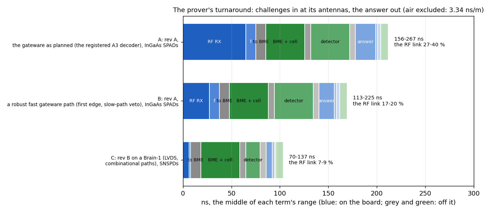

# The QPV system around the radio: the prover's chain, the verifiers, and what rev A must prove

Prompt 27 (2026-10-12).  Jason: the prover combines the 2 or 3 verifiers' challenges (an XOR or a hash)
into one basis, sets a BME-driven Pockels cell, measures the photon with SPADs or SNSPDs at 1550 nm, and
sends back "click A, click B, or no click".  That chain has latency the radio does not control.  So for
rev A, reliability and robustness to interference matter more than the last nanosecond.  The lowest
latency is for other quantum-networking experiments later.

**The questions:**
- Put the radio's numbers in the context of the whole chain: the on-board terms, and the off-board
  ones (the driver, the cell, the detectors, the cables to the antennas, the air).
- Suggest what rev A should change before the order.
- Lay out the verifiers and their synchronization over the same links, and which platform should
  carry them.

Detector inputs and Pockels outputs belong to rev B, not rev A (Jason's clarification).

`sim/system_budget.py` computes section 1 (`build/system_budget.json`, `docs/images/system_budget.png`).
Every term carries its source; "est" marks an estimate to measure on the bench.

## 1. The prover's turnaround, on the board and off it

The clock starts when the challenges arrive at the prover's receive antennas.  It stops when the
answer leaves its transmit antenna.  The photon is not on this clock: in QPV-BB84^f it may arrive early
and wait in a fibre coil until the cell has settled.  The air between the nodes is geometry, not the
prover's time: 3.34 ns/m, so 334 ns at 100 m and 3.3 µs at 1 km.

| term | where | A: rev A, gateware as planned | B: rev A, robust fast gateware | C: rev B on a Brain-1 | source |
|---|---|---|---|---|---|
| RF receive: RX SMA to the challenge's bit in the FPGA | on | 60-70 | 20-35 | 5-8 | model: A is rev A's registered A3 decoder (PLAN.md section 19, row 0); B is B2's first edge into one or two 100 MHz clocks, with the slow path as a veto rather than a wait; C is rev B's LVDS comparators into a LUT |
| combine the verifiers' bits (an XOR or a small hash) | on | 10 | 10 | 1-2 | one clock, or one LUT level |
| the basis out to the BME: a 5 V buffer and 1 m of cable | off | 8-13 | 8-13 | 8-13 | the SyzygyRadioBoard's Pockels path, 1.4-9.5 ns (its review 1), plus 3.9 ns/m |
| **BME PCD-dpp: trigger to the cell settled** | off | **25-55** | **25-55** | **25-55** | the manual: 4-7 ns edges, ≥ 3 V (4 V better) into 50 Ω.  The trigger-to-output delay is not given (est 15-40 ns).  A Leysop RTP cell is a few pF (6 pF for the RTP-4-20) and rings little (est 3-10 ns to settle) |
| the photon after the cell: PBS, fibre to the detector | off | 2.5-10 | 2.5-10 | 2.5-10 | est: 0.5-2 m |
| **detector: photon to output pulse** | off | **20-60** | **20-60** | **10-20** | est: InGaAs SPAD modules (ID Qube, ID120) do not publish it.  An SNSPD's own latency is ps; its amplifiers and ~2 m of coax out of the cryostat make 10-20 ns |
| the detector's cable to the box | off | 4-8 | 4-8 | 4-8 | 1-2 m |
| detector pulse to the answer on the TX ladder pins | on | 15-27 | 12-20 | 5-8 | rev A: TRIG IN (1 kΩ into a Schmitt buffer) on clock-capable pin 26, then one or two clocks.  Rev B: a buffer and a LUT |
| constant-time release (the detection window) | on | 1-3 | 1-3 | 1-3 | click, no click and invalid all leave at the same time after the window |
| RF transmit: ladder, modulator, TX SMA at 50 % | on | 3-3.5 | 3-3.5 | 1.2-1.8 | sim/latency_roadmap.py |
| antenna cables at the prover, 1 m each way | off | 7.8 | 7.8 | 7.8 | 3.9 ns/m; **10 m each way would be 78 ns** |
| **total** | | **156-267 ns** | **113-225 ns** | **71-137 ns** | |
| on the board | | 89-114 | 46-72 | 13-23 | |
| the RF link's own (receive + transmit) | | 63-74 (27-40 %) | 23-39 (17-20 %) | 6-10 (7-9 %) | |
| c·t/2, the position's slack | | 23-40 m | 17-34 m | 11-21 m | |

**What it says:**
- **The Pockels driver and cell (25-55 ns) and the detector (10-60 ns) are the chain.**  With the
  gateware's robust fast path (B), the radio is a fifth of it.  Rev B's LVDS and combinational paths
  make it a tenth.
  - Row 4 of PLAN.md section 19, the CML path, would save ~7 ns more: 3-5 % of the chain.
  - **Neither rev A nor rev B needs heroics for a nanosecond.**
- **The largest avoidable term is off the board: the antenna cables.**  The prover's cables are in
  its turnaround, and the verifiers' are calibrated out.  A metre each way is 8 ns; ten metres each
  way is 78 ns, more than the whole radio.  **Put the box behind the antenna.**
- **The fibre coil is cheap.**
  - The photon must reach the cell after the challenges are decoded, combined and sent to the BME,
    and after the cell has settled: 63-113 ns in B.  That is 13-23 m of SMF, ~0.005 dB.
  - Build it from patch cords, so its length can follow the measured chain.
  - Its temperature coefficient (~40 ps/°C/km) is nothing at this length.
- **The answer has four messages.**  Click A, click B, no click, and invalid, the last for a round
  the slow path vetoed or a challenge that never arrived.
  - That is exactly B2's alphabet: four window comparators, each message moving one of them.
  - All four leave at the same time after the detection window.  When the answer leaves must not
    depend on what it says, and "no click" cannot be known any earlier.
- **Long challenges cost time on the air.**  B2 carries 2 bits an event; a stream carries 2 bits per
  10 ns symbol.  An n-bit x and y (QPV_BB84^f's security grows with n) take ~5n ns to arrive.  The
  qubit can still be sent early.  When the challenge "arrives", given that an attacker sees the early
  bits early, is a protocol question.  The radio can carry either.

## 2. What it means for rev A: robust, not heroic

Rev A's job in this system is the 23-39 ns of configuration B, held reliably on a roof.  That is
gateware and driver work, none of it hardware:
- **Decide on the first edge, veto with the slow path, report "invalid".**  The fast decision drives
  the basis at once.  The slow path (7.5 MHz, 16 dB more sensitive, ~37 ns later) confirms or vetoes
  it.  A veto turns the answer into "invalid", which the verifiers discard.  Reliability then costs no
  latency, only a few discarded rounds.
- **Gate the receivers.**  Arm the windows only around a round's scheduled arrival.  The schedule
  goes over Ethernet; the time base comes over the links (section 4).  WiFi then has a thousandth of
  the chances to fake an event, and the CFAR's z can come down.
- **Survey, choose, and keep watching** (PLAN.md section 19, Prompts 25-26):
  - `survey()` between sessions;
  - each receiver chooses its frequency and tells its transmitter over Ethernet;
  - the idle carrier on a WiFi null (5775 MHz);
  - the window thresholds servoed to the measured false-event rate.
- **Watch the lock.**  Abort a session when the loop's VC leaves its range or the PLLs' lock detect
  drops.  Keep the Morse identification between sessions, never inside one.
- **Re-trim between sessions.**  The offsets and thresholds drift with the box's temperature.  The
  MAX2871s carry a temperature sensor (±3 °C, in their register 6, read back through MUX:
  an SPI readback the gateware does not do yet).

## 3. Robust on the roof: rev A as it is, and what goes around it

- **The box goes behind the antennas** (section 1): short cables, so few ns and little loss
  (LMR-400 loses ~0.2 dB/m at 5.8 GHz).
- **Ahead of RX ANT, in the cable:**
  - A 5.8 GHz cavity bandpass filter.  The board has none (PLAN.md section 4), and the receive chain
    is broadband from the LNA on.
  - A limiter when a PA shares the site.  RX ANT's absolute maximum is +1 dBm, the SKY65404's.
- **A DC-grounded antenna and a quarter-wave-stub surge arrestor at the bulkhead.**  On the board,
  RX ANT is a 1.5 pF DC block straight into the LNA, with no path to ground for static.
  - An arrestor (or a DC-grounded panel) is the roof's protection, with no board change.
  - A shunt inductor resonant near 5.8 GHz at the jack would be the on-board one (section 6).
- **The control network:** Ethernet over fibre media converters for galvanic isolation (or PoE with
  surge protection).
  - Not a 2.4 GHz WiFi radio inside the box.  Its +20 dBm a few centimetres from the receive chain is
    what the LNA would have to survive.
  - If WiFi is used, give it its own antenna a metre or more away, off the panels' axis.
- **Shade and a vented box.**  The parts are rated −40 to +85 °C, and a dark box in the sun gets past
  60 °C.  Re-trim between sessions (section 2).
- **Power:** PoE+ (25 W) into a 5 V converter.  The board draws 6.7 W, the PYNQ a few more.  The
  board's own TVS and PTC stay.

## 4. The verifiers and their synchronization

**The links, and what each needs.**  For three verifiers V0, V1, V2 and the prover P:

| link | carries | needs | latency |
|---|---|---|---|
| Vk → P | the challenge | low latency, robustness | counts: it is the prover's security budget |
| P → Vk | the answer (four messages) | low latency, robustness | counts |
| V0 ↔ Vk | frequency (the carrier), time (two-way exchanges) | precision: ~100 ps, stability | does not count |
| V0 → Vk | "a photon is coming": the herald, the round's schedule | reliability | **µs is fine**: a fibre coil at V0 absorbs it (below) |
| Ethernet (all) | configuration, schedules, results, the frequency choice | — | ms |

- **Only the 2N prover links are latency-critical.**  The verifier-to-verifier links need precision,
  not speed.
- **A herald needs only a coil.**  If V0's source is heralded (SPDC), V0's herald detector fires, V0
  tells the others, and they launch their challenges at the agreed offset.  The photon meanwhile
  waits in a coil at V0: 1 km of SMF is 4.9 µs for ~0.2 dB (plus ~0.3 dB of connectors).  So the
  herald path may take microseconds, and the V0 ↔ Vk links can be narrow, slow and robust.  The slow
  path alone (7.5 MHz) would do.
- **Why not the prover:** the prover is the party under test.  The verifiers' clocks must agree
  among themselves, through links the prover does not touch.

**Synchronization without GPS or NTP, over the RF links:**
- **Frequency comes from the carrier.**
  - Vk's receiver from V0 locks its VCXO to V0's carrier (the Costas loop).  REF OUT carries it to
    the node's other boards' REF IN (their TX synthesizers) and to the FPGA's clock.
  - Every node then runs at V0's TCXO frequency, phase-continuously, with nothing to count but a
    fixed offset.
- **Time comes from two-way exchanges.**
  - V0 sends an event at its t1; Vk receives it at its t2 and answers at t3; V0 receives at t4.
  - Then offset = ((t2 − t1) − (t4 − t3)) / 2, and the air path cancels.  This is two-way satellite
    time transfer and White Rabbit's principle, on the QPV radios.
  - The B2 event's jitter with a carry-chain TDC is ~0.07 ns (docs/HOSTS.md), so 100 exchanges give
    ~10 ps of statistics.
  - The systematics are the hardware's asymmetry (calibrate the boards side by side once), the
    cables' temperature (ps) and multipath (the panels' directivity).
- **The alternatives:**
  - NTP is milliseconds.
  - PTP over ordinary Ethernet is 100 ns to µs.
  - GPS PPS is 10-20 ns, or 2-5 ns with sawtooth correction in common view; the repository's
    GPSDO-PYNQ-Z2 project gives frequency to ~1e-11 averaged.
  - White Rabbit is sub-ns but needs fibre between the nodes and WR switches.
  - GPS remains a good coarse first alignment.  The radios do the last nanosecond.
- **Rev A can test all of it now.**  A REF OUT (MMCX) to TRIG IN (SMA) lead puts the locked 25 MHz on
  header pin 26, which is clock-capable on the PYNQ-Z2 and the Icepi.
  - The FPGA then runs from the link's reference (an MMCM from 25 MHz).
  - CMP_I on pin 18, also clock-capable, time-stamps the events.
  - Two boards make a two-way time transfer on the bench.  BRINGUP.md stage 4.8 is added for it.
  - The cost: TRIG IN is busy for that test.

**The frequency plan is the deployment's real constraint.**
- Three verifiers make 3 bidirectional prover links and 2 synchronization links: up to 10 one-way
  links.
- Today each low-latency link is ~190 MHz wide.  Under Part 97 the 5 cm band has 275 MHz: one link.
  The ways out, which combine:
  - **Time division per link.**  QPV is half duplex within a round, and the HMC536 switch turns in
    30 ns.
  - **Spatial reuse.**  The verifiers sit in different directions from P, and the panels give
    20-30 dB.
  - **Narrow channels for the synchronization links.**  Their latency does not count, so a 20-40 MHz
    filter costs them nothing that matters.
  - **80 MHz channels for the prover links.**  The 4th-order filter costs +17 ns (PLAN.md section 19,
    "Narrower instead"): **about 10 % of configuration B's chain, and it fits three prover links in the
    5 cm band**.  With a 150 ns chain, this is the one place where the radio's latency should yield to
    the channel plan.
  - **A Part 5 experimental licence for 4.9-6 GHz,** which the parts cover.

## 5. Platforms

**Recommended: one universal radio, rev B on SYZYGY; every node a Brain-1 with two or three of them.**

| node | radios | what else |
|---|---|---|
| P | 3: one link per verifier, the challenge in, the answer out | the basis to the BME, 2 detector inputs: on the radios' own field I/O |
| V0 | 3: the prover, V1, V2 | the herald detector in; the source's Pockels cell or modulator, if any |
| V1, V2 | 2 each: the prover, V0 | — |

- That is 10 radios and 4 Brain-1s ($1,800).
- At JLCPCB a 10-12-board order costs ~$250-400 a radio (est).  The two-board order of section 17 is
  ~$490 each.
- One board, one gateware and one driver serve every role, and any spare fits any node.
- A Brain-1 and three radios fit a roof box behind the antennas.

**Rev B is CostasLink's coherent core plus the SyzygyRadioBoard's field I/O:**
- **The four BME outputs.**  An SN74ACT04 per line with all six gates in parallel, through 10 Ω,
  gives 3.5-4.0 V into 50 Ω (that board's review 3; with 15 Ω it gives 3.2-3.7 V).
  - Add an Ioff buffer or a power-up hold, so On and Off never rise together (its finding 6).
  - Rev A's TRIG A/B give ~1.8 V into 50 Ω, under the BME's 3 V.  Rev A tests drive the BME from the
    SyzygyRadioBoard or a buffer.
- **Two to four detector inputs as comparators, not logic gates.**
  - 50 Ω or Hi-Z, a DAC threshold, polarity by jumper.
  - Accepting LVTTL (ID120, ID Qube), NIM and an SNSPD amplifier's few hundred mV.
  - Pull-downs on every jack (its finding 8) and series resistors (finding 12).
- **The locked reference to the host's clock:** SYZYGY's P2C_CLK pins, unused on the
  SyzygyRadioBoard.
- **GPS PPS and 10 MHz in**, to the PLL's reference and to the host, for the coarse alignment.
- **TLV3604 LVDS comparators, the DNA, SmartVIO** (docs/HOSTS.md).
- **The pin budget.**  A Standard port has 28 I/O, and rev A already uses 28.  The five fast
  comparators as LVDS take 10.  The BME's 4, the detectors' 2 and the clock push past 28.
  - Move the static controls (LOOP_SEL, LOOP_HOLD, the LEs, TX_EN) behind an I2C expander on the
    port's I2C.
  - Or let the node's first radio carry the field I/O and the others not: two board variants from one
    design.

**The RFSoC 4x2 as an RF-only verifier: possible, not better.**
- What it has:
  - Two RF-DACs at 9.85 GS/s synthesize 5.8 GHz directly in the second Nyquist zone.
  - Four RF-ADCs at 5 GS/s sample it in the third.
  - Channels and filters are digital.  A verifier's receive filter costs only calibrated delay, never
    the prover's latency.
  - It times edges to picoseconds.
- Against it:
  - Each link still needs its LNA, band filter and PA.
  - Two DACs serve Vk (to P and to V0) but not V0 (three transmitters).
  - Its converters' 90-117 ns (QICK) rule it out as the prover.
  - It costs several Brain-1s (est $2-3k) and breaks the one-board, one-gateware family.
- **Use it in the lab as the reference verifier and timing monitor:** sample every radio's RF and time
  its edges to ps.  It calibrates the radios' hardware delays for the two-way time transfer.

**The ZCU102: a lab host, not a roof node.**
- No RF converters.
- Two FMC HPC connectors with many LVDS pairs could carry three or four radios through an FMC-to-SYZYGY
  adapter.
- Its SFP+ GTH lanes are 61 ps samplers.
- Too large, too costly and too power-hungry for a roof box.

**The SyzygyRadioBoard (a colleague's, 20 in the works): its field I/O now, its RF only where the band is
quiet.**
- Its RF is OOK into an ADL5511 envelope detector.  With no channel selection after the LNA, WiFi is
  a false bit.  There is no carrier to lock, so no frequency transfer over the air.
- Its 10 MHz and PPS reach only the FPGA, and nothing reaches SYZYGY's clock pins.
- Its four BME outputs and four detector inputs are exactly what the optics needs today, and what
  rev B should copy.

## 6. Rev A before the order

**What rev A must prove for rev B:**
- the RF core: the lock, the link budget, the latency in configuration B, the interference immunity
  and the survey;
- the coherent transponder (REF OUT → REF IN);
- the T/R switch;
- the FPGA clocked from the link, and two-way time transfer (REF OUT → TRIG IN);
- a season on the roof.

All of that is in rev A as designed.

**Not on rev A (rev B, or the SyzygyRadioBoard meanwhile):** the BME outputs, the detector front ends,
GPS, LVDS.  Rev A's TRIG IN already takes LVTTL in Hi-Z mode.  NIM and SNSPD pulses go through an
external discriminator for rev A's tests.

**Worth considering before the order, in order:**
1. **An ESD and DC path at RX ANT (and TX ANT):** an 0402 shunt inductor at the jack, ahead of the
   DC block, chosen to self-resonate near 5.8 GHz so that it is nearly invisible there.  Optionally a
   ~0.2 pF RF ESD diode footprint, unfitted.
   - The cost is cents and ~0.05 dB.  The risk is a re-placement beside the SMA.
   - The same protection comes, with no board change, from a DC-grounded antenna and a bulkhead
     arrestor (section 3).  That is enough for rev A if the layout by the jack is tight.
2. **Unfitted baseband channel-filter footprints.**  A series inductor (fitted as 0 Ω) and a shunt
   capacitor (unfitted) in each leg of the I/Q arms and after the TX ladders: 16 footprints.
   - They would let rev A measure the 80 MHz-channel option of section 4 on the bench.
   - Only worth it if the three-verifier deployment will be in the 5 cm band.  Otherwise rev B.
3. **Nothing else.**  A dedicated reference-clock route to the header is not needed: the REF OUT →
   TRIG IN lead does it, for the price of TRIG IN during that test.  A second detector input and the
   BME drive are rev B's.

**My recommendation:** order rev A as it is, or with item 1 if the jack has room, and do sections 2-3
in gateware, the driver and the box.

Sources: [BME PCD-dpp manual](../../SyzygyRadioDrivers/datasheets/) (in the SyzygyRadioDrivers project,
as text in its design reviews); [Leysop RTP-4-20](https://www.gophotonics.com/products/pockels-cells/leysop-ltd/80-62-rtp-4-20);
[Eksma RTP cells](https://www.eksmaoptics.com/p/rtp-pockels-cells/53);
[ID Qube NIR FR](https://www.idquantique.com/quantum-sensing/products/id-qube-nir-free-running/);
[Becker & Hickl's ID Qube table](https://www.becker-hickl.com/products/id-qube-nir-free-running/);
[SNSPD cryogenic readout](https://arxiv.org/pdf/2501.08125); [Single Quantum](https://www.singlequantum.com/technology/);
[QICK](https://arxiv.org/pdf/2110.00557).
