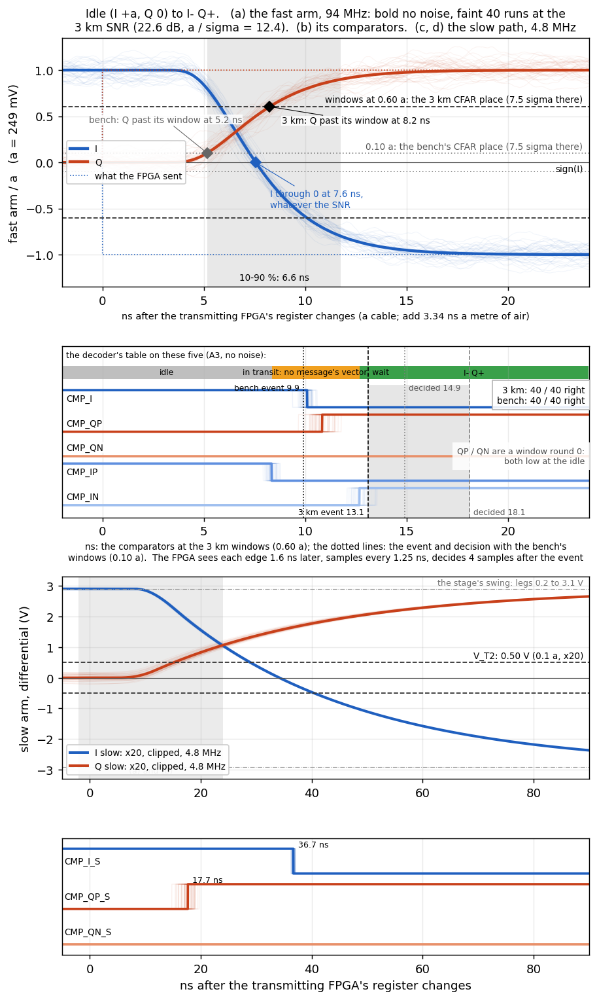
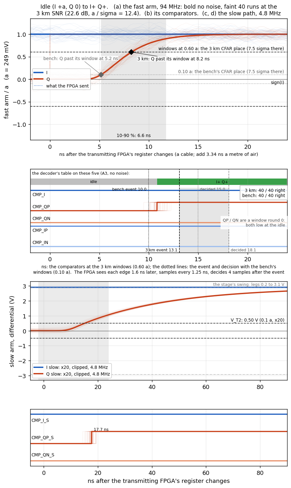
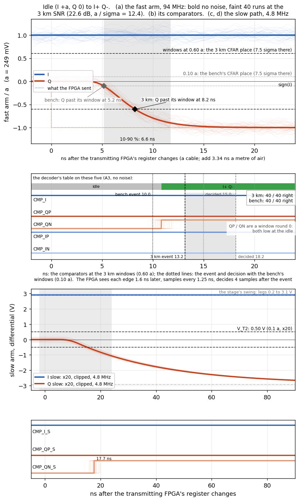
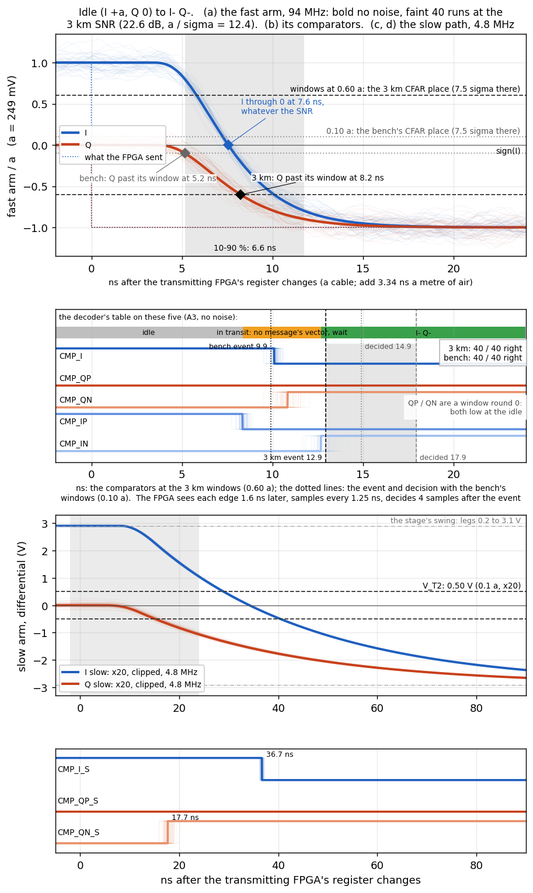
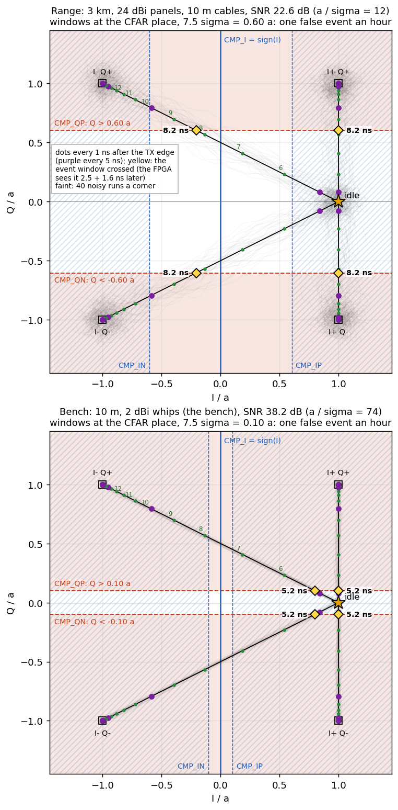
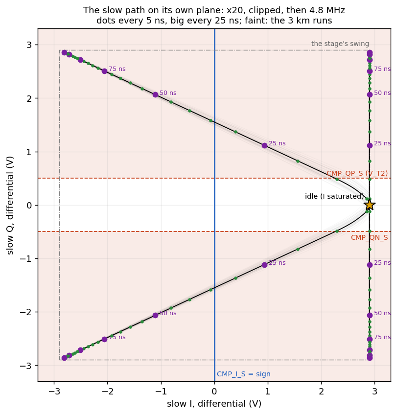
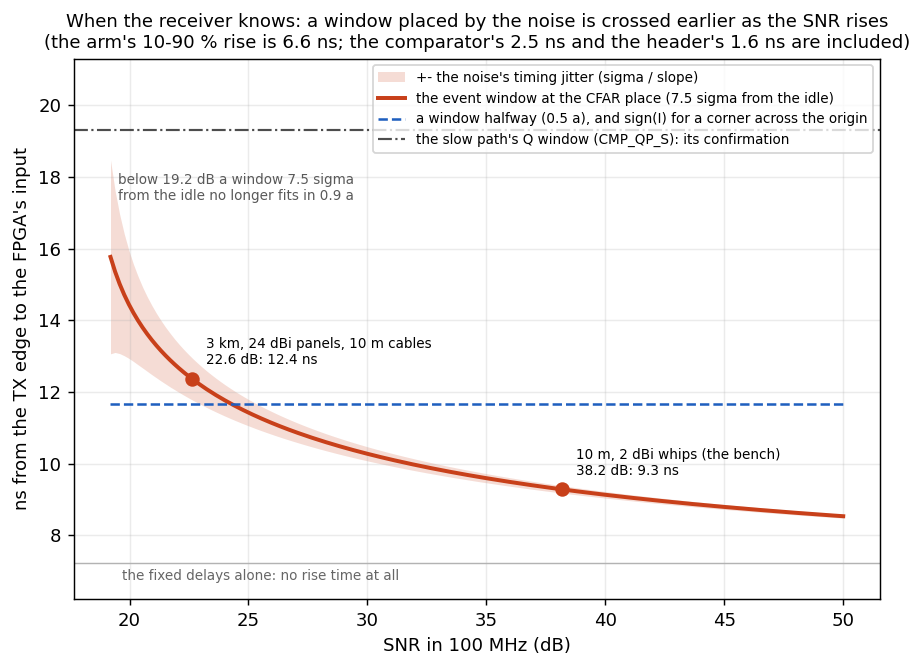

# From the idle to a symbol: what the receiver sees, and when it knows

Prompt 18 (2026-10-11).  `sim/trajectories.py` makes every figure and number here
(`python3 sim/trajectories.py`; the numbers go to `build/trajectories.json`).  The transmitter
idles on the carrier at 0° and then jumps to one of the four QPSK "X" corners.  This page follows the
jump through the receiver: I and Q against time, the comparators that watch them, the same path
on the I/Q plane, and what the receiver's noise does to it.

## The setup

**The scheme.** This is the driver's scheme A3 (`gateware/driver/costaslink.py`, PLAN.md
section 18):

* **The idle** is (I, Q) = (+a, 0).  The receiver's Costas loop holds that idle on +I.
* **The four messages** are the corners (±a, ±a).
* **The event** is CMP_QP or CMP_QN leaving its idle value by an amount in either direction, whose threshold avoids false crossings.  That comparator also gives the Q bit.
* **The I bit** is sign(I).

Here a is the axis amplitude at the comparators.  The **DSA** (digital step attenuator: U102, a
PE43711 between the LNA and the gain blocks, 0 to 31.75 dB in 0.25 dB steps, set by the FPGA over
SPI) works as the receiver's gain control.  It holds the demodulator's input at about −20 dBm from
3 m to about 300 m, which makes a = **249 mV**, differential.

**The chain.** Every value is the board's own (`build/budget.json`, from `sim/budget.py`).
Each pole is first order.

| stage | model | where the number comes from |
|---|---|---|
| PYNQ-Z2 header | 200 Ω into ~10 pF: τ = 2.0 ns | the TUL schematic's series resistor; 10 pF is the budget's estimate |
| the TX ladder's node | 240 Ω, 3 pF: τ = 0.72 ns | sim/budget.py section 1 |
| ADL5375 baseband | 750 MHz | datasheet |
| fixed delays | 3.1 ns | the FPGA output buffer 1.5 ns, the TX gain block and lines 0.5 ns, the RX front end 1.1 ns.  The air is left out (a cable); add 3.34 ns per metre |
| ADL5380 baseband | 390 MHz | datasheet, ADJ open |
| THS4541, gain 4 | 850 MHz / noise gain 9 = **94 MHz** | the datasheet's GBW (gain-bandwidth product); the noise gain includes the level-shift shunts |
| **noise** | white, through the two receiver poles only | it enters at the LNA (the low-noise amplifier at RX ANT, a SKY65404) |
| fast comparators (TLV3601) | 2.5 ns delay, 3 mV of hysteresis | datasheet (typical; 600 ps of overdrive dispersion is not modelled) |
| slow stage | the fast arm ×20 in a second THS4541 (850/21 = 40 MHz), each leg clipped at 0.2 and 3.1 V (its swing on 3.3 V), then 1 kΩ / 33 pF on each leg (**4.8 MHz**) | sheet 6, sim/budget.py section 7b |
| to the FPGA | 33 Ω + 200 Ω into 10 pF: 1.6 ns to 50 %.  Sampled every 1.25 ns (800 Ms/s), from a random phase (the transmitter is another board) | sim/budget.py section 5 |
| the decision | the event is the first sample with QP or QN off its idle.  The decision is all five fast comparators 4 samples later, through A3's table | `rx_config()` defaults; the table is the driver's own `Scheme.lut()` |

**The comparators** (fast path, differential I and Q):

| comparator | fires when |
|---|---|
| CMP_I | I > 0 |
| CMP_QP | Q > +t·a |
| CMP_QN | Q < −t·a |
| CMP_IP | I > +t·a |
| CMP_IN | I < −t·a |

Each window comparator looks at one leg of its arm, against a threshold from the AD5696R.  The
slow path has CMP_I_S = sign(I_slow), and CMP_QP_S / CMP_QN_S, which fire when one slow leg passes
V_T2 = 1.65 V + 0.1·(20a)/2.

**The noise and the two places a link lives.** The SNR (signal-to-noise ratio) is the budget's:
the carrier's power against kTF in 100 MHz, the thermal noise kT (−174 dBm/Hz) times the receiver's
noise figure F, over a 100 MHz band.  That makes a/σ = √SNR in each quadrature (sim/constellations.py's convention).  The
model's two receiver poles pass 119 MHz of noise, not 100 MHz, so its σ is 0.4 dB above that
convention.  The figures use the model's σ.

| case | SNR in 100 MHz | a / σ | σ at the comparators |
|---|---|---|---|
| **bench**: 10 m, 2 dBi whips | 38.2 dB | 74 | 3.4 mV |
| **range**: 3 km, 24 dBi panels, 10 m cables | 22.6 dB | 12.4 | 20 mV |

**Where the thresholds go.** The link idles almost all the time.  Noise that carries the idle past
a window is a false event, and it happens at Rice's rate ν₀·exp(−u²/2) for a window u·σ from the
idle.  This filter's noise has an rms frequency ν₀ of 183 MHz.  One false event an hour on the two
Q comparators then needs u = **7.5 σ**.  That is the CFAR place (constant false-alarm rate, as radar sets
its thresholds), where the FPGA's threshold servo puts each window by counting false events
(PLAN.md section 18).  In units of a, it is:

* **0.60 a** at the 3 km range: about halfway, close to the driver's default of 0.5.
* **0.10 a** at the bench: a tenth of the way.

## 1. One jump in time

**I− Q+** is the hardest corner: both arms move, and I passes through zero.  Read the four panels
top to bottom.

**(a) The fast arm, zoomed to the first 24 ns.**

* The dotted lines are what the transmitting FPGA did: a step at t = 0.
* The bold curves are what reaches the comparators, without noise.
* The faint curves are 40 runs with the 3 km noise.
* The grey band is the 10–90 % rise: **6.6 ns**.  That is slower than the receiver's 94 MHz arm
  alone, which takes 3.9 ns.  The transmitter's header (200 Ω into 10 pF) adds 4.4 ns of its own.
  "About 100 MHz" is right for the receiver; end to end, the board behaves like about 53 MHz.  On
  the Icepi Zero there is no header resistor, and the rise is 4.4 ns.
* **The diamonds are the point of the figure.**  With the window at the 3 km CFAR place (0.60 a),
  Q passes it at 8.2 ns.  At the bench's place (0.10 a), Q passes at **5.2 ns**, 3 ns earlier and
  barely into the rise.  The receiver does not need to wait for the arms to settle: once the noise
  is small, the first tenth of the step is already beyond doubt.
* The I bit is different.  sign(I) can only tell I− from I+ when I passes **zero**, at 7.6 ns,
  halfway through the rise, whatever the SNR.

**(b) The five fast comparators, at the 3 km windows.**

* The bold traces are without noise; the faint ones are the 40 noisy runs.
* The dashed lines are the gateware's mean event (13.1 ns at the FPGA) and decision (18.1 ns) at
  3 km.  The dotted lines are the same at the bench windows: 9.9 and 14.9 ns.
* The strip above the traces is what the decoder's table makes of the five comparators at each
  instant (the next section explains it).
* CMP_IP lets go at 8.4 ns, CMP_I at 10.1 and CMP_IN fires at 12.7.  The four-sample decision
  delay waits for all three.
* All 40 noisy runs were decided right, at both SNRs.

**(c) The slow arm** (each leg is 1.65 V ± half of what is plotted).  It runs ×20 and is clipped.
At idle its I is **saturated**: +a × 20 = 5 V is more than the stage's ±2.9 V.

* Its Q leaves zero and passes V_T2 quickly.  CMP_QP_S fires at 17.7 ns, because the clipped stage
  drives its 33 ns RC with the full swing.
* Its I must come out of saturation and cross the middle.  CMP_I_S follows at **36.7 ns**.
  sim/budget.py's "37 ns later" is the right figure for this I confirmation.  The Q confirmation
  comes twice as fast.

**(d) The slow comparators.** The gateware compares them with RX_SLOW_EXP 6 clocks (60 ns) after
the decision, when both have long settled.

The other three corners:

The I+ corners move only Q, so the event and both bits come with the one window crossing.  The
two I− corners repeat I− Q+ with Q mirrored.

## Reading the comparators: windows, and when the FPGA trusts them

These answer Jason's two questions about the figures above.

**Why CMP_QP and CMP_QN are not complements.** They are not the sign of Q.  They are the two edges
of a window round Q = 0:

* CMP_QP fires when Q > +t·a.
* CMP_QN fires when Q < −t·a.

At the idle Q is 0, so both are low, and the pair has three states:

| CMP_QP | CMP_QN | means |
|---|---|---|
| 0 | 0 | Q near zero: the idle, or nothing yet |
| 1 | 0 | Q up: a Q+ corner |
| 0 | 1 | Q down: a Q− corner |

(1 and 1 cannot happen.)  The window is the point of the design.  A sign comparator on Q would sit
exactly on the idle, so noise would toggle it continuously and every toggle would be a false event.
The window's edges sit 7.5 σ away from the idle, at the CFAR place, which keeps false events to one
an hour.

CMP_IP and CMP_IN are the same window on I.  The idle has I = +a, so CMP_IP is high at the idle.
CMP_I is the one true sign comparator: sign(I).

**There is no "data valid" wire.  The gateware makes one in time, and the table refuses
half-finished vectors.**  Take the idle (+a, 0) going to I− Q+ (−a, +a), against the nearer
I+ Q+ (+a, +a).  Your worry is that the FPGA reads "I+ Q+" because it looks before I has finished
swinging.  Two mechanisms stop that (`gateware/rx_engine.v`, the driver's `Scheme.lut()`):

1. **The event starts a clock; the decision waits.**  The event is the first 1.25 ns sample in which
   a masked comparator leaves its idle value.  For A3 those are CMP_QP and CMP_QN.  The decision
   reads all five fast comparators RX_TIMING[7:0] samples later, 4 by default (5 ns).  That delay is
   the "data valid".  In panel (b), the shaded band runs from the event to the decision.
2. **The table only knows settled vectors.**  Each message's entry is the vector it settles to.
   I− Q+ settles to CMP_I 0, CMP_QP 1, CMP_IP 0, CMP_IN 1.  I+ Q+ settles to CMP_I 1, CMP_QP 1,
   CMP_IP 1, CMP_IN 0.  A vector that is neither, or that two messages could make, maps to "no
   decision", not to the nearer message.  On its way to I− Q+, the signal shows CMP_IP already low
   (I has left +a) while CMP_IN is not yet high (I has not reached −0.6 a).  That matches neither
   message.  The strip at the top of panel (b) shows what the table says at each instant: idle,
   then **in transit** (orange) from 8.4 to 12.7 ns, then I− Q+.  The decision, at 18.1 ns at the
   FPGA, lands in the green.  If the delay were too short, the decoder would count an undecided
   event, not a wrong message.

**The two checks after it.**

* The slow path confirms or vetoes the decision 6 clocks (60 ns) later, against what the message
  should make on the slow comparators (RX_SLOW_EXP).
* With B2 (a pilot at 45°, the corners turned onto the axes), each message moves exactly one window
  comparator, so the first comparator to fire is the whole answer.  That is the "first-edge" mode
  (RX_CTRL[2]), and it needs no wait at all.  A3 cannot use it: its first edge (QP) is the same for
  I+ Q+ and I− Q+, and that is the half-rise wait A3 pays for its I bit.

## 2. The same jumps on the I/Q plane

How to read the plane:

* Each path starts at the idle (the star) and ends at its corner (the square).
* The dots are 1 ns apart, counted from the transmitter's edge; the purple dots are every 5 ns.
  On the I− Q+ path the small numbers count the nanoseconds.
* Orange bands are the Q windows (the event and the Q bit).  Hatched bands are the I windows.  The
  solid blue line is sign(I).
* The yellow diamond is where each path crosses its event window, with the time.  The FPGA sees
  that crossing 2.5 + 1.6 ns later.
* The faint grey tangles are the 40 noisy runs per corner.

**Why the paths are straight.** I and Q go through identical filters, so the path is the straight
line from idle to corner, r(t) = idle + g(t)·(corner − idle).  The filter's step response g(t)
only sets the speed along that line.  The dots bunch at both ends (the start and the settling) and
spread out in the middle of the rise.

**Where a window fires, and when.** Where a path fires a comparator is set by geometry alone.
When it fires is set by g(t).

* **Top, range (a/σ = 12):** the noise cloud around the idle is wide.  The windows must sit at
  0.60 a to keep false events to one an hour, and every path crosses at **8.2 ns**.
* **Bottom, bench (a/σ = 74):** the cloud is a dot.  The windows close in to 0.10 a, and every
  path crosses at **5.2 ns**, before it has covered a tenth of its way.

**Two gaps a corner path must cross.** The I− paths must still travel to the blue line (sign(I))
to give their I bit.  The bench gains nothing there.  This is A3's weakness, and the reason
PLAN.md section 18 prefers B2: a weak pilot at 45° turns the corners onto the four axes, so every
message has its own window next to the idle, and all its bits arrive with the event.

## 3. The slow path's own plane

The slow path runs ×20 and clips.  The dash-dot box is the stage's swing.

* The idle sits at the box's right edge, I saturated.
* A jump drives the clipped stage rail to rail, and the 4.8 MHz RC then carries the point along an
  exponential.  The dots here are 5 ns apart, the purple ones every 25 ns.
* The path is curved near the idle while I is still clipped and only Q moves.
* The Q windows (V_T2, at 0.1 a ×20) are passed by 18 ns.  sign(I) is passed at 37 ns.

With the 3 km noise filtered to 4.8 MHz and squeezed by the clip, the slow plane's noise tangle is
far thinner than the fast plane's.  That is what it is for: it confirms or vetoes the fast path's
decision, with 11 dB more SNR, tens of nanoseconds later.

## 4. When the receiver knows, at any SNR

This plot puts section 2's argument into one curve, from the transmitter's edge to the FPGA's
input, with the comparator's 2.5 ns and the header's 1.6 ns included.

* **The red curve** is the event window at its CFAR place (7.5 σ from the idle).  As the SNR rises
  the window closes in on the idle, and the event comes earlier: 12.4 ns at the 3 km range, 9.3 ns
  at the bench.  It approaches the fixed delays (grey line) only slowly, because g(t) starts
  gently.
* **The shaded band** is the noise's timing jitter, σ divided by the slope at the crossing:
  ±0.6 ns at 3 km, ±0.1 ns at the bench.
* **The blue dashed line** is a window fixed halfway, which is also where sign(I) is crossed (both
  sit at g = 0.5): 11.7 ns at every SNR.
* **The dash-dot line** is the slow path's Q confirmation, 19.3 ns.
* **Below 19.2 dB**, a window 7.5 σ from the idle no longer fits within 0.9 a.  There the fast path
  must accept more false events, or leave the event to the slow path.

## 5. With noise: what the gateware decided

Forty runs per corner and per case went through the gateware's own decoder: comparator edges 1.6
ns late, sampled every 1.25 ns from a random phase, the event, then the table 4 samples on.

| corner | range (0.60 a windows): right / wrong / undecided | event at the FPGA | bench (0.10 a): right / wrong / undecided | event at the FPGA |
|---|---|---|---|---|
| I+ Q+ | 40 / 0 / 0 | 13.1 ± 0.7 ns | 40 / 0 / 0 | 10.0 ± 0.4 ns |
| I+ Q− | 40 / 0 / 0 | 13.2 ± 0.9 ns | 40 / 0 / 0 | 10.0 ± 0.4 ns |
| I− Q+ | 40 / 0 / 0 | 13.1 ± 0.6 ns | 40 / 0 / 0 | 9.9 ± 0.3 ns |
| I− Q− | 40 / 0 / 0 | 12.9 ± 0.6 ns | 40 / 0 / 0 | 9.9 ± 0.4 ns |

These spreads are more than section 4's jitter because they include the 1.25 ns sampling grid
(±0.36 ns rms by itself).  Forty runs show the shape; they cannot measure error rates.
sim/link_rates.py has those.

## What this says about the board

1. **"About 100 MHz" describes the receiver.**  The arm is 94 MHz, with a 3.9 ns rise.  The
   transmitter's header RC makes the whole path 6.6 ns.  A transmitter without the PYNQ's 200 Ω
   (the Icepi Zero, ~25 Ω of FPGA output into the same 10 pF) rises in 4.4 ns and reaches 50 %
   1.6 ns sooner.
2. **High SNR buys early decisions.**  Only the event's distance from the idle matters, and the
   CFAR servo sets it from the noise.  From 3 km to the bench, the event moves 3 ns earlier, to the
   first tenth of the rise.
3. **A bit decided through the origin does not speed up.**  A3's I bit (sign(I)) waits for the
   halfway point at any SNR.  That is the latency case for B2 (pilot at 45°).  Rev A can run B2's
   one-bit half today (PLAN.md section 18).
4. **The decision delay of 4 samples (5 ns) is right for A3 at range.**  It waits for CMP_IN at
   12.7 ns (14.3 ns at the FPGA) after an event at 13 ns.  At the bench, 2 samples would catch the
   Q bit but would race the I bit (CMP_IN reaches the FPGA at 12.0 ns, against an event at
   9.9 ns), so 4 stays.
5. **The slow path confirms Q in about 6 ns and I in about 25 ns** after the fast event.  The
   default confirm delay (60 ns) covers both.

**Caveats.**

* The THS4541 is modelled as GBW over noise gain (94 MHz, one pole).  The datasheet's gain-of-5
  and gain-of-10 bandwidths (200 and 120 MHz) suggest the real arm is somewhat faster, with a
  little peaking.
* The 10 pF at the PYNQ's header is an estimate.  BRINGUP.md stage 3 measures the real rise on the
  scope (TX MON and I MON).
* The comparator's overdrive dispersion (600 ps) is not modelled, nor the THS4541's recovery from
  saturation, nor the loop's phase noise (its 3 kHz is static on this time scale).
